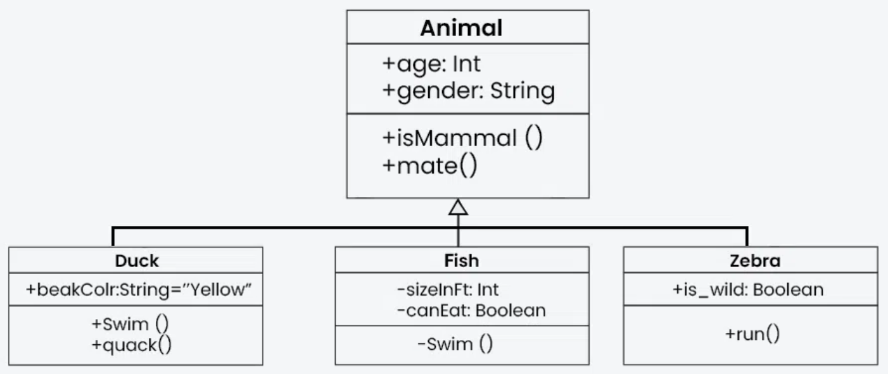
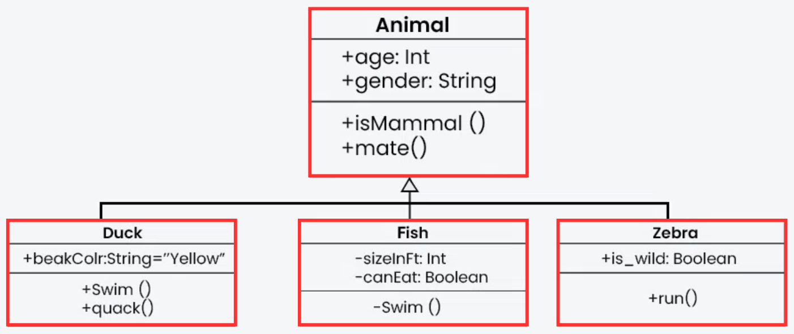
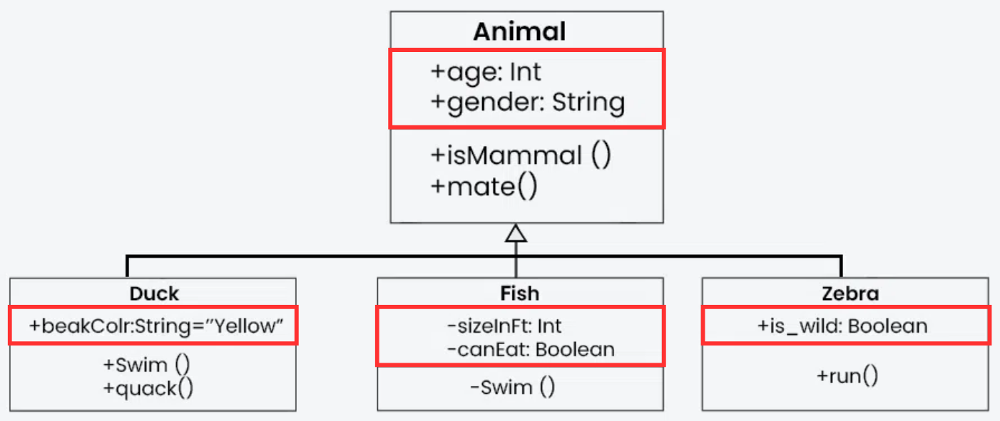
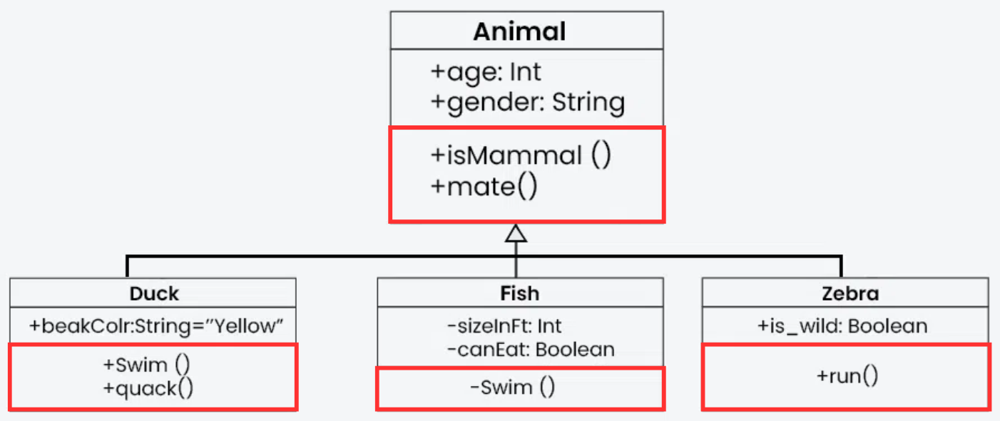
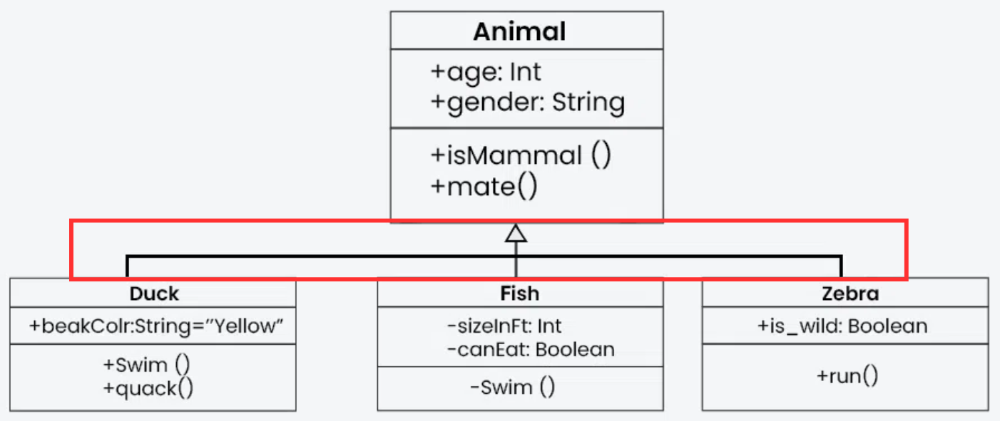

Τα **UML (Unified Modeling Language)** Class Diagrams είναι σημαντικά εργαλεία
για την κατανόηση και την απεικόνιση της δομής ενός αντικειμενοστραφούς
συστήματος **(OOP)**.

Αυτά τα διαγράμματα παρουσιάζουν τις κλάσεις, τα χαρακτηριστικά τους, τις
μεθόδους τους και τις σχέσεις μεταξύ των κλάσεων, προσφέροντας μια σαφή εικόνα
για το πώς οι διάφορες οντότητες ενός συστήματος συνδέονται και αλληλεπιδρούν
μεταξύ τους.

Τα **UML Class Diagrams** βοηθούν τους προγραμματιστές να κατανοήσουν τη
συνολική αρχιτεκτονική ενός προγράμματος, να οργανώσουν την κωδικοποίηση και να
επικοινωνούν αποτελεσματικά με άλλους για τη σχεδίαση και υλοποίηση του
συστήματος.

Στην επόμενη ενότητα, θα εξετάσουμε βήμα-βήμα πώς να διαβάσουμε και να
κατανοήσουμε ένα **UML Class Diagram** και πώς να το μετατρέψουμε σε πραγματικό
κώδικα.

## Τι είναι τα UML Class Diagrams

Τα διαγράμματα κλάσεων UML είναι ένας οπτικός τρόπος παρουσίασης της δομής και
των σχέσεων μεταξύ κλάσεων σε ένα αντικειμενοστραφές σύστημα (OOP - Object
Oriented Programming).



Όταν βλέπεις ένα UML Class Diagram για πρώτη φορά, ακολουθείς μια συγκεκριμένη
σειρά βημάτων για να το κατανοήσεις σωστά και να ξέρεις τι να υλοποιήσεις σε
κώδικα.

## Βήμα 1: Εντοπισμός των Κλάσεων (Classes)



Κοίτα τα κουτιά του διαγράμματος, γιατί το καθένα αντιπροσωπεύει μια κλάση:

- Τι αντικείμενα περιγράφει το διάγραμμα; (π.χ., User, Product, Order κλπ.)
- Ποιες είναι οι κύριες οντότητες του συστήματος;

Σε κώδικα Java: Κάθε κλάση θα γίνει ένα class.

```java
public class User {
    // περιεχόμενο...
}
```

## Βήμα 2: Ανάγνωση των Χαρακτηριστικών (Attributes)



Μέσα σε κάθε κλάση, δες τις μεταβλητές που έχει (χαρακτηριστικά/ attributes):

- Ποια είναι τα δεδομένα που αποθηκεύει η κλάση;
- Ποιοι είναι οι τύποι δεδομένων τους (int, String, double κλπ.);
- Ποια είναι η ορατότητα (public, private, protected);

Σε κώδικα Java: Κάθε attribute θα γίνει μια μεταβλητή με το σωστό επίπεδο
ορατότητας.

```java
public class User {
    private String name;
    private int age;
}
```

- Η ορατότητα (visibility) των χαρακτηριστικών (attributes) και των μεθόδων
  (methods) προσδιορίζεται από τα σύμβολα που βρίσκονται μπροστά από το όνομα
  κάθε στοιχείου

## Ποια είναι τα επίπεδα ορατότητας;

| Σύμβολο | Ορατότητα | Περιγραφή |
| --- | --- | --- |
| + | Public (Δημόσιο) | Προσβάσιμο από όλες τις κλάσεις. |
| - | Private (Ιδιωτικό) | Προσβάσιμο μόνο μέσα στην ίδια κλάση. |
| # | Protected (Προστατευμένο) | Προσβάσιμο μόνο από υποκλάσεις (κληρονομικότητα). |
| ~ | Package (Προστασία Πακέτου) | Προσβάσιμο μόνο από κλάσεις του ίδιου πακέτου. |

## Βήμα 3: Ανάγνωση των Μεθόδων (Methods)



Οι μέθοδοι περιγράφουν τη συμπεριφορά της κλάσης:

- Ποιες μέθοδοι υπάρχουν;
- Τι ορίσματα δέχονται και τι επιστρέφουν; Ορίσματα (arguments ή parameters),
  είναι οι τιμές που λαμβάνουν για να εκτελέσουν κάποια λειτουργία.
- Είναι δημόσιες (+), ιδιωτικές (-) ή προστατευμένες (#);

Σε κώδικα Java: Οι μέθοδοι θα γίνουν functions μέσα στην κλάση.

```java
public class User {
    private String name;
    private int age;

    public void setName(String newName) {
        this.name = newName;
    }

    public String getName() {
        return name;
    }
}
```

## Πώς ξέρω τι κώδικα θα γράψω μέσα σε μια μέθοδο;

Τα **UML διαγράμματα** συνήθως δεν δείχνουν τη λειτουργικότητα των μεθόδων,
παρά μόνο την δομή τους. Αν και κάποιες μέθοδοι με προφανή ονόματα (όπως
getName()) δίνουν μια ιδέα για το τι κάνουν, τις περισσότερες φορές το
διάγραμμα δεν παρέχει πληροφορίες για το πώς ακριβώς λειτουργεί μια μέθοδος
εσωτερικά. Αυτό σημαίνει ότι η πραγματική λογική της υλοποίησης παραμένει στον
προγραμματιστή.

## Βήμα 4: Ανάλυση των Σχέσεων μεταξύ Κλάσεων



Στα UML Class Diagrams, οι σχέσεις μεταξύ κλάσεων δείχνουν πώς συνδέονται και
πώς αλληλεπιδρούν μεταξύ τους. Αυτές οι σχέσεις παριστάνονται με γραμμές και
ειδικά σύμβολα που δείχνουν τον τύπο της σχέσης.

Γενικά, υπάρχουν σχέσεις που περιγράφουν:

1. Ιδιοκτησία → Μία κλάση περιέχει ή εξαρτάται από μια άλλη.
2. Χρήση → Μία κλάση χρησιμοποιεί μια άλλη, αλλά δεν την «κατέχει».
3. Κληρονομικότητα → Μία κλάση βασίζεται σε μια άλλη για να αποκτήσει
   χαρακτηριστικά και μεθόδους.

Ανάλογα με τη σχέση, μπορούμε να καταλάβουμε αν μια κλάση μπορεί να υπάρχει
ανεξάρτητα ή αν εξαρτάται από κάποια άλλη.\
Παράδειγμα:

1. Ένας Χρήστης μπορεί να έχει πολλαπλές Παραγγελίες (ιδιοκτησία).
2. Μια Παραγγελία περιέχει Προϊόντα, αλλά αυτά υπάρχουν και χωρίς την
   παραγγελία (χρήση).
3. Ένας Διαχειριστής είναι ειδικός τύπος Χρήστη και κληρονομεί τα
   χαρακτηριστικά του (κληρονομικότητα).

Σε κώδικα Java:

```java
// Κληρονομικότητα (Inheritance)
public class Admin extends User {
    private String role;
}

// Συσχέτιση (Association)
public class Order {
    private User customer;
}
```

## Βήμα 5: Υλοποίηση του Κώδικα Βήμα-Βήμα

Τώρα που κατάλαβες τη δομή, μπορείς να ξεκινήσεις να γράφεις τον κώδικα:

1. Δημιούργησε τις κλάσεις πρώτα.
2. Πρόσθεσε τα attributes με τα σωστά data types.
3. Υλοποίησε τις μεθόδους με βάση τα ονόματα και τις επιστροφές τους.
4. Πρόσθεσε σχέσεις μεταξύ κλάσεων.
