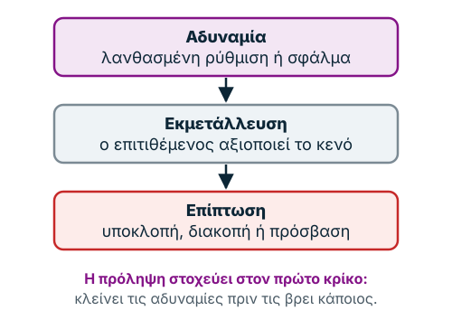
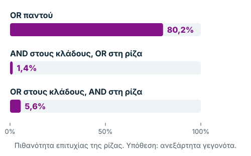

Το κεφάλαιο βασίζεται στη διάλεξη της Ενότητας 2 («Μορφές επιθέσεων και
ευπάθειες δικτύων»), στις σημειώσεις του καθηγητή για τα δέντρα επιθέσεων και
στις δύο συνοπτικές παρουσιάσεις της ίδιας ενότητας. Επειδή ο καθηγητής
διαθέτει το υλικό στο Moodle για περιορισμένο χρονικό διάστημα, το κείμενο
είναι γραμμένο ώστε να στέκεται αυτόνομα. Η διάλεξη προτείνει επίσης ένα
[εισαγωγικό βίντεο](https://www.youtube.com/watch?v=mCt2hzpyWZc). Η επίσημη
εκφώνηση του Security Mission 2 βρίσκεται στο Moodle, μέσω της εργασίας της
εβδομάδας.

Η σελίδα έχει τρία μέρη: **Μάθε** (οι επιθέσεις, οι θύρες, η DMZ και τα δέντρα
επιθέσεων, με τρία διαδραστικά εργαλεία), **Εμβάθυνε** (πώς φτιάχνεται ένα
δέντρο και τα όριά του) και **Εξετάσεις** (σύνοψη και ερωτήσεις). Οι
λεπτομέρειες της διάλεξης βρίσκονται στα πλαίσια «Αναλυτικά».

**Μαθησιακοί στόχοι.** Μετά τη μελέτη θα μπορείς να:

1. διακρίνεις ευπάθεια, εκμετάλλευση και επίπτωση·
2. αναγνωρίζεις συνηθισμένες δικτυακές επιθέσεις·
3. εξηγείς πώς βοηθούν το firewall και η DMZ·
4. κατασκευάζεις δέντρο επιθέσεων με AND/OR·
5. υπολογίζεις κόστος και πιθανότητες με σαφείς παραδοχές·
6. προτείνεις αντίμετρα.

## Μάθε

### 1. Πώς προκύπτει μια επίθεση;

Φαντάσου έναν web server που φιλοξενεί μια εταιρική εφαρμογή. Μια παλιά
υπηρεσία του δεν έχει ενημερωθεί. Αυτή είναι **ευπάθεια (vulnerability)**: μια
αδυναμία ή ένα ελάττωμα σε πρωτόκολλο, υπηρεσία, ρύθμιση ή μηχανισμό
ασφαλείας, που μπορεί να αξιοποιήσει ένας κακόβουλος χρήστης. Αν κάποιος την
αξιοποιήσει, έχουμε **εκμετάλλευση (exploit)**. Αν διαρρεύσουν δεδομένα ή
σταματήσει η εφαρμογή, αυτή είναι η **επίπτωση (impact)**: υποκλοπή,
παραποίηση δεδομένων, μη εξουσιοδοτημένη πρόσβαση ή διακοπή υπηρεσίας.

Όλες οι επιθέσεις του κεφαλαίου ακολουθούν αυτή την αλυσίδα τριών κρίκων:
**αδυναμία → εκμετάλλευση → επίπτωση**. Η πρόληψη στοχεύει στον πρώτο κρίκο,
δηλαδή στη μείωση των αδυναμιών πριν τις αξιοποιήσει κάποιος.



*Σχήμα 1. Η αλυσίδα μιας επίθεσης: αδυναμία, εκμετάλλευση, επίπτωση.*

Η **επιφάνεια επίθεσης (attack surface)** είναι το σύνολο των σημείων όπου
μπορεί να αλληλεπιδράσει κάποιος με το σύστημα: εκτεθειμένες υπηρεσίες,
λογαριασμοί, API, θύρες και συσκευές. Για παράδειγμα, μια περιττή ανοιχτή θύρα
με μη ενημερωμένη υπηρεσία την αυξάνει. Μια ανοιχτή θύρα δεν είναι όμως από
μόνη της ευπάθεια· ο κίνδυνος εξαρτάται από την υπηρεσία, τη διαμόρφωση και τα
δικαιώματα. Η Ενότητα 1 εξέτασε τις επιθέσεις ως κατηγορίες· εδώ βλέπουμε πού
ακριβώς βρίσκουν έδαφος μέσα σε ένα δίκτυο.

### 2. Οι βασικές επιθέσεις δικτύων

**DNS cache poisoning.** Το DNS μεταφράζει ονόματα όπως `example.com` σε
διευθύνσεις IP. Αν η προσωρινή μνήμη (cache) ενός διακομιστή DNS αποθηκεύσει
μια πλαστή εγγραφή, ο χρήστης μπορεί να κατευθυνθεί σε λάθος server, ενώ
πληκτρολόγησε το σωστό όνομα. Προστασία προσφέρουν οι σωστές ρυθμίσεις DNS, οι
ενημερώσεις, ο έλεγχος DNSSEC όπου εφαρμόζεται και η επαλήθευση του HTTPS.


*Σχήμα 2. Κανονική επίλυση DNS και δηλητηρίαση της cache.*

**ARP spoofing και Man-in-the-Middle (MitM).** Σε ένα τοπικό δίκτυο το ARP
αντιστοιχίζει διευθύνσεις IP με διευθύνσεις MAC. Στο ARP spoofing ο
επιτιθέμενος προσπαθεί να πείσει τις συσκευές ότι η δική του MAC ανήκει σε μια
άλλη IP, συνήθως του δρομολογητή (router). Έτσι μπορεί να ανακατευθύνει την
κίνηση μέσω της συσκευής του. Το **MitM** είναι ευρύτερη κατηγορία: ο
επιτιθέμενος παρεμβάλλεται ανάμεσα στον χρήστη που στέλνει δεδομένα και στην
υπηρεσία που τα λαμβάνει, και μπορεί να επιχειρήσει υποκλοπή ή αλλοίωση. Η
σωστά επαληθευμένη κρυπτογράφηση TLS προστατεύει το περιεχόμενο ακόμη και όταν
κάποιος βλέπει τη δικτυακή κίνηση.


*Σχήμα 3. ARP spoofing: η κίνηση του χρήστη περνά από τον επιτιθέμενο.*

**SSL stripping.** Είναι η απόπειρα υποβάθμισης μιας σύνδεσης από HTTPS σε
μη κρυπτογραφημένο HTTP, ώστε η επικοινωνία να είναι αναγνώσιμη. Η χρήση
HTTPS και HSTS και η αποφυγή παράκαμψης των προειδοποιήσεων πιστοποιητικών
μειώνουν τον κίνδυνο.

**DoS και DDoS.** Το **DoS** είναι η προσπάθεια να μην είναι διαθέσιμη μια
υπηρεσία, συνήθως από μία πηγή· το **DDoS** είναι η αντίστοιχη επίθεση από
πολλές, κατανεμημένες πηγές. Στο **SYN flood** πολλά αιτήματα έναρξης σύνδεσης
TCP εξαντλούν τους πόρους διαχείρισης συνδέσεων. Στο **UDP flood** μεγάλος
όγκος πακέτων UDP επιβαρύνει τη σύνδεση ή την υπηρεσία. Η άμυνα περιλαμβάνει
rate limiting, προστασία DDoS, παρακολούθηση και κατάλληλες ρυθμίσεις δικτύου.


*Σχήμα 4. Η κανονική χειραψία TCP και το SYN flood.*

**Άλλες εκθέσεις πρωτοκόλλων.** Στο **BGP** λανθασμένες ή κακόβουλες
ανακοινώσεις διαδρομών μπορούν να ανακατευθύνουν κίνηση. Στο **SMTP spoofing**
παραποιούνται τα στοιχεία του αποστολέα ενός email· η άμυνα στηρίζεται στα
SPF, DKIM και DMARC. Τέλος, το **αδύναμο TLS ή η αδύναμη αυθεντικοποίηση**
(παρωχημένες εκδόσεις, λανθασμένη επαλήθευση πιστοποιητικών, αδύναμοι
μηχανισμοί) αυξάνουν τον κίνδυνο.

| Επίθεση | Τι προσπαθεί να πετύχει | Κύρια διάσταση CIA |
| --- | --- | --- |
| DNS poisoning | Λανθασμένη επίλυση ονόματος | Ακεραιότητα |
| ARP spoofing / MitM | Παρεμβολή στην επικοινωνία | Εμπιστευτικότητα / Ακεραιότητα |
| SYN / UDP flood | Υπερφόρτωση υπηρεσίας | Διαθεσιμότητα |
| Email spoofing | Παραποίηση ταυτότητας αποστολέα | Αυθεντικότητα |

<div data-demo="sec-netattack" data-pagefind-ignore>
<p>Το διαδραστικό εργαλείο χρειάζεται JavaScript. Για τρεις επιθέσεις (DNS
cache poisoning, ARP spoofing, SYN flood) δείχνει την κανονική λειτουργία, την
επίθεση και την άμυνα, όπως περιγράφονται παραπάνω.</p>
</div>

<details>
<summary>Αναλυτικά: εκμετάλλευση πρωτοκόλλων (TCP/IP, DNS, BGP, SMTP)</summary>

Τα βασικά πρωτόκολλα του διαδικτύου σχεδιάστηκαν σε μια εποχή όπου οι
συμμετέχοντες εμπιστεύονταν ο ένας τον άλλον. Κατά συνέπεια, πολλά από αυτά δεν
επαληθεύουν την ταυτότητα εκείνου που επικοινωνεί, και αυτή η παραδοχή
εμπιστοσύνης αποτελεί σήμερα πηγή ευπαθειών.

Στο TCP/IP, ο τρόπος με τον οποίο χειρίζεται τις συνδέσεις μπορεί να επιτρέψει
την πειρατεία συνόδου (session hijacking), κατά την οποία ο επιτιθέμενος
«αναλαμβάνει» μια ήδη ανοιχτή σύνδεση, καθώς και την έγχυση πακέτων (packet
injection), δηλαδή την παρεμβολή κακόβουλων πακέτων στη ροή της επικοινωνίας.

Το DNS είναι ευάλωτο στη δηλητηρίαση της προσωρινής μνήμης. Σε αυτή την επίθεση
ένας διακομιστής DNS αποθηκεύει μια ψευδή εγγραφή και, στη συνέχεια,
ανακατευθύνει όσους υποβάλλουν το σχετικό ερώτημα σε κακόβουλο διακομιστή,
χωρίς οι χρήστες να το αντιληφθούν.

Το BGP (Border Gateway Protocol) είναι το πρωτόκολλο που καθορίζει τις διαδρομές
ανάμεσα στα μεγάλα δίκτυα που συνθέτουν το διαδίκτυο. Λανθασμένες ρυθμίσεις ή
κακόβουλες ανακοινώσεις διαδρομών μπορούν να στείλουν την κίνηση ολόκληρων
δικτύων από λάθος δρόμο, με σκοπό την υποκλοπή ή την ανακατεύθυνσή της. Τέλος,
το SMTP δεν ελέγχει τον αποστολέα ενός μηνύματος και, επομένως, επιτρέπει την
παραποίηση email (email spoofing): μηνύματα που φαίνεται ότι προέρχονται από
νόμιμη ή έμπιστη πηγή. Για τον λόγο αυτό, στην πράξη ελέγχεται η προέλευση των
μηνυμάτων και παρακολουθούνται οι αλλαγές στη δρομολόγηση. Γενικότερα, η άμυνα
απέναντι στις ευπάθειες πρωτοκόλλων στηρίζεται στον έλεγχο των ρυθμίσεων, στις
ενημερώσεις και στην παρακολούθηση ασυνήθιστης κίνησης.

</details>

<details>
<summary>Αναλυτικά: εκμετάλλευση θυρών (ανοιχτές, προεπιλεγμένες, εξάντληση)</summary>

Κάθε ανοιχτή θύρα (open port) αποτελεί ένα πιθανό σημείο εισόδου, όταν η
αντίστοιχη υπηρεσία δεν προστατεύεται. Γι' αυτό συνιστάται η σάρωση θυρών και
το κλείσιμο όσων δεν είναι απαραίτητες. Ο κίνδυνος συνδέεται άμεσα με τις μη
ασφαλείς υπηρεσίες (unsecured services): μια υπηρεσία που ακούει σε ανοιχτή
θύρα μπορεί να έχει ευπάθειες, αν δεν είναι σωστά ρυθμισμένη ή ενημερωμένη.

Οι προεπιλεγμένες θύρες (default ports) δημιουργούν ένα πρόσθετο ζήτημα. Επειδή
οι γνωστές υπηρεσίες ακούν σε γνωστές θύρες, ο επιτιθέμενος γνωρίζει ακριβώς
πού να αναζητήσει μια υπηρεσία, για παράδειγμα τη θύρα 3389 για το RDP. Όπως
σημειώνει η διάλεξη, ο κίνδυνος σχετίζεται κυρίως με την ασφάλεια της ίδιας της
υπηρεσίας και όχι με τον αριθμό της θύρας.

Αντίθετα, η εξάντληση θυρών (port exhaustion) αφορά τη διαθεσιμότητα. Αν μια
υπηρεσία δέχεται απεριόριστες ταυτόχρονες συνδέσεις, οι υπερβολικά πολλές
συνδέσεις μπορούν να εξαντλήσουν τους πόρους της, ώστε να μην εξυπηρετεί πλέον
τους νόμιμους χρήστες· πρόκειται, ουσιαστικά, για άρνηση υπηρεσίας. Η
αντιμετώπιση περιλαμβάνει περιορισμούς στις συνδέσεις, έλεγχο πρόσβασης και
παρακολούθηση του φόρτου.

</details>

<details>
<summary>Αναλυτικά: MitM, αδύναμη κρυπτογράφηση και αυθεντικοποίηση, DoS/DDoS</summary>

Στο ARP spoofing ο επιτιθέμενος συνδέει τη δική του διεύθυνση MAC με τη
διεύθυνση IP μιας νόμιμης συσκευής, συνήθως του δρομολογητή, ώστε η κίνηση του
τοπικού δικτύου να περνά από τον ίδιο. Στο SSL stripping επιχειρεί να
υποβαθμίσει τη σύνδεση από HTTPS σε HTTP, ώστε η επικοινωνία να μη διαθέτει
κρυπτογράφηση. Η προστασία στηρίζεται σε ασφαλές HTTPS, σε σωστή διαχείριση
πιστοποιητικών και στην προστασία του τοπικού δικτύου.

Η κρυπτογράφηση προστατεύει μόνο όσο ισχυρή είναι η υλοποίησή της. Στο SSL/TLS,
οι αδύναμες σουίτες κρυπτογράφησης (cipher suites), οι παρωχημένες εκδόσεις
του πρωτοκόλλου ή ο ελλιπής έλεγχος πιστοποιητικών ανοίγουν τον δρόμο σε
επιθέσεις MitM ή σε μη εξουσιοδοτημένη πρόσβαση. Ανάλογα, στην αυθεντικοποίηση,
παλαιά πρωτόκολλα όπως το NTLM (η παλαιότερη σουίτα αυθεντικοποίησης της
Microsoft) ή αδύναμες υλοποιήσεις νεότερων, όπως του Kerberos, μπορεί να είναι
ευάλωτα. Ο στόχος είναι σύγχρονες ρυθμίσεις, τακτικές ενημερώσεις και ισχυρός
έλεγχος ταυτότητας.

Οι επιθέσεις άρνησης υπηρεσίας στοχεύουν στη διαθεσιμότητα. Πολλά αιτήματα ή
πακέτα υπερφορτώνουν τους πόρους του δικτύου, με αποτέλεσμα ο διακομιστής να
μην μπορεί να εξυπηρετήσει. Στις επιπτώσεις, οι νόμιμοι χρήστες μπορεί να
αντιμετωπίσουν από καθυστερήσεις έως πλήρη διακοπή της υπηρεσίας. Η πλημμύρα
SYN εκμεταλλεύεται τη χειραψία τριών βημάτων του TCP: ο επιτιθέμενος στέλνει
πάρα πολλά πακέτα SYN χωρίς να ολοκληρώνει ποτέ τη χειραψία, και ο διακομιστής
διατηρεί μισάνοιχτες συνδέσεις μέχρι να εξαντληθούν οι πόροι του. Η πλημμύρα
UDP κατακλύζει το δίκτυο ή την υπηρεσία με μεγάλο όγκο πακέτων UDP και
καταναλώνει το διαθέσιμο εύρος ζώνης ή τους πόρους της υπηρεσίας.

> **Επεξήγηση:** Η χειραψία, όπως παρουσιάστηκε στην Εβδομάδα 0, έχει τη μορφή
> SYN → SYN-ACK → ACK. Στο SYN flood ο διακομιστής στέλνει το SYN-ACK και
> περιμένει ένα ACK που δεν φτάνει ποτέ, συχνά επειδή η διεύθυνση του
> αποστολέα είναι πλαστή.

</details>

### 3. Πρωτόκολλα και θύρες

Μια **θύρα (port)** βοηθά το λειτουργικό σύστημα να παραδώσει τα δεδομένα στη
σωστή υπηρεσία. Η IP εντοπίζει τη συσκευή· η θύρα την υπηρεσία μέσα στη
συσκευή. Το TCP και το UDP έχουν χωριστούς χώρους αριθμών θυρών.

| Θύρα | Συνήθης υπηρεσία | Σημείωση |
| --- | --- | --- |
| 20, 21 | FTP | Παραδοσιακή μεταφορά αρχείων, χωρίς κρυπτογράφηση |
| 22 | SSH / SFTP | Ασφαλής απομακρυσμένη διαχείριση και μεταφορά αρχείων |
| 23 | Telnet | Απομακρυσμένη σύνδεση **χωρίς** εγγενή κρυπτογράφηση |
| 25 / 587 | SMTP | Μεταφορά email / υποβολή από πελάτες |
| 53 | DNS | Ονόματα → διευθύνσεις· συνήθως UDP, και TCP όταν απαιτείται |
| 80 | HTTP | Μη κρυπτογραφημένο HTTP |
| 110 / 143 | POP3 / IMAP | Πρόσβαση στο email (στο IMAP τα μηνύματα μένουν στον διακομιστή) |
| 123 | NTP | Συγχρονισμός ώρας |
| 161 | SNMP | Διαχείριση συσκευών δικτύου |
| 389 | LDAP | Υπηρεσίες καταλόγου (π.χ. Active Directory) |
| 443 | HTTPS | HTTP μέσω TLS (επίσης 4433, 8443) |
| 1521 / 3306 | Oracle / MySQL | Συνήθεις θύρες βάσεων δεδομένων |
| 3389 | RDP | Απομακρυσμένη επιφάνεια εργασίας των Windows |
| 8080 / 8443 | Εναλλακτικές θύρες web | Εξαρτώνται από την εφαρμογή· συχνά διακομιστές ανάπτυξης ή proxies |

> **Μην απομνημονεύεις μόνο αριθμούς:** ρώτα ποια υπηρεσία εκτίθεται, ποιος
> χρειάζεται πρόσβαση και αν η επικοινωνία προστατεύεται. Το να αλλάξεις μόνο
> τον αριθμό θύρας δεν διορθώνει μια ευάλωτη υπηρεσία.

<details>
<summary>Αναλυτικά: γνωστές και καταχωρημένες θύρες, ομάδες πρωτοκόλλων, το Exchange</summary>

Οι θύρες διακρίνονται σε γνωστές θύρες (well-known ports), τυποποιημένες για
συγκεκριμένες υπηρεσίες, και σε καταχωρημένες θύρες (registered ports), τις
οποίες εκχωρεί η IANA (Internet Assigned Numbers Authority) σε συγκεκριμένες
εφαρμογές.

Τα πρωτόκολλα που συναντώνται συχνότερα μπορούν να ομαδοποιηθούν ανάλογα με τον
ρόλο τους. Τα IP, TCP και UDP υποστηρίζουν τη μεταφορά και τη διευθυνσιοδότηση
των δεδομένων ανάμεσα στις συσκευές. Τα HTTP/HTTPS (ιστός), FTP (αρχεία) και
SMTP, POP3, IMAP (ηλεκτρονικό ταχυδρομείο) παρέχουν υπηρεσίες εφαρμογών.
Τέλος, τα DNS (ονόματα), DHCP (ρυθμίσεις IP) και BGP (δρομολόγηση) αποτελούν
την υποδομή του δικτύου.

Ένας διακομιστής email όπως το Microsoft Exchange χρησιμοποιεί πολλές από τις
θύρες ταυτόχρονα: τις 25 και 587 για το SMTP, την 110 για το POP3 και την 143
για το IMAP.

</details>

### 4. Firewall και DMZ

Το **firewall** ελέγχει την επιτρεπόμενη δικτυακή κίνηση με κανόνες. Ένα
firewall είναι τόσο αποτελεσματικό όσο οι κανόνες του: όταν είναι υπερβολικά
επιτρεπτικοί, περνά κίνηση που θα έπρεπε να αποκλείεται (ή, αντίστροφα,
αποκλείεται νόμιμη κίνηση). Σε πολλά firewalls «πρώτης αντιστοίχισης» (first
match) κρίσιμη είναι και η **σειρά των κανόνων**: ένας γενικός κανόνας `ALLOW
ALL` πριν από έναν ειδικό `DENY` τον καθιστά άχρηστο. Η ακριβής συμπεριφορά
εξαρτάται από την πλατφόρμα και την πολιτική κανόνων. Οι καλές πρακτικές
περιλαμβάνουν ελάχιστα απαραίτητα δικαιώματα, τεκμηρίωση των κανόνων και
τακτικό έλεγχό τους.


*Σχήμα 5. Η σειρά των κανόνων firewall: ισχύει ο πρώτος που ταιριάζει.*

<div data-demo="sec-firewall" data-pagefind-ignore>
<p>Το διαδραστικό εργαλείο χρειάζεται JavaScript. Με τέσσερις κανόνες και
πακέτα προς τις θύρες 22, 23, 80 και 443 αλλάζεις τη σειρά των κανόνων και
βλέπεις ποιος εφαρμόζεται πρώτος.</p>
</div>

Η **DMZ (Demilitarized Zone, αποστρατιωτικοποιημένη ζώνη)** είναι ένα
ξεχωριστό τμήμα του δικτύου ανάμεσα στο εσωτερικό δίκτυο (LAN) και στο
διαδίκτυο (WAN), για τις δημόσιες υπηρεσίες, όπως ένας web server ή ένας mail
gateway. Σκέψου ένα πανεπιστήμιο: ο ιστότοπος πρέπει να είναι προσβάσιμος από
το Internet, όχι όμως και οι υπολογιστές της γραμματείας. Η DMZ και οι κανόνες
πρόσβασης περιορίζουν την κίνηση ανάμεσα σε Internet, δημόσιους servers και
εσωτερικό LAN. **Δεν εξαλείφουν** τον κίνδυνο· μειώνουν την πιθανότητα
εξάπλωσης μιας παραβίασης.


*Σχήμα 6. Η DMZ ενός πανεπιστημίου πίσω από ένα firewall.*

Οι πρακτικές άμυνες είναι: ελάχιστες απαραίτητες υπηρεσίες, τακτικά patches,
περιορισμένη απομακρυσμένη πρόσβαση, έλεγχος του UPnP, παρακολούθηση των logs
και εξουσιοδοτημένος έλεγχος της έκθεσης θυρών.

<details>
<summary>Αναλυτικά: προστασία από την έκθεση θυρών και πώς λειτουργεί η DMZ</summary>

Η βασική αρχή της προστασίας είναι ο περιορισμός: διατηρούνται ανοιχτές μόνο οι
απολύτως απαραίτητες θύρες και απενεργοποιούνται οι υπηρεσίες που δεν
χρησιμοποιούνται. Ένα firewall ελέγχει τι εισέρχεται και τι εξέρχεται, ενώ
περιοδικές σαρώσεις με εργαλεία όπως το nmap επιβεβαιώνουν ποιες θύρες είναι
πράγματι ενεργές. Το UPnP (Universal Plug and Play), το οποίο επιτρέπει σε
προγράμματα και συσκευές να ανοίγουν θύρες στον δρομολογητή χωρίς τη γνώση του
χρήστη, θα πρέπει να είναι απενεργοποιημένο ή τουλάχιστον υπό έλεγχο.

Για απομακρυσμένη πρόσβαση προτιμάται ένα ασφαλές VPN αντί για άνοιγμα θυρών
προς το διαδίκτυο. Οι τακτικές ενημερώσεις λογισμικού κλείνουν τις γνωστές
ευπάθειες, και η DMZ χρησιμοποιείται μόνο όταν χρειάζεται, για υπηρεσίες που
πρέπει να είναι προσβάσιμες από το διαδίκτυο.

Στη DMZ τοποθετούνται οι υπηρεσίες που πρέπει να είναι διαθέσιμες στο κοινό,
όπως ένας web server, ένας mail server ή οι κάμερες ασφαλείας. Ο μηχανισμός της
είναι απλός. Όταν ένας εξωτερικός χρήστης ζητά μια δημόσια υπηρεσία, η κίνηση
κατευθύνεται **στη DMZ και όχι στο εσωτερικό δίκτυο**, ενώ το firewall ελέγχει
την κίνηση ανάμεσα σε διαδίκτυο, DMZ και LAN. Κατά συνέπεια, αν ένας εισβολέας
παραβιάσει έναν διακομιστή της DMZ, δεν αποκτά αυτόματα πρόσβαση στους
υπολογιστές και στα δεδομένα του LAN. Η DMZ λειτουργεί επομένως ως χώρος
«buffer»: επιτρέπει την πρόσβαση στις δημόσιες υπηρεσίες, τις απομονώνει από το
εσωτερικό δίκτυο και περιορίζει τη ζημιά μιας παραβίασης. Όπως τονίζει η
διάλεξη, η DMZ δεν εγγυάται απόλυτη ασφάλεια.

Στο παράδειγμα του πανεπιστημίου, το LAN περιλαμβάνει τους υπολογιστές του
προσωπικού και των φοιτητών, με δεδομένα που δεν πρέπει να εκτίθενται δημόσια.
Η DMZ φιλοξενεί τον web server και τον mail server, που πρέπει να είναι
προσβάσιμοι από το διαδίκτυο. Το firewall διαχωρίζει τις ζώνες και περιορίζει
την πρόσβαση προς το εσωτερικό δίκτυο, οπότε, αν δεχθεί επίθεση ο web server,
οι υπολογιστές του LAN παραμένουν προστατευμένοι.

</details>

### 5. Τέσσερα πραγματικά παραδείγματα

Η σημασία της έγκαιρης ενημέρωσης γίνεται φανερή από πραγματικά περιστατικά
όπου ένα πρωτόκολλο ή μια βιβλιοθήκη εξέθεσε χιλιάδες συστήματα.

| Περίπτωση | Τι ήταν | Βασικό μάθημα |
| --- | --- | --- |
| **Heartbleed** (CVE-2014-0160) | σφάλμα στη βιβλιοθήκη OpenSSL, που υλοποιεί το SSL/TLS σε πάρα πολλούς web servers· επέτρεπε σε οποιονδήποτε να διαβάζει κομμάτια της μνήμης του διακομιστή: κωδικούς, κλειδιά, προσωπικά δεδομένα | ενημερώσεις βιβλιοθηκών και διαχείριση κλειδιών |
| **Shellshock** (CVE-2014-6271) | ευπάθεια στην επεξεργασία μεταβλητών περιβάλλοντος στο Bash, το κέλυφος γραμμής εντολών των Unix/Linux· επέτρεπε την εκτέλεση αυθαίρετων εντολών | ασφαλής διαχείριση εισόδων και patches |
| **NTP amplification** | μικρά αιτήματα σε διακομιστές NTP με πλαστή διεύθυνση (του θύματος)· οι διακομιστές στέλνουν πολύ μεγαλύτερες απαντήσεις στο θύμα, άρα DDoS με ελάχιστο κόστος | περιορισμός καταχρηστικών υπηρεσιών και του spoofing |
| **HTTP header injection** | μη ασφαλής ενσωμάτωση εισόδου στις κεφαλίδες HTTP· μπορεί να οδηγήσει σε XSS ή άλλες επιθέσεις σε εφαρμογές ιστού | επικύρωση και ασφαλής παραγωγή αποκρίσεων |

> **Επεξήγηση:** Το CVE (Common Vulnerabilities and Exposures) είναι ο δημόσιος
> κατάλογος γνωστών ευπαθειών. Κάθε ευπάθεια λαμβάνει έναν μοναδικό κωδικό
> (π.χ. CVE-2014-0160), ώστε όλοι να αναφέρονται στο ίδιο ζήτημα. Το NTP
> amplification λειτουργεί όπως το DNS amplification της Ενότητας 1.

### 6. Δέντρα επιθέσεων: σκέψου όπως ένας αναλυτής ασφάλειας

Ένα **δέντρο επιθέσεων (attack tree)** είναι μια ιεραρχική, γραφική μέθοδος
μοντελοποίησης απειλών (threat modeling). Δείχνει τους διαφορετικούς τρόπους
με τους οποίους θα μπορούσε να επιτευχθεί ένας στόχος επίθεσης, όπως «κλοπή
των credentials» ή «διακοπή λειτουργίας του διακομιστή». Η **ρίζα (root)**
είναι ο στόχος, οι **ενδιάμεσοι κόμβοι (nodes)** είναι υποστόχοι και τα
**φύλλα (leaves)** είναι οι πιο συγκεκριμένες ενέργειες του μοντέλου, που δεν
αναλύονται περαιτέρω. Η ιδέα έγινε γνωστή από τον Bruce Schneier ([Attack
Trees](https://www.schneier.com/academic/archives/1999/12/attack_trees.html),
1999).

Οι κόμβοι συνδέονται με δύο λογικούς τελεστές. Στον **OR** αρκεί να πετύχει
**τουλάχιστον ένα** παιδί· στον **AND** πρέπει να πετύχουν **όλα**. Για
παράδειγμα, η «πρόσβαση σε λογαριασμό» μπορεί να γίνει με κλοπή κωδικού **OR**
κατάχρηση ενεργής συνεδρίας. Αν μια διαδρομή απαιτεί «απόκτησε φυσική πρόσβαση
**AND** βρες ξεκλείδωτη συσκευή», και τα δύο βήματα είναι απαραίτητα.

<details>
<summary>Αναλυτικά: τελεστές σειράς και κατωφλίου</summary>

Σε πιο σύνθετα μοντέλα χρησιμοποιούνται επιπλέον τελεστές σειράς (sequence
gates), όταν οι ενέργειες πρέπει να γίνουν με συγκεκριμένη σειρά, και τελεστές
κατωφλίου (threshold gates), όταν αρκούν «k από τα n» παιδιά. Οι τελεστές αυτοί
εκφράζουν σχέσεις που τα απλά AND και OR δεν μπορούν να αποδώσουν.

</details>

#### 6.1 Υπολογισμός κόστους: το χρηματοκιβώτιο

Όταν κάθε φύλλο έχει ένα κόστος, οι τιμές «ανεβαίνουν» από τα φύλλα προς τη
ρίζα με δύο κανόνες. Σε έναν κόμβο **OR** ο επιτιθέμενος επιλέγει τη
φθηνότερη διαδρομή, άρα το κόστος είναι το **ελάχιστο** των παιδιών. Σε έναν
κόμβο **AND** απαιτούνται όλα τα παιδιά, άρα το κόστος είναι το **άθροισμά**
τους (εφόσον τα κόστη δεν επικαλύπτονται).

Το παράδειγμα του Schneier έχει ως στόχο το άνοιγμα ενός χρηματοκιβωτίου. Όλοι
οι κόμβοι είναι τύπου OR, εκτός από το «κρυφάκουσε», που είναι AND. Δίπλα σε
κάθε κόμβο σημειώνεται το εκτιμώμενο κόστος της επίθεσης, ενώ με «ΕΕ»
σημειώνονται τα φύλλα που απαιτούν ειδικό εξοπλισμό· όλα τα υπόλοιπα
πραγματοποιούνται χωρίς εξοπλισμό.

- **Άνοιξε το χρηματοκιβώτιο** (OR)
  - Παραβίασε την κλειδαριά: 30.000 $, ΕΕ
  - **Μάθε τον συνδυασμό** (OR): 20.000 $
    - Βρες τον συνδυασμό γραμμένο κάπου: 75.000 $
    - **Πάρε τον συνδυασμό από τον κάτοχο** (OR): 20.000 $
      - Απείλησε: 60.000 $
      - Εκβίασε: 100.000 $
      - **Κρυφάκουσε** (AND): 60.000 $
        - Άκου τη συνομιλία: 20.000 $, ΕΕ
        - Κάνε τον κάτοχο να πει τον συνδυασμό: 40.000 $
      - Δωροδόκησε: 20.000 $
  - Κόψε το χρηματοκιβώτιο: 10.000 $, ΕΕ
  - Εκμεταλλεύσου κακή εγκατάσταση: 100.000 $

![Το δέντρο του χρηματοκιβωτίου σε μορφή διαγράμματος με εσοχές. Ρίζα «Άνοιξε το χρηματοκιβώτιο» (OR, 10.000 $). Παιδιά: Παραβίασε την κλειδαριά 30.000 $ με ειδικό εξοπλισμό· Μάθε τον συνδυασμό (OR, 20.000 $) με παιδιά «Βρες τον συνδυασμό γραμμένο κάπου» 75.000 $ και «Πάρε τον από τον κάτοχο» (OR, 20.000 $), που έχει παιδιά Απείλησε 60.000 $, Εκβίασε 100.000 $, Κρυφάκουσε (AND, 60.000 $: Άκου τη συνομιλία 20.000 $ με εξοπλισμό, Κάνε τον να πει τον συνδυασμό 40.000 $) και Δωροδόκησε 20.000 $· Κόψε το χρηματοκιβώτιο 10.000 $ με εξοπλισμό· Εκμεταλλεύσου κακή εγκατάσταση 100.000 $. Τονισμένα το «Κόψε» και το «Δωροδόκησε».](./images/attack-tree-safe.svg)

*Σχήμα 7. Το δέντρο επιθέσεων του χρηματοκιβωτίου, με τα κόστη.*

Το «κρυφάκουσε» απαιτεί δύο βήματα, άρα:

```math
20.000 + 40.000 = 60.000 \ \$
```

Η φθηνότερη επίθεση συνολικά είναι το κόψιμο του χρηματοκιβωτίου (10.000 $),
αλλά απαιτεί ειδικό εξοπλισμό. Χωρίς τον εξοπλισμό, η φθηνότερη επιτρεπτή
διαδρομή του μοντέλου είναι η δωροδοκία του κατόχου (20.000 $). Εδώ φαίνεται
και το πρακτικό όφελος της μεθόδου: ο αμυνόμενος γνωρίζει πού να επενδύσει.
Ένα πιο ανθεκτικό χρηματοκιβώτιο δεν προσφέρει τίποτα, αν ο υπάλληλος
δωροδοκείται.

> **Σημαντικό:** Το «ελάχιστο» αφορά το κόστος της βέλτιστης διαδρομής, όχι
> την πιθανότητα επιτυχίας. Μην μπερδεύεις τους δύο διαφορετικούς
> υπολογισμούς.

#### 6.2 Υπολογισμός πιθανοτήτων

Αν οι επιτυχίες των παιδιών είναι **ανεξάρτητα γεγονότα**, σε έναν κόμβο AND
πρέπει να επιτύχουν όλα τα παιδιά, οπότε η πιθανότητα είναι το γινόμενο των
πιθανοτήτων τους:

```math
P_{\text{AND}} = p_1 \cdot p_2 \cdots p_n
```

Σε έναν κόμβο OR αρκεί να επιτύχει ένα παιδί. Η πιθανότητα υπολογίζεται
ευκολότερα μέσω του συμπληρωματικού γεγονότος: αφαιρούμε από το 1 την
πιθανότητα να αποτύχουν όλα.

```math
\begin{aligned}
P_{\text{OR}} = 1 - {} &(1 - p_1)(1 - p_2) \\
&\cdots (1 - p_n)
\end{aligned}
```

**Μικρή άσκηση:** δύο ανεξάρτητες διαδρομές με πιθανότητες 30% και 20%.
Με AND: 0,30 × 0,20 = **6%**. Με OR: 1 − (0,70 × 0,80) = **44%**.

#### 6.3 Το πλήρες παράδειγμα της εταιρείας Χ

Στο παράδειγμα της διάλεξης ο στόχος είναι η **πρόσβαση στα ευαίσθητα δεδομένα
της εταιρείας Χ**. Τρεις εναλλακτικοί κλάδοι οδηγούν στον ίδιο στόχο (OR στη
ρίζα), και καθένας περιλαμβάνει τρία φύλλα (OR), το καθένα με μια εκτιμώμενη
πιθανότητα επιτυχίας. Το πιθανότερο φύλλο είναι το spear phishing και το
λιγότερο πιθανό η μη εξουσιοδοτημένη φυσική είσοδος.

| Κλάδος | Φύλλο | Πιθανότητα |
| --- | --- | --- |
| Κλοπή credentials | spear phishing | 0,30 |
| | keylogger / malware στο laptop | 0,20 |
| | κοινωνική μηχανική για τον κωδικό | 0,10 |
| Εκμετάλλευση ευπάθειας | unpatched υπηρεσία SMB | 0,25 |
| | zero-day στον web server | 0,15 |
| | custom malware σε συνημμένο | 0,20 |
| Φυσική πρόσβαση | μη εξουσιοδοτημένη είσοδος στο κτίριο | 0,05 |
| | κλοπή κάρτας (badge) | 0,10 |
| | tailgating | 0,10 |


*Σχήμα 8. Το δέντρο επιθέσεων για τα δεδομένα της εταιρείας Χ.*

Για τον κλάδο «κλοπή credentials» (OR):

```math
\begin{aligned}
P &= 1 - (0{,}70 \cdot 0{,}80 \cdot 0{,}90) \\
&= 1 - 0{,}504 = 0{,}496 \ (49{,}6\%)
\end{aligned}
```

Για τον κλάδο «εκμετάλλευση ευπάθειας» (OR):

```math
\begin{aligned}
P &= 1 - (0{,}75 \cdot 0{,}85 \cdot 0{,}80) \\
&= 1 - 0{,}510 = 0{,}490 \ (49{,}0\%)
\end{aligned}
```

Τους δύο τελευταίους υπολογισμούς, για τον κλάδο της φυσικής πρόσβασης και για
τη ρίζα, ο καθηγητής ζήτησε να γίνουν από τους φοιτητές. Η λύση δίνεται παρακάτω
και καλό είναι να ανοιχτεί μόνο μετά από μια προσωπική προσπάθεια.

<details>
<summary>Κλάδος «φυσική πρόσβαση» και ρίζα: λύση</summary>

Για τον κλάδο «φυσική πρόσβαση» (OR):

```math
\begin{aligned}
P &= 1 - (0{,}95 \cdot 0{,}90 \cdot 0{,}90) \\
&= 1 - 0{,}7695 \\
&= 0{,}2305 \ (23{,}05\%)
\end{aligned}
```

Για τη ρίζα (OR ανάμεσα στους τρεις κλάδους):

```math
\begin{aligned}
P &= 1 - (1 - 0{,}496)(1 - 0{,}490) \\
&\qquad \cdot (1 - 0{,}2305) \\
&= 1 - 0{,}504 \cdot 0{,}510 \cdot 0{,}7695 \\
&= 1 - 0{,}1978 \\
&\approx 0{,}8022 \ (80{,}2\%)
\end{aligned}
```

</details>

Η ερμηνεία των αριθμών είναι σαφής. Ο κλάδος της φυσικής πρόσβασης έχει
πιθανότητα επιτυχίας περίπου **23%**, δηλαδή σχεδόν μία στις τέσσερις
προσπάθειες. Η ρίζα έχει περίπου **80%**· δύο κλάδοι κοντά στο 50% αρκούν για
να ωθήσουν το συνολικό ρίσκο εκεί. Ο οργανισμός, επομένως, έχει πολύ υψηλό
συνολικό ρίσκο, με τους κλάδους των credentials και των ευπαθειών ως τους πιο
ρεαλιστικούς. Η φυσική πρόσβαση είναι δυσκολότερη, αλλά δεν πρέπει να
αγνοείται σε κρίσιμες υποδομές.

> **Προσοχή:** Οι τιμές είναι **υποθετικές πιθανότητες μοντέλου**, όχι
> εμπειρική εκτίμηση ότι «80,2% των πραγματικών επιθέσεων θα πετύχουν». Για να
> τις ερμηνεύσουμε πρέπει να οριστεί κοινός χρονικός ορίζοντας ή μονάδα
> προσπάθειας και να τεκμηριωθεί η ανεξαρτησία. Κοινές αιτίες ή εξαρτήσεις
> μπορούν να αλλάξουν την πραγματική πιθανότητα προς οποιαδήποτε κατεύθυνση.

#### 6.4 Τι αλλάζει αν αλλάξουν οι τελεστές;

Το ίδιο δέντρο δίνει πολύ διαφορετικά αποτελέσματα, αν αλλάξουν οι τελεστές:

| Δομή | Πιθανότητα ρίζας (περίπου) |
| --- | ---: |
| OR σε όλους τους κόμβους | **80,2%** |
| AND σε κάθε κλάδο, OR στη ρίζα | **1,4%** |
| OR σε κάθε κλάδο, AND στη ρίζα | **5,6%** |

Στη δεύτερη περίπτωση κάθε κλάδος απαιτεί **όλα** τα φύλλα του:

| Κλάδος | Υπολογισμός | Πιθανότητα |
| --- | --- | --- |
| Credentials | 0,30 × 0,20 × 0,10 | 0,006 |
| Ευπάθειες | 0,25 × 0,15 × 0,20 | 0,0075 |
| Φυσική πρόσβαση | 0,05 × 0,10 × 0,10 | 0,0005 |

Για τη ρίζα:

```math
\begin{aligned}
P &= 1 - (0{,}994 \cdot 0{,}9925 \cdot 0{,}9995) \\
&= 1 - 0{,}98605 \\
&\approx 0{,}01395 \ (\approx 1{,}4\%)
\end{aligned}
```

> **Διόρθωση αριθμητικής:** Στις σημειώσεις του καθηγητή ο ενδιάμεσος
> υπολογισμός γράφει 0,994 × 0,9925 = 0,98605, που δεν είναι σωστό: το σωστό
> είναι 0,986545. Το τελικό αποτέλεσμα (≈ 0,01395) είναι σωστό, γιατί
> υπολογίζεται από τις ακριβείς ενδιάμεσες τιμές. Οι διαφάνειες «Δέντρα
> επιθέσεων» γράφουν ≈ 0,0149 (1,5%)· το σωστό είναι ≈ 0,0139, δηλαδή
> **1,4%**.

Στην τρίτη περίπτωση οι κλάδοι παραμένουν OR, αλλά η ρίζα γίνεται AND: ο
επιτιθέμενος πρέπει να επιτύχει και στους τρεις κλάδους.

```math
\begin{aligned}
P &= 0{,}496 \cdot 0{,}490 \cdot 0{,}2305 \\
&\approx 0{,}056 \ (\approx 5{,}6\%)
\end{aligned}
```



*Σχήμα 9. Η πιθανότητα της ρίζας για τρεις επιλογές τελεστών.*

Ο τελεστής OR σημαίνει «τουλάχιστον μία διαδρομή»: ο επιτιθέμενος επιλέγει την
ευκολότερη, άρα η πιθανότητα αυξάνεται. Ο τελεστής AND σημαίνει «απαιτούνται
όλα»: κάθε επιπλέον βήμα πολλαπλασιάζει τη δυσκολία, άρα η πιθανότητα
μειώνεται δραματικά.

> **Κρίσιμο:** Δεν αλλάζουμε έναν κόμβο από OR σε AND μόνο και μόνο για να
> «πέσει» ο αριθμός. Ο τελεστής πρέπει να αποτυπώνει τι πραγματικά απαιτείται
> για την επίθεση. Αν ένα exploit απαιτεί πρώτα πρόσβαση στο LAN, ο σωστός
> τελεστής είναι AND («unpatched SMB» AND «πρόσβαση στο LAN»)· αν ο
> επιτιθέμενος μπορεί να επιλέξει ανάμεσα σε πολλούς τρόπους, ο σωστός είναι
> OR. Επιπλέον, οι τύποι υποθέτουν ανεξαρτησία, ενώ στην πράξη τα γεγονότα
> συνδέονται: ένα επιτυχημένο spear phishing διευκολύνει ένα exploit. Κατά τη
> διάλεξη, οι συσχετίσεις αυτές συνήθως **αυξάνουν** το πραγματικό ρίσκο.

<div data-demo="sec-attack-tree" data-pagefind-ignore>
<p>Το διαδραστικό εργαλείο χρειάζεται JavaScript. Στο δέντρο της εταιρείας Χ
και στο χρηματοκιβώτιο αλλάζεις τελεστές AND/OR και τιμές φύλλων και κάνεις τον
υπολογισμό από τα φύλλα προς τη ρίζα, βήμα προς βήμα, με πρόβλεψη πριν από
κάθε αποτέλεσμα.</p>
</div>

### 7. Από το δέντρο επιθέσεων στα αντίμετρα

Ένα δέντρο είναι χρήσιμο μόνο αν οδηγεί σε αποφάσεις. Για κάθε σημαντικό φύλλο
ρώτα: «Ποια αδυναμία επιτρέπει αυτή τη διαδρομή; Ποιο μέτρο θα τη
δυσκολέψει;»

| Διαδρομή | Ενδεικτικό αντίμετρο | Τι ελέγχουμε |
| --- | --- | --- |
| Spear phishing / κλοπή credentials | MFA ανθεκτικό στο phishing, εκπαίδευση, προστασία email | Ποσοστό κάλυψης MFA και επιτυχείς δοκιμές |
| Μη ενημερωμένη υπηρεσία | Patch management, περιορισμός πρόσβασης | Χρόνος αποκατάστασης ευπαθειών |
| Κακόβουλο συνημμένο | Φιλτράρισμα, endpoint protection, περιορισμένα δικαιώματα | Ανίχνευση και περιορισμός εκτέλεσης |
| Μη εξουσιοδοτημένη είσοδος | Έλεγχος πρόσβασης, καταγραφή, διαδικασίες επισκεπτών | Συμμόρφωση και περιστατικά |

Μια σύντομη αναφορά προς τη διοίκηση περιλαμβάνει: **στόχο, πεδίο εφαρμογής,
παραδοχές, σημαντικές διαδρομές, υπολογισμούς, προτεραιότητες αντιμέτρων και
περιορισμούς του μοντέλου**. Αν δεν υπάρχουν αξιόπιστες πιθανότητες,
χρησιμοποίησε ποιοτικές κατηγορίες και δήλωσε την αβεβαιότητα. Στο calculator
μπορείς να δοκιμάσεις ένα αντίμετρο: κράτα την αρχική ρίζα ως «πριν» και
μείωσε την πιθανότητα του spear phishing.

## Εμβάθυνε

### 8. Πώς φτιάχνουμε δέντρο επιθέσεων

Η κατασκευή ενός δέντρου επιθέσεων ακολουθεί επτά βήματα:

1. **Ορισμός του στόχου** (ρίζα) με ακρίβεια: τι σημαίνει «επιτυχημένη
   επίθεση».
2. **Ορισμός του περιβάλλοντος**: το σύστημα, οι περιορισμοί, τα assets, οι
   τεχνολογίες και οι ικανότητες του αντιπάλου που λαμβάνονται υπόψη.
3. **Διάσπαση του στόχου** σε εναλλακτικούς ή αναγκαίους υποστόχους, που
   εξηγούν «πώς» επιτυγχάνεται.
4. **Προσθήκη φύλλων**: συγκεκριμένα, πραγματικά βήματα που μπορεί να κάνει ο
   επιτιθέμενος.
5. **Σήμανση AND/OR** με βάση την πραγματική λογική: ποιες ενέργειες είναι
   εναλλακτικές και ποιες απαιτούνται μαζί.
6. **Ποσοτικοποίηση** (προαιρετικά): κόστος, πιθανότητα, χρόνος ή απαιτούμενες
   δεξιότητες για κάθε φύλλο, όταν υπάρχουν δεδομένα.
7. **Επικύρωση και επανάληψη**: έλεγχος με τους ενδιαφερόμενους (stakeholders)
   και ενημέρωση όταν αλλάζει το σύστημα.

Το δέντρο μπορεί να παραμείνει ποιοτικό, με κλίμακα High / Medium / Low, ή να
γίνει ποσοτικό, με πιθανότητα, κόστος ή χρόνο σε κάθε φύλλο και συνάθροιση των
τιμών από κάτω προς τα πάνω (bottom-up aggregation). Οι αριθμοί προσφέρουν
ακρίβεια, αλλά μόνο όταν τα δεδομένα είναι αξιόπιστα· διαφορετικά, η
ποσοτικοποίηση δημιουργεί ψευδή βεβαιότητα.

<details>
<summary>Αναλυτικά: παραλλαγές, χρήσεις, πλεονεκτήματα, όρια, καλές πρακτικές και εργαλεία</summary>

Όταν χρειάζεται να αποτυπωθούν και οι άμυνες, χρησιμοποιούνται τα δέντρα
επίθεσης-άμυνας (attack-defense trees), τα οποία προσθέτουν ρητά κόμβους
άμυνας ή ελέγχων (controls) απέναντι σε συγκεκριμένες επιθέσεις, ώστε να
φαίνονται και οι δύο πλευρές. Όταν οι εξαρτήσεις είναι πιο σύνθετες, για
παράδειγμα με πολλές καταστάσεις του συστήματος, προτιμώνται οι γράφοι
επιθέσεων (attack graphs), οι οποίοι είναι κατάλληλοι για αυτόματη ανάλυση
μεγάλων δικτύων.

Στην πράξη τα δέντρα επιθέσεων εξυπηρετούν τέσσερις χρήσεις. Στη μοντελοποίηση
απειλών παράγουν ρεαλιστικά σενάρια επίθεσης, ώστε να εστιάσει ο σχεδιασμός της
ασφάλειας. Στην αξιολόγηση κινδύνου, με αριθμητικές τιμές, βοηθούν να
αποφασιστεί πού θα γίνουν πρώτα οι επενδύσεις ασφαλείας. Στον σχεδιασμό
αντιμέτρων δείχνουν τις κρίσιμες διαδρομές που πρέπει να «σπάσουν». Τέλος, στο
pentesting και στο red teaming χρησιμεύουν ως οδικός χάρτης για τα σενάρια
ελέγχου.

Τα πλεονεκτήματα της μεθόδου είναι η συστηματική, ιεραρχική εικόνα όλων των
τρόπων επίθεσης, η καλύτερη επικοινωνία ανάμεσα σε τεχνικούς και διοίκηση,
επειδή τα δέντρα είναι οπτικά και δομημένα, και ο εύκολος εντοπισμός μοναδικών
σημείων αποτυχίας (single points of failure), ώστε να δοθεί προτεραιότητα στους
αντίστοιχους ελέγχους.

Η μέθοδος έχει ωστόσο και όρια. Ως προς την πληρότητα, το δέντρο δείχνει μόνο
όσα γνωρίζει ο αναλυτής, οπότε ορισμένες διαδρομές μπορεί να λείπουν. Οι
πιθανότητες μπορεί να είναι λανθασμένες, οι εξαρτήσεις να αγνοούνται και κοινά
φύλλα να επαναλαμβάνονται σε πολλούς κλάδους. Ως προς την κλίμακα, σε μεγάλα
συστήματα οι κόμβοι αυξάνονται εκθετικά και η συντήρηση δυσκολεύει. Ως προς την
αξιοπιστία, χωρίς καλά δεδομένα οι πιθανότητες και τα κόστη είναι εικασίες.
Τέλος, ως προς το κόστος, η κατασκευή και η επικύρωση ενός μεγάλου δέντρου
απαιτούν χρόνο και ανθρώπους, και το όφελος πρέπει να δικαιολογεί την
προσπάθεια.

Οι καλές πρακτικές συνοψίζονται στο «ξεκίνα μικρά, συμπλήρωσε με όλους». Η
ανάλυση αρχίζει από μικρούς, σαφείς στόχους και επεκτείνεται σταδιακά, με τη
συμμετοχή ανθρώπων από διαφορετικούς ρόλους (ops, developers, security,
business). Συνδυάζεται η ποιοτική με την ποσοτική ανάλυση, χρησιμοποιείται
τυποποιημένη σημειογραφία ή κατάλληλα εργαλεία για τη συντήρηση και τη
διαχείριση εκδόσεων, και το δέντρο ενημερώνεται μετά από αλλαγές ή
περιστατικά.

Από τα διαθέσιμα εργαλεία, ανοιχτού κώδικα είναι τα ADTool (Πανεπιστήμιο του
Λουξεμβούργου), Ent και SeaMonster, ενώ εμπορικά είναι τα AttackTree
(Isograph) και SecurITree (Amenaza). Για περαιτέρω μελέτη προτείνονται τα B.
Schneier, *Attack Trees*, Dr. Dobb's Journal (1999), S. Mauw και M. Oostdijk,
*Foundations of Attack Trees* (2005), καθώς και οι αναφορές του NIST και της
MITRE για τη μοντελοποίηση απειλών και την αξιολόγηση κινδύνου.

</details>

## Εξετάσεις

### 9. Σύνοψη

Οι ευπάθειες ενός δικτύου εντοπίζονται σε πρωτόκολλα (TCP/IP, DNS, BGP, SMTP),
σε θύρες (ανοιχτές, προεπιλεγμένες, με μη ασφαλείς υπηρεσίες), σε αδύναμη
κρυπτογράφηση ή αυθεντικοποίηση και σε λανθασμένες ρυθμίσεις firewall. Οι
επιθέσεις MitM, όπως το ARP spoofing και το SSL stripping, στοχεύουν στην
εμπιστευτικότητα και στην ακεραιότητα της επικοινωνίας, ενώ οι επιθέσεις
DoS/DDoS, όπως το SYN flood και το UDP flood, στη διαθεσιμότητα.

Η άμυνα στηρίζεται σε λίγες ανοιχτές θύρες, σε firewall με σωστή σειρά κανόνων,
στην απενεργοποίηση του UPnP, στη χρήση VPN για απομακρυσμένη πρόσβαση, στις
ενημερώσεις και στις περιοδικές σαρώσεις με nmap. Οι βασικές θύρες είναι 21
FTP, 22 SSH, 23 Telnet, 25 SMTP, 53 DNS, 80 HTTP, 443 HTTPS και 3389 RDP. Η DMZ
απομονώνει τις δημόσιες υπηρεσίες από το εσωτερικό δίκτυο, ώστε μια παραβίαση
εκεί να μη φτάνει στο LAN. Περιστατικά όπως το Heartbleed, το Shellshock και το
NTP amplification δείχνουν πώς ένα πρωτόκολλο ή μια βιβλιοθήκη μπορεί να
εκθέσει χιλιάδες συστήματα.

| Κίνδυνος | Κεντρική άμυνα |
| --- | --- |
| DNS poisoning | έλεγχος DNS και ασφαλείς ρυθμίσεις |
| ARP spoofing / MitM | ασφάλεια LAN και HTTPS |
| SYN / UDP flood | προστασία από υπερφόρτωση |
| Ανοιχτές θύρες | firewall και ελάχιστες υπηρεσίες |
| Αδύναμο SSL/TLS | ενημέρωση και ισχυρή κρυπτογράφηση |
| Έκθεση δημόσιου server | DMZ και διαχωρισμός δικτύου |

Τέλος, ένα δέντρο επιθέσεων αποτελείται από ρίζα (στόχο), κόμβους
(υπο-στόχους) και φύλλα (ενέργειες), συνδεδεμένα με τελεστές OR ή AND. Στα
κόστη, ο κόμβος OR παίρνει το ελάχιστο και ο κόμβος AND το άθροισμα των
παιδιών. Στις πιθανότητες, με την υπόθεση της ανεξαρτησίας, ισχύουν
`$P_{\text{OR}} = 1 - \prod (1 - p_i)$` και `$P_{\text{AND}} = \prod p_i$`.

### 10. Ερωτήσεις αυτοαξιολόγησης

<details>
<summary>1. Ποια είναι η διαφορά μεταξύ ευπάθειας και επίπτωσης;</summary>

Η ευπάθεια είναι η αδυναμία· η επίπτωση είναι το αποτέλεσμα της αξιοποίησής
της (υποκλοπή, διακοπή, πρόσβαση).

</details>

<details>
<summary>2. Γιατί το ARP spoofing μπορεί να διευκολύνει MitM;</summary>

Γιατί ανακατευθύνει την τοπική κίνηση μέσω της συσκευής του επιτιθέμενου, που
βρίσκεται έτσι «στη μέση».

</details>

<details>
<summary>3. Ποια διάσταση CIA πλήττει κυρίως το DDoS;</summary>

Τη **διαθεσιμότητα**.

</details>

<details>
<summary>4. Γιατί δεν αρκεί να αλλάξουμε τη θύρα RDP;</summary>

Γιατί η ευπάθεια της υπηρεσίας παραμένει· ο κίνδυνος σχετίζεται με την ίδια την
υπηρεσία, όχι με τον αριθμό της θύρας.

</details>

<details>
<summary>5. Τι απομονώνει μια DMZ και τι δεν εγγυάται;</summary>

Απομονώνει τις δημόσιες υπηρεσίες από το LAN· δεν παρέχει απόλυτη ασφάλεια.

</details>

<details>
<summary>6. Σε δέντρο επιθέσεων με OR και κόστη 40, 20, 70, ποιο είναι το ελάχιστο κόστος;</summary>

**20**: στον OR ο επιτιθέμενος διαλέγει τη φθηνότερη διαδρομή.

</details>

<details>
<summary>7. Σε AND με ανεξάρτητες πιθανότητες 0,4 και 0,5, ποια είναι η πιθανότητα;</summary>

0,4 × 0,5 = **0,2 (20%)**.

</details>

<details>
<summary>8. Σε OR με ανεξάρτητες πιθανότητες 0,4 και 0,5, ποια είναι η πιθανότητα;</summary>

1 − (0,6 × 0,5) = **0,7 (70%)**.

</details>

<details>
<summary>9. Γιατί οι πιθανότητες του παραδείγματος της εταιρείας Χ δεν αποτελούν αυτομάτως πραγματική πρόβλεψη;</summary>

Επειδή οι τιμές και οι παραδοχές (π.χ. η ανεξαρτησία) είναι υποθετικές· δεν
είναι μετρήσεις από πραγματικά περιστατικά.

</details>

<details>
<summary>10. Ποιο αντίμετρο θα πρότεινες πρώτο για την κλοπή credentials και πώς θα αξιολογούσες την αποτελεσματικότητά του;</summary>

Για παράδειγμα MFA ανθεκτικό στο phishing, με έλεγχο του ποσοστού κάλυψης και
των συμβάντων πριν και μετά.

</details>

**Ερωτήσεις από τη διάλεξη.** Η διάλεξη ολοκληρώνεται με δύο ερωτήσεις για
συζήτηση, οι οποίες καλό είναι να απαντηθούν πριν από το επόμενο μάθημα:

1. Ποια είναι η διαφορά ανάμεσα σε μια επίθεση MitM και μια επίθεση DDoS;
2. Γιατί χρησιμοποιούμε DMZ;
