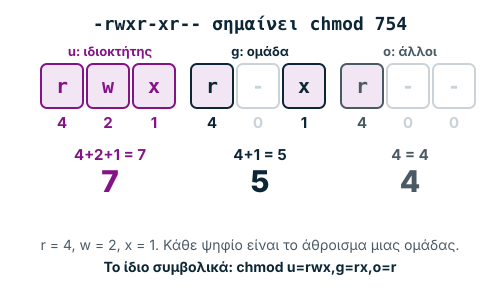

Σημειώσεις μελέτης για την Εβδομάδα 5, βασισμένες στην Ενότητα 10 «Δικτυακές
Εντολές και Ασφάλεια Δικτύου», στο φυλλάδιο ασκήσεων με τις δικτυακές εντολές
και στη διάλεξη «Εισαγωγή στο UNIX». Όπου το υλικό έχει λάθος ή κάτι που άλλαξε
στα σημερινά συστήματα, το σημειώνουμε.

Η **γραμμή εντολών** είναι το εργαλείο που μοιράζονται ο διαχειριστής και ο
επιτιθέμενος. Με τις ίδιες εντολές ο πρώτος βρίσκει τι πάει στραβά στο δίκτυό
του, και ο δεύτερος μαθαίνει διευθύνσεις, ανοιχτές θύρες, χρήστες και
κοινόχρηστους φακέλους, για να σχεδιάσει την επίθεσή του. Αυτή την εβδομάδα
μαθαίνουμε τις βασικές δικτυακές εντολές των Windows και τα πρώτα βήματα στο
**UNIX**, το λειτουργικό από το οποίο κατάγονται το Linux και το Kali που θα
χρησιμοποιήσουμε στα εργαστήρια.

Η σελίδα έχει τρία μέρη: **Μάθε** (η θεωρία, με έναν υπολογιστή δικαιωμάτων),
**Εργαστήρια** (το φυλλάδιο ασκήσεων, με μια γραμμή εντολών Windows και ένα
UNIX shell που τρέχουν μόνο στον browser) και **Εξετάσεις** (επανάληψη και
αυτοαξιολόγηση).

**Μαθησιακοί στόχοι.** Μετά τη μελέτη θα μπορείς να:

1. χρησιμοποιείς τις δικτυακές εντολές των Windows για διάγνωση·
2. εξηγείς τι μπορεί να μάθει ένας επιτιθέμενος από την έξοδο κάθε εντολής·
3. διαβάζεις την έξοδο των `netstat` και `arp -a` και εντοπίζεις κάτι ύποπτο·
4. περιγράφεις τα μέρη ενός συστήματος UNIX (πυρήνας, φλοιός)·
5. δουλεύεις με αρχεία και φακέλους, ανακατευθύνσεις και σωληνώσεις·
6. διαβάζεις και ορίζεις δικαιώματα με το `chmod`, συμβολικά και οκταδικά.

## Μάθε

### 1. Δικτυακές εντολές: εργαλείο και κίνδυνος

Τα Windows έχουν ένα σύνολο εντολών γραμμής εντολών για να ελέγχουμε και να
διαχειριζόμαστε το δίκτυο: συνδεσιμότητα, διευθύνσεις, δρομολόγηση, ενεργές
συνδέσεις, χρήστες, κοινόχρηστους φακέλους, υπηρεσίες. Είναι ιδιαίτερα χρήσιμες
για τους διαχειριστές, γιατί δίνουν γρήγορα την εικόνα ενός υπολογιστή χωρίς
γραφικό περιβάλλον.

Οι ίδιες εντολές όμως είναι και **παράγοντας κινδύνου**. Το `ipconfig`, το
`netstat` και το `ping` αποκαλύπτουν διευθύνσεις IP, θύρες και συνδέσεις, δηλαδή
ακριβώς ό,τι χρειάζεται ένας επιτιθέμενος στη φάση της **αναγνώρισης**
(reconnaissance, Εβδομάδα 1). Τα `net user`, `net localgroup` και `net share`
διαχειρίζονται χρήστες, ομάδες και δικαιώματα· μια λάθος ρύθμιση μπορεί να δώσει
σε μη εξουσιοδοτημένους πρόσβαση σε δεδομένα ή ακόμη και τον έλεγχο του
συστήματος. Η καλή γνώση τους προστατεύει την **εμπιστευτικότητα**, την
**ακεραιότητα** και τη **διαθεσιμότητα** του δικτύου (τριάδα CIA).

> **Προσοχή:** Η διάλεξη τις λέει «δικτυακές εντολές του MS-DOS». Στην
> πραγματικότητα είναι εντολές της γραμμής εντολών των **Windows** (`cmd.exe`).
> Το MS-DOS δεν είχε `ipconfig`, `netstat` ή `tracert`· αυτές ήρθαν με τα
> Windows και τη δικτύωση TCP/IP. Η «μαύρη οθόνη» απλώς θυμίζει το παλιό DOS.

Οι εντολές χωρίζονται σε δύο ομάδες: όσες **διαβάζουν** πληροφορίες (π.χ.
`ipconfig`, `netstat`, `arp -a`) και όσες **αλλάζουν** ρυθμίσεις (π.χ.
`route add`, `arp -s`, `net user … /add`, `net stop`). Οι δεύτερες χρειάζονται
γραμμή εντολών **ως διαχειριστής** και στο εργαστήριο τις τρέχουμε μόνο σε δική
μας εικονική μηχανή.

### 2. Εντολές διάγνωσης δικτύου

**`ping`: υπάρχει επικοινωνία;** Στέλνει πακέτα ICMP *Echo Request* και περιμένει
*Echo Reply*. Τα Windows στέλνουν 4 πακέτα των 32 bytes, εκτός αν πεις
διαφορετικά (`-n` πλήθος, `-l` μέγεθος, `-t` συνεχώς).

```text
ping www.google.com
ping 192.168.1.1
ping -n 10 -l 128 192.168.1.1
```

Κάθε γραμμή «Reply from … time=1ms TTL=64» λέει ότι ο υπολογιστής απάντησε, σε
πόσο χρόνο πήγε κι ήρθε το πακέτο (*round-trip time*) και με τι **TTL** έφτασε.
Το «Request timed out» σημαίνει ότι δεν ήρθε απάντηση: ο υπολογιστής είναι
κλειστός, η διεύθυνση είναι λάθος, ένα firewall μπλοκάρει το ICMP ή η
δρομολόγηση δεν φτάνει ως εκεί. **Ασφάλεια:** πολλά ping σε σύντομο χρόνο προς
έναν στόχο (*ping flood*) είναι απλή μορφή **DoS**· γι' αυτό πολλοί servers δεν
απαντούν καθόλου σε ping, κάτι που δεν σημαίνει ότι είναι κλειστοί.

**`ipconfig`: ποιες είναι οι ρυθμίσεις μου;** Δείχνει διεύθυνση IP, μάσκα
υποδικτύου και προεπιλεγμένη πύλη κάθε κάρτας δικτύου.

| Εντολή | Τι κάνει |
| --- | --- |
| `ipconfig` | IP, μάσκα, πύλη για κάθε κάρτα |
| `ipconfig /all` | επιπλέον: φυσική διεύθυνση (MAC), αν είναι ενεργό το DHCP, ο DHCP server, οι DNS servers, το όνομα υπολογιστή |
| `ipconfig /release` | αφήνει τη διεύθυνση που έδωσε ο DHCP server· η κάρτα μένει χωρίς IP και δεν επικοινωνεί |
| `ipconfig /renew` | ζητά από τον DHCP server νέα διεύθυνση, μάσκα, πύλη και DNS |
| `ipconfig /flushdns` | αδειάζει την προσωρινή μνήμη DNS του υπολογιστή |

**Ασφάλεια:** η έξοδος δείχνει τη θέση του υπολογιστή στο δίκτυο και τη
διεύθυνση του δρομολογητή. Με αυτά ένας επιτιθέμενος ξέρει ποιον να μιμηθεί
(IP spoofing) και ποια συσκευή να στοχεύσει. Ένα σωστό `ipconfig /all` είναι
επίσης η πρώτη απόδειξη για «λάθος» DNS server, σύμπτωμα κακόβουλης αλλαγής
ρυθμίσεων.

**`tracert`: από πού περνάνε τα πακέτα;** Στέλνει πακέτα με TTL 1, 2, 3, …
Κάθε δρομολογητής μειώνει το TTL κατά 1, και όποιος το μηδενίσει απαντά με
μήνυμα ICMP *Time Exceeded*. Έτσι μαθαίνουμε τη διεύθυνση και την καθυστέρηση
κάθε **βήματος** (hop) μέχρι τον προορισμό.

```text
tracert www.google.com
tracert 8.8.8.8
```

Ένα `* * *` σημαίνει ότι εκείνος ο δρομολογητής δεν απάντησε (συχνά επίτηδες).
Αν η διαδρομή σταματά πάντα στο ίδιο σημείο, εκεί είναι το πρόβλημα.
**Ασφάλεια:** το `tracert` χαρτογραφεί το δίκτυο: δείχνει δρομολογητές, πάροχο
και πιθανά σημεία όπου θα μπορούσε να σταθεί ένας **Man-in-the-Middle**.

**`netstat`: ποιες συνδέσεις και θύρες είναι ανοιχτές;** Είναι ίσως η πιο
χρήσιμη εντολή για τον αμυνόμενο.

| Εντολή | Τι δείχνει |
| --- | --- |
| `netstat` | τις ενεργές συνδέσεις TCP, με ονόματα |
| `netstat -a` | και τις θύρες που **ακούν** (LISTENING), και το UDP |
| `netstat -n` | διευθύνσεις και θύρες σε αριθμούς (πιο γρήγορο, πιο σαφές) |
| `netstat -o` | και τον αριθμό διεργασίας (PID) κάθε σύνδεσης |
| `netstat -b` | και το εκτελέσιμο πρόγραμμα κάθε σύνδεσης (χρειάζεται διαχειριστή) |

Οι στήλες: **Proto** (TCP ή UDP), **Local Address** (η δική μας IP:θύρα),
**Foreign Address** (η απέναντι IP:θύρα), **State** (κατάσταση: LISTENING =
περιμένει συνδέσεις, ESTABLISHED = ενεργή σύνδεση, SYN_SENT = ζήτησε σύνδεση
και περιμένει, TIME_WAIT / CLOSE_WAIT = κλείνει). **Ασφάλεια:** ένα άγνωστο
πρόγραμμα που ακούει σε ασυνήθιστη θύρα, ή μια σύνδεση προς άγνωστη διεύθυνση,
είναι από τα πρώτα σημάδια κακόβουλου λογισμικού (backdoor, botnet).

**`nslookup`: τι λέει το DNS;** Ρωτά έναν DNS server.

```text
nslookup example.com               ← όνομα → διεύθυνση IP
nslookup 93.184.215.14             ← αντίστροφη αναζήτηση: IP → όνομα
nslookup -type=txt example.com     ← εγγραφές TXT (SPF, DKIM, DMARC)
```

Στην ασφάλεια χρησιμεύει για να εντοπίσουμε **DNS spoofing** (διαφορετικές
απαντήσεις από διαφορετικούς DNS servers για το ίδιο όνομα), να ελέγξουμε τις
εγγραφές **SPF, DKIM, DMARC** που προστατεύουν το email από spoofing και
phishing, να επιβεβαιώσουμε με αντίστροφη αναζήτηση (*reverse DNS*) ότι ένας
server είναι αυτός που λέει, και να διαγνώσουμε ένα όνομα που δεν επιλύεται.

**`arp`: ποια MAC αντιστοιχεί σε ποια IP;** Δείχνει και αλλάζει τον πίνακα
**ARP** (Address Resolution Protocol, Εβδομάδα 4).

| Εντολή | Τι κάνει |
| --- | --- |
| `arp -a` | όλες τις αντιστοιχίες IP → MAC που ξέρει ο υπολογιστής |
| `arp -d 192.168.1.1` | διαγράφει μία εγγραφή· θα ξαναμαθευτεί με νέο ARP request |
| `arp -s 192.168.1.100 00-11-22-33-44-55` | προσθέτει **στατική** εγγραφή, που δεν αλλάζει από ARP απαντήσεις |

**Ασφάλεια:** στο **ARP spoofing / poisoning** ο επιτιθέμενος στέλνει ψεύτικες
απαντήσεις ARP, ώστε η IP της πύλης να αντιστοιχιστεί στη δική του MAC· έτσι
περνά όλη η κίνηση από αυτόν (MitM). Το σύμπτωμα στο `arp -a` είναι **δύο
διαφορετικές IP με την ίδια MAC**, η μία από τις οποίες η πύλη. Μια στατική
εγγραφή (`arp -s`) για την πύλη είναι απλή άμυνα σε μικρό δίκτυο.

**`route`: ο πίνακας δρομολόγησης.**

```text
route print                                          ← εμφάνιση του πίνακα
route add 192.168.1.0 mask 255.255.255.0 192.168.0.1  ← στατική διαδρομή
route delete 192.168.1.0                             ← διαγραφή διαδρομής
```

Η γραμμή `0.0.0.0  0.0.0.0  192.168.1.1` είναι η **προεπιλεγμένη διαδρομή**:
ό,τι δεν ταιριάζει αλλού πάει στην πύλη. **Ασφάλεια:** μια κακόβουλα αλλαγμένη
διαδρομή στέλνει την κίνηση σε λάθος σημείο: Man-in-the-Middle ή DoS.

| Windows | Linux / Kali (Εβδομάδα 8) | Σκοπός |
| --- | --- | --- |
| `ping` | `ping` (συνεχώς, ως Ctrl+C) | συνδεσιμότητα |
| `ipconfig /all` | `ip a`, `ip route` | διευθύνσεις, πύλη |
| `tracert` | `traceroute` | διαδρομή |
| `netstat -ano` | `ss -tulpn` | θύρες και συνδέσεις |
| `arp -a` | `ip neigh` | πίνακας ARP |
| `nslookup` | `nslookup`, `dig` | DNS |

### 3. Εντολές διαχείρισης: η οικογένεια `net`

| Εντολή | Τι κάνει | Ο κίνδυνος |
| --- | --- | --- |
| `net use Z: \\server\shared` | συνδέει κοινόχρηστο φάκελο ως μονάδα Z: | χωρίς σωστά δικαιώματα, ανοιχτή πόρτα σε δεδομένα |
| `net use X: /delete` | αποσυνδέει τη μονάδα X: | |
| `net use \\server\shared /user:όνομα κωδικός` | σύνδεση με συγκεκριμένα διαπιστευτήρια | ο κωδικός μένει στο ιστορικό εντολών και σε scripts |
| `net share` | δείχνει τους κοινόχρηστους πόρους | κοινή χρήση χωρίς έλεγχο πρόσβασης εκθέτει δεδομένα |
| `net share Όνομα=C:\folder` | δημιουργεί κοινόχρηστο φάκελο | |
| `net view`, `net view \\pc` | υπολογιστές του δικτύου, κοινόχρηστοι πόροι ενός υπολογιστή | αναγνώριση για επιτιθέμενο |
| `net user`, `net user admin` | λογαριασμοί, στοιχεία ενός λογαριασμού | λογαριασμοί χωρίς έλεγχο, αδύναμοι κωδικοί |
| `net localgroup Administrators` | μέλη μιας τοπικής ομάδας | ένας χρήστης με περισσότερα δικαιώματα από όσα χρειάζεται |
| `net localgroup Administrators όνομα /add` (ή `/delete`) | προσθήκη/αφαίρεση μέλους | κλιμάκωση δικαιωμάτων |
| `net start`, `net stop "Υπηρεσία"` | ξεκινά/σταματά υπηρεσίες | αν σταματήσει το antivirus, ο υπολογιστής μένει απροστάτευτος |
| `net time \\server /set` | συγχρονίζει την ώρα με έναν server | λάθος ώρα χαλά την αυθεντικοποίηση και τα logs |
| `net statistics workstation` / `server` | στατιστικά των υπηρεσιών Workstation / Server | δείχνει φόρτο, συνδέσεις, αποτυχημένες προσβάσεις |
| `net config workstation` / `server` | ρυθμίσεις των ίδιων υπηρεσιών | |
| `net help`, `net help use` | βοήθεια | |

Λίγα σχόλια για όσα δεν είναι προφανή:

- **Ώρα και ασφάλεια.** Τα πρωτόκολλα αυθεντικοποίησης (π.χ. Kerberos)
  απορρίπτουν αιτήματα όταν τα ρολόγια διαφέρουν πολύ, και τα **logs**
  χρειάζονται σωστή ώρα για να συσχετιστούν. Ένας επιτιθέμενος που χαλάει την
  ώρα μπορεί να μπερδέψει την ανίχνευση ή να διευκολύνει επιθέσεις **replay**.
  Στα σύγχρονα Windows ο συγχρονισμός γίνεται με την υπηρεσία Windows Time
  (`w32tm /resync`)· το `net time` σώζεται για συμβατότητα.
- **Workstation και Server.** Η υπηρεσία *Workstation* συνδέει τον υπολογιστή σε
  κοινόχρηστους πόρους άλλων· η υπηρεσία *Server* προσφέρει τους δικούς του.
- **Netlogon.** Η διάλεξη την παρουσιάζει ως «net logon», αλλά είναι
  **υπηρεσία** (ξεκινά με `net start netlogon`) που χρειάζεται σε δίκτυα με
  **Active Directory**: αυθεντικοποίηση στον τομέα, σχέσεις εμπιστοσύνης (trust
  relationships). Η παρακολούθηση των συνδέσεων βοηθά να φανούν κακόβουλες
  προσπάθειες από άγνωστους χρήστες ή ύποπτες διευθύνσεις.
- **`netsh`.** Το φυλλάδιο ασκήσεων έχει και το `netsh`, το εργαλείο ρυθμίσεων
  δικτύου: `netsh interface ipv4 show config` (ρυθμίσεις IPv4),
  `netsh wlan show profiles` (αποθηκευμένα ασύρματα δίκτυα) και
  `netsh advfirewall show allprofiles state` (αν το firewall είναι ενεργό σε
  κάθε προφίλ: Domain, Private, Public).

> **Παγίδα:** Ένα προφίλ firewall σε **OFF**, ειδικά το Public, είναι εύρημα
> ασφαλείας: όταν ο φορητός συνδεθεί σε δημόσιο Wi-Fi, θα είναι ανοιχτός σε όλο
> το δίκτυο.

### 4. Εισαγωγή στο UNIX

Ένα **λειτουργικό σύστημα** διαχειρίζεται τους πόρους (συσκευές εισόδου/εξόδου,
μνήμη) και τις διεργασίες (δημιουργία, τερματισμός, επικοινωνία μεταξύ τους,
εναλλαγή στη CPU). Το **UNIX** είναι οικογένεια λειτουργικών με πολλές
παραλλαγές· οι βιβλιοθήκες που δίνουν πρόσβαση στον πυρήνα είναι σχεδόν ίδιες
σε όλες. Είναι **ανοιχτό σύστημα**: εφαρμογές διαφορετικών κατασκευαστών
συνεργάζονται και ανταλλάσσουν δεδομένα πάνω σε πολύ διαφορετικό υλικό.


*Σχήμα 1. Τα επίπεδα ενός συστήματος UNIX.*

- Ο **πυρήνας** (kernel) είναι η «καρδιά» του συστήματος: ένα μεγάλο πρόγραμμα
  που φορτώνεται στη RAM με την εκκίνηση και μοιράζει τους πόρους του υλικού
  (επεξεργαστή, μνήμη, δίσκους, κάρτες). Ξέρει ποιο υλικό υπάρχει και έχει τα
  προγράμματα για να επικοινωνεί με κάθε συσκευή.
- Ο **φλοιός** (shell) είναι ο «διερμηνέας» ανάμεσα στον χρήστη και στο
  σύστημα: ένα πρόγραμμα που επαναλαμβάνει τον κύκλο *περιμένει εντολή →
  δέχεται → μεταφράζει → εκτελεί → περιμένει την επόμενη*. Κάθε χρήστης που
  συνδέεται παίρνει **δικό του** φλοιό, άρα τρέχουν πολλοί ταυτόχρονα. Γνωστοί
  φλοιοί: `sh`, `csh`/`tcsh`, `bash`, `zsh`.
- Ο πυρήνας τρέχει σε **κατάσταση πυρήνα** (kernel mode), με πλήρη πρόσβαση στο
  υλικό· τα προγράμματα και ο φλοιός τρέχουν σε **κατάσταση χρήστη** (user
  mode) και ζητούν από τον πυρήνα ό,τι χρειάζονται. Αυτός ο διαχωρισμός
  εμποδίζει μη εξουσιοδοτημένες εντολές να πειράξουν το σύστημα ή το υλικό
  (Εβδομάδα 0).

Η συνεδρία ενός χρήστη: **log in** → ο φλοιός ανοίγει την κονσόλα → ο χρήστης
γράφει εντολή → ο φλοιός εκτελεί το πρόγραμμα → ο χρήστης αλληλεπιδρά μαζί του →
**log off**.

**Βασικά χαρακτηριστικά.**

- **Πολλών χρηστών (multi-user):** πολλοί χρήστες ταυτόχρονα, με όνομα χρήστη
  και συνθηματικό. Υπάρχουν οι απλοί χρήστες και ο **διαχειριστής** (`root`),
  υπεύθυνος για τη λειτουργία και την ασφάλεια του συστήματος, τους χρήστες και
  τις περιφερειακές συσκευές.
- **Πολλών διεργασιών (multi-tasking)** και **καταμερισμού χρόνου (time
  sharing):** η CPU δίνεται με τη σειρά σε κάθε διεργασία για ένα μικρό κομμάτι
  χρόνου, ανάλογα με την προτεραιότητά της, οπότε όλες «τρέχουν μαζί».
- **Φορητό (portable):** τρέχει σε περισσότερους τύπους υπολογιστών από
  οποιοδήποτε άλλο λειτουργικό, και από νωρίς είχε δικτυακά προγράμματα όπως
  FTP και Telnet.
- **Όλα είναι αρχεία:** κανονικά αρχεία, φάκελοι και **ειδικά αρχεία** που
  αντιστοιχούν σε συσκευές· μέσα από αυτά γίνεται και η δικτύωση. Ένα πρόγραμμα
  που τρέχει λέγεται **διεργασία**. Αρχεία και διεργασίες έχουν **ιδιοκτήτη και
  ομάδα** και προστατεύονται από μη εξουσιοδοτημένη πρόσβαση. Οι φάκελοι
  οργανώνονται ιεραρχικά, σε δέντρο.

<details>
<summary>Αναλυτικά: η ιστορία του UNIX</summary>

- **Τέλη δεκαετίας 1960, Bell Labs.** Οι Ken Thompson και Dennis Ritchie, μετά
  την εγκατάλειψη του έργου MULTICS, μεταφέρουν ιδέες του σε έναν μικρότερο
  υπολογιστή PDP-7. Η «μικρή» έκδοση ονομάζεται UNICS και αργότερα **UNIX**.
- **1970:** μεταφορά σε PDP-11, για το γραφείο ευρεσιτεχνιών των Bell Labs.
- **1973:** ξαναγράφεται σε **C** (Ritchie), για να μεταφέρεται εύκολα σε νέους
  υπολογιστές. Από εδώ ξεκινά η φορητότητά του.
- **Μέσα 1970 – αρχές 1980:** γίνεται πολύ δημοφιλές στα πανεπιστήμια. Το 1977
  το Berkeley δίνει το **BSD** UNIX, που γίνεται ανεξάρτητη οικογένεια.
- **1983:** τα Bell Labs δίνουν το **System V**.
- **Σήμερα:** τα συστήματα UNIX είναι συνδυασμός System V και BSD, που
  ακολουθούν κοινά πρότυπα (POSIX). Το Linux είναι «UNIX-like»: δεν προέρχεται
  από τον κώδικα του UNIX, αλλά ακολουθεί τα ίδια πρότυπα και εντολές. Το macOS
  βασίζεται σε BSD.

</details>

### 5. Εντολές UNIX

Οι εντολές έχουν συνήθως τη μορφή

```text
εντολή  -παράμετροι  αρχείο/φάκελος …
```

Η **εντολή** λέει τι θα γίνει (π.χ. `rm` = διαγραφή). Οι **παράμετροι** ξεκινούν
με `-` και ένα ή περισσότερα γράμματα, το καθένα μια ιδιότητα (π.χ. `rm -i`
ζητά επιβεβαίωση)· πολλές μαζί γράφονται και ενωμένες (`ls -la` = `ls -l -a`).
Το **αρχείο** δίνεται με το όνομά του, αν είναι στον τρέχοντα φάκελο, ή με
μονοπάτι. Τα κεφαλαία διαφέρουν από τα μικρά: `File` και `file` είναι δύο
αρχεία.

**Φάκελοι και μονοπάτια.**

- **Φάκελος εργασίας** (working directory): ο φάκελος στον οποίο βρισκόμαστε.
- **Μονοπάτι** (path): διαδρομή στο δέντρο με `/`, π.χ.
  `/home1/dep/plir/alekosto`. **Απόλυτο** αν ξεκινά από τη ρίζα `/`,
  **σχετικό** αν ξεκινά από τον φάκελο εργασίας.
- `.` είναι ο τρέχων φάκελος και `..` ο γονικός (ένα επίπεδο πάνω). Το `~` είναι
  ο αρχικός σου φάκελος (home).
- Στα ονόματα, το `*` σημαίνει «οποιαδήποτε ακολουθία χαρακτήρων» και το `?`
  «ακριβώς έναν χαρακτήρα» (π.χ. `ls *.txt`, `ls file?`).

| Εντολή | Τι κάνει |
| --- | --- |
| `pwd` | το μονοπάτι του φακέλου εργασίας |
| `cd φάκελος`, `cd ..`, `cd /`, `cd` | μετάβαση σε υποφάκελο, ένα επίπεδο πάνω, στη ρίζα, στον αρχικό φάκελο |
| `ls` | τα περιεχόμενα του φακέλου |
| `ls -l` / `-a` / `-F` / `-R` / `-C` | αναλυτικά / και τα κρυφά (που αρχίζουν με `.`) / με `/` στους φακέλους και `*` στα εκτελέσιμα / και όλων των υποφακέλων / σε στήλες |
| `mkdir a b`, `mkdir a/c` | νέοι φάκελοι |
| `rmdir a` | διαγραφή **άδειου** φακέλου |
| `cp f1 f2`, `cp -i f1 f2`, `cp -r d1 d2` | αντιγραφή αρχείου, με επιβεβαίωση αν το f2 υπάρχει, αντιγραφή φακέλου |
| `mv f1 f2`, `mv f1 dir/` | μετονομασία, μετακίνηση |
| `rm f`, `rm -i f`, `rm -r d`, `rm -f f` | διαγραφή, με επιβεβαίωση, φακέλου με όλο το περιεχόμενο, χωρίς ερωτήσεις |
| `cat f`, `more f` | εμφάνιση αρχείου (όλο / ανά σελίδα) |
| `head f`, `head -5 f` | οι 10 (ή 5) πρώτες γραμμές |
| `tail f`, `tail -3 f`, `tail +24 f` | οι 10 (ή 3) τελευταίες γραμμές, από τη γραμμή 24 ως το τέλος |
| `cut -f 2,4 f`, `cut -c 6-9 f` | οι στήλες 2 και 4 (χωρισμένες με TAB), οι χαρακτήρες 6–9 κάθε γραμμής |
| `cmp f1 f2`, `diff f1 f2` | πού διαφέρουν δύο αρχεία (πρώτη διαφορά / αναλυτικά) |
| `find . -name "*.txt"` | αναζήτηση αρχείων με βάση το όνομα |
| `who`, `who am i` | ποιοι είναι συνδεδεμένοι, ποιος είμαι εγώ |
| `date`, `cal`, `cal 11 2026` | ημερομηνία και ώρα, ημερολόγιο |
| `finger χρήστης` | πληροφορίες και τελευταία είσοδος ενός χρήστη |
| `history` | οι εντολές που έχεις εκτελέσει, με τη σειρά |
| `man εντολή` | το εγχειρίδιο (manual) μιας εντολής |
| `echo κείμενο` | τυπώνει το κείμενο |
| `ps`, `kill -9 PID` | οι διεργασίες σου, τερματισμός μιας διεργασίας |
| `write`, `talk` | μήνυμα / συνομιλία με άλλον συνδεδεμένο χρήστη |
| `quota -v` | πόσο χώρο στο δίσκο δικαιούσαι και πόσο χρησιμοποιείς |
| `alias rm 'rm -i'` | ψευδώνυμο: το `rm` θα ζητά πάντα επιβεβαίωση |

> **Προσοχή:** Τέσσερα σημεία της διάλεξης θέλουν διόρθωση.
>
> - Το **`^C`** (Ctrl+C) **δεν** είναι ίδιο με το `kill -9`. Το Ctrl+C στέλνει
>   σήμα **SIGINT**, που το πρόγραμμα μπορεί να «πιάσει» και να κλείσει
>   κανονικά (π.χ. να σώσει δεδομένα). Το `kill -9` στέλνει **SIGKILL**, που
>   τερματίζει αμέσως και δεν μπορεί να αγνοηθεί.
> - Το **`tail +24 file1`** δείχνει από τη γραμμή **24** ως το τέλος, όχι από
>   την 23η. Στα σημερινά Linux γράφεται `tail -n +24 file1`.
> - Το **`find file`** όπως το γράφει η διάλεξη δεν ψάχνει με όνομα· η σωστή
>   σύνταξη είναι `find . -name file` (ψάξε από τον τρέχοντα φάκελο και κάτω).
> - Η σύνταξη `alias rm rm -i` είναι του φλοιού **csh** (όπως φαίνεται και από
>   την προτροπή `dias 11%` των διαφανειών). Στο **bash**, τον φλοιό του Linux
>   και του Kali, γράφεται `alias rm='rm -i'` και μπαίνει στο `.bashrc`, όχι στο
>   `.cshrc`.

**Ασφάλεια.** Το `history` καταγράφει ό,τι γράφεις: ένας κωδικός που δόθηκε
μέσα σε εντολή (π.χ. `net use … /user:x κωδικός` ή `mysql -p κωδικός`) μένει
στο αρχείο ιστορικού, που μπορεί να διαβάσει κάποιος άλλος. Αντίστροφα, ένας
εισβολέας συχνά σβήνει το ιστορικό του για να «καθαρίσει τα ίχνη» (φάση
*Clearing Tracks*, Εβδομάδα 1). Το `who` και το `finger` δείχνουν ποιος είναι
συνδεδεμένος και πότε: χρήσιμο για τον διαχειριστή, χρήσιμο και για τον
επιτιθέμενο που ψάχνει ονόματα χρηστών. Το `rm -r` δεν έχει κάδο ανακύκλωσης.

<details>
<summary>Αναλυτικά: ο επεξεργαστής κειμένου vi, συνοπτικά</summary>

Ο **vi** (και ο σημερινός **vim**) υπάρχει σε κάθε σύστημα UNIX, ακόμη και
χωρίς γραφικό περιβάλλον, άρα αξίζει να ξέρεις τα βασικά. Έχει δύο
καταστάσεις: **κατάσταση εντολών** (command mode), όπου τα πλήκτρα είναι
εντολές, και **κατάσταση εισαγωγής** (insert mode), όπου γράφεις κείμενο.

| Πλήκτρα | Τι κάνουν |
| --- | --- |
| `vi file1` | άνοιγμα (ή δημιουργία) του file1 |
| `i` / `Esc` | μετάβαση σε insert mode / επιστροφή σε command mode |
| `:w`, `:w file2`, `:wq`, `:q`, `:q!` | αποθήκευση, αποθήκευση με άλλο όνομα, αποθήκευση και έξοδος, έξοδος, έξοδος χωρίς αποθήκευση |
| `:set number` / `:set nonumber` | αρίθμηση γραμμών / χωρίς αρίθμηση |
| `h j k l` | ένα βήμα αριστερά, κάτω, πάνω, δεξιά (όπως τα βελάκια) |
| `w`, `b`, `e`, `$` | επόμενη λέξη, αρχή λέξης, τέλος λέξης, τέλος γραμμής |
| `G`, `:15` | τέλος του αρχείου, γραμμή 15 |
| `x`, `dw`, `dd`, `D` | διαγραφή χαρακτήρα, λέξης, γραμμής, ως το τέλος της γραμμής |
| `yy`, `p` | αντιγραφή γραμμής, επικόλληση |
| `u`, `Ctrl+R`, `.` | αναίρεση, επανάληψη (redo), επανάληψη της τελευταίας ενέργειας |
| `r`, `cw`, `cc` | αντικατάσταση χαρακτήρα, λέξης, γραμμής |
| `/λέξη`, `n`, `N` | αναζήτηση, επόμενο, προηγούμενο |
| `:s/παλιό/νέο`, `:1,$ s/παλιό/νέο/g` | αντικατάσταση στη γραμμή, σε όλο το κείμενο |
| `:3,10 w new.java` | γράφει τις γραμμές 3–10 σε νέο αρχείο |

</details>

### 6. Ανακατευθύνσεις και σωληνώσεις

Κάθε πρόγραμμα έχει τρεις προκαθορισμένες **ροές** (streams): **είσοδο**
(συνήθως το πληκτρολόγιο), **έξοδο** (η οθόνη) και **διαγνωστικά μηνύματα**
(τα σφάλματα, κι αυτά στην οθόνη). Με την **ανακατεύθυνση** τις στέλνουμε σε
αρχεία, και με τη **σωλήνωση** συνδέουμε την έξοδο ενός προγράμματος με την
είσοδο του επόμενου.


*Σχήμα 2. Ροές, ανακατευθύνσεις και σωλήνωση.*

| Σύνταξη | Τι κάνει |
| --- | --- |
| `εντολή > f` | η έξοδος γράφεται στο f· αν το f υπάρχει, **αντικαθίσταται** |
| `εντολή >> f` | η έξοδος **προστίθεται στο τέλος** του f (το δημιουργεί αν δεν υπάρχει) |
| `εντολή < f` | η είσοδος έρχεται από το f αντί για το πληκτρολόγιο |
| `εντολή >& f` (csh) · `εντολή &> f` (bash) | και η έξοδος και τα σφάλματα στο f |
| `εντολή 2> f` (bash) | μόνο τα σφάλματα στο f |
| `cat << .` | είσοδος από το πληκτρολόγιο μέχρι μια γραμμή με τελεία (*here document*) |
| `εντολή1 \| εντολή2` | σωλήνωση: η έξοδος της 1 γίνεται είσοδος της 2 |
| `εντολή1 ; εντολή2` | δύο εντολές στη σειρά, στην ίδια γραμμή |

Παραδείγματα της διάλεξης:

```text
cat > file                    ← νέο αρχείο από το πληκτρολόγιο· τέλος με Ctrl+D
cat file1 file2 > file        ← ένωση δύο αρχείων σε ένα νέο
cat file1 > file1backup       ← αντίγραφο χωρίς cp
cat file1backup >> file       ← προσθήκη ενός αρχείου στο τέλος άλλου
ls -l > info                  ← η έξοδος μιας εντολής σε αρχείο
pwd >> info; who am i >> info ← προσθήκη δύο εξόδων στο τέλος του info
cat non_existing_file >& java.err ← το μήνυμα σφάλματος σε αρχείο
cat < file > backup           ← διπλή ανακατεύθυνση: διάβασε το file, γράψε το backup
```

> **Προσοχή:** Η διάλεξη γράφει ότι το `date > info` «προσθέτει την ημερομηνία
> στο τέλος του info». Με ένα `>` **αντικαθιστά** όλο το περιεχόμενο του info
> με την ημερομηνία· για προσθήκη στο τέλος χρειάζεται `date >> info`. Είναι
> το πιο συνηθισμένο λάθος με τις ανακατευθύνσεις: ένα `>` αντί για `>>`
> σβήνει ένα αρχείο χωρίς ερώτηση.

**Φίλτρα.** Εντολές που διαβάζουν γραμμές, τις επεξεργάζονται και βγάζουν
γραμμές, ιδανικές για σωληνώσεις:

| Εντολή | Τι κάνει |
| --- | --- |
| `wc f`, `wc -l` / `-w` / `-c` | γραμμές, λέξεις, χαρακτήρες (ή μόνο ένα από αυτά) |
| `sort f`, `sort -r`, `sort -n` | ταξινόμηση αλφαβητική, φθίνουσα, αριθμητική. **Δεν αλλάζει** το αρχείο |
| `sort -o out f` | ταξινόμηση με αποθήκευση στο out (μπορεί να είναι και το ίδιο το f) |
| `grep aaa f` | οι γραμμές που περιέχουν «aaa» |
| `grep -v` / `-c` / `-n` / `-l` / `-i` | όσες **δεν** το περιέχουν / πόσες είναι / με αριθμό γραμμής / μόνο τα ονόματα των αρχείων / χωρίς διάκριση κεφαλαίων |

Με σωλήνωση γίνεται σε μία γραμμή ό,τι αλλιώς θα ήθελε προσωρινά αρχεία:

```text
who | sort              ← οι συνδεδεμένοι χρήστες, ταξινομημένοι
who | wc -l             ← πόσοι είναι (μία γραμμή ανά χρήστη)
ls -l | more            ← τα περιεχόμενα του φακέλου ανά σελίδα
who | sort | lp         ← εκτύπωση της ταξινομημένης λίστας
```

**Ασφάλεια.** Τα φίλτρα είναι το βασικό εργαλείο ανάλυσης **logs**. Για
παράδειγμα, `grep "Failed password" /var/log/auth.log | wc -l` μετρά τις
αποτυχημένες συνδέσεις SSH· ένας μεγάλος αριθμός από την ίδια διεύθυνση είναι
σημάδι επίθεσης **brute force** (Εβδομάδα 1). Στο εργαστήριο θα κάνεις το ίδιο
σε ένα μικρό `log.txt`.

### 7. Δικαιώματα αρχείων και `chmod`

Κάθε αρχείο και φάκελος έχει **ιδιοκτήτη** και **ομάδα**, και τρία σετ
δικαιωμάτων: για τον **ιδιοκτήτη** (u, user), την **ομάδα** (g, group) και
**όλους τους άλλους** (o, others). Κάθε σετ έχει τρία δικαιώματα:

| | Σε αρχείο | Σε φάκελο |
| --- | --- | --- |
| **r** (read) | διάβασμα του περιεχομένου | εμφάνιση των ονομάτων (`ls`) |
| **w** (write) | αλλαγή του περιεχομένου | δημιουργία και διαγραφή αρχείων μέσα του |
| **x** (execute) | εκτέλεση ως πρόγραμμα | είσοδος στον φάκελο (`cd`) |

Η έξοδος του `ls -l`:

```text
-rwxr-xr--  1 alekosto dep_plir  0 Nov 25 22:55 file
│└┬┘└┬┘└┬┘    └──┬───┘ └──┬───┘  │ └────┬─────┘ └─ όνομα
│ u  g  o     ιδιοκτήτης  ομάδα  μέγεθος (bytes)  τελευταία αλλαγή
└ τύπος: - αρχείο, d φάκελος
```

**Συμβολικός τρόπος.** `chmod <ποιοι><+ - =><δικαιώματα> αρχείο`, με «ποιοι» =
`u`, `g`, `o` ή `a` (όλοι), `+` προσθέτει, `-` αφαιρεί, `=` δίνει **ακριβώς**.
Πολλές αλλαγές χωρίζονται με κόμμα.

```text
chmod go=r file           -r-xr-xr-x  →  -r-xr--r--
chmod u=rwx,g=rx,o=r file -r-xr--r--  →  -rwxr-xr--
chmod a+x script.sh       όλοι μπορούν να το εκτελέσουν
chmod o-rwx secret.txt    οι «άλλοι» χάνουν κάθε δικαίωμα
```

**Οκταδικός (απόλυτος) τρόπος.** Κάθε δικαίωμα έχει μια τιμή, **r = 4, w = 2,
x = 1** (είναι τα δυαδικά 100, 010, 001), και κάθε σετ γίνεται ένα ψηφίο από 0
έως 7, το άθροισμα των τιμών του. Τρία ψηφία: ιδιοκτήτης, ομάδα, άλλοι.



*Σχήμα 3. Από το rwx στο οκταδικό: `-rwxr-xr--` είναι 754.*

| Εντολή | Αποτέλεσμα | Τυπική χρήση |
| --- | --- | --- |
| `chmod 400 file` | `-r--------` | αρχείο που μόνο ο ιδιοκτήτης διαβάζει (π.χ. ιδιωτικό κλειδί SSH) |
| `chmod 600 file` | `-rw-------` | προσωπικά, ευαίσθητα αρχεία |
| `chmod 644 file` | `-rw-r--r--` | συνηθισμένο αρχείο: όλοι διαβάζουν, μόνο ο ιδιοκτήτης γράφει |
| `chmod 700 file` | `-rwx------` | προσωπικό πρόγραμμα ή φάκελος |
| `chmod 755 file` | `-rwxr-xr-x` | πρόγραμμα ή φάκελος που χρησιμοποιούν όλοι |
| `chmod 444 file` | `-r--r--r--` | μόνο για ανάγνωση, από όλους |
| `chmod 666 file` | `-rw-rw-rw-` | όλοι γράφουν: σπάνια σωστό |
| `chmod 777 file` | `-rwxrwxrwx` | όλοι τα πάντα: **σχεδόν πάντα λάθος** |

**Ασφάλεια.** Τα δικαιώματα είναι η πρώτη γραμμή **ελέγχου πρόσβασης** (access
control) και εφαρμογή της αρχής του **ελάχιστου δικαιώματος** (least
privilege): δώσε μόνο ό,τι χρειάζεται. Ένα `chmod 777` «για να δουλέψει»
σημαίνει ότι οποιοσδήποτε χρήστης, ή οποιοδήποτε πρόγραμμα παραβιάστηκε,
μπορεί να αλλάξει ή να αντικαταστήσει το αρχείο, π.χ. ένα script που τρέχει
αυτόματα. Το SSH αρνείται να χρησιμοποιήσει ιδιωτικό κλειδί που διαβάζουν και
άλλοι. Ο `root` παρακάμπτει όλα αυτά τα δικαιώματα· γι' αυτό δεν δουλεύουμε
καθημερινά ως `root`.

Δοκίμασε τον υπολογιστή δικαιωμάτων: άλλαξε τα κουτάκια ή γράψε μια εντολή
`chmod` και δες πώς αλλάζουν μαζί η συμβολοσειρά, ο οκταδικός και ο συμβολικός
τρόπος.

<div data-demo="sec-chmod" data-pagefind-ignore>
<p>Το διαδραστικό εργαλείο χρειάζεται JavaScript. Μετατρέπει δικαιώματα ανάμεσα
σε rwx, οκταδικό αριθμό και συμβολική εντολή chmod, με τα παραδείγματα της
διάλεξης: 754 = rwxr-xr--.</p>
</div>

<details>
<summary>Ερώτηση κατανόησης: ένα αρχείο είναι <code>-rw-r--r--</code>. Τι γίνεται με chmod g+w,o-r;</summary>

Η ομάδα παίρνει και εγγραφή και οι άλλοι χάνουν την ανάγνωση: `-rw-rw----`,
δηλαδή **660**.

</details>

## Εργαστήρια

> **Κανόνας για όλα τα εργαστήρια:** Οι εντολές που **αλλάζουν** ρυθμίσεις
> (`ipconfig /release`, `route add`, `arp -s`, `net user … /add`,
> `net localgroup … /add`, `net stop`, `net share`) τρέχουν **μόνο** σε δική
> σου εικονική μηχανή ή στο εργαστήριο με την άδεια του υπεύθυνου. Σε έναν
> υπολογιστή που δεν είναι δικός σου, ακόμη και η απλή «εξερεύνηση» χρηστών και
> κοινόχρηστων φακέλων είναι αναγνώριση για επίθεση. Τα δύο εργαλεία αυτής της
> ενότητας τρέχουν μόνο στον browser, χωρίς κίνδυνο.

### 8. Εργαστήριο Α: δικτυακές εντολές στα Windows

Άνοιξε τη **Γραμμή εντολών** (Command Prompt): πλήκτρο Windows, γράψε `cmd`,
Enter. Για όσες εντολές χρειάζονται διαχειριστή, δεξί κλικ → *Εκτέλεση ως
διαχειριστής*. Οι ασκήσεις είναι αυτές του φυλλαδίου· στα πλαίσια «Τι πρέπει
να δεις» είναι οι απαντήσεις.

<details>
<summary>1–3. ping, ipconfig, tracert</summary>

**ping.** Τρέξε `ping www.google.com`. Κάθε απάντηση με χρόνο (`time=…ms`)
σημαίνει ότι ο υπολογιστής-στόχος απάντησε, και ο χρόνος είναι η καθυστέρηση
πήγαινε-έλα. Με `ping 127.0.0.1` (ή τη δική σου IP) ελέγχεις ότι λειτουργεί η
στοίβα TCP/IP του ίδιου του υπολογιστή, χωρίς να βγεις στο δίκτυο· αν αποτύχει,
το πρόβλημα είναι τοπικό. Το **«Request timed out»** σημαίνει: ο στόχος είναι
κλειστός ή δεν υπάρχει, firewall μπλοκάρει το ICMP, λάθος διεύθυνση, ή
πρόβλημα δρομολόγησης.

**ipconfig.** Το `ipconfig` δίνει IPv4, μάσκα και πύλη. Το `ipconfig /all`
δείχνει κάθε κάρτα χωριστά: ο **Ethernet adapter** είναι η ενσύρματη κάρτα και
ο **Wireless LAN adapter** η ασύρματη, η καθεμιά με τη δική της MAC και τις
δικές της ρυθμίσεις· όποια δεν είναι συνδεδεμένη γράφει *Media disconnected*.
Μετά το `ipconfig /release` η κάρτα μένει χωρίς IPv4, και με το
`ipconfig /renew` παίρνει ξανά (συνήθως την ίδια, αν δεν έχει λήξει η μίσθωση
του DHCP). **Θα χαθεί η σύνδεση** στο ενδιάμεσο.

**tracert.** Το `tracert www.google.com` δείχνει μία γραμμή ανά δρομολογητή:
το πλήθος των γραμμών είναι τα **hops** (συνήθως 8–15 ως έναν μεγάλο πάροχο).
Βοηθά να βρεις **πού** σταματά η σύνδεση: αν τα βήματα τελειώνουν μετά την πύλη,
φταίει ο πάροχος, όχι ο υπολογιστής σου. Ένα `tracert 192.168.1.1` (μια
τοπική συσκευή) δίνει **ένα** βήμα, γιατί η συσκευή είναι στο ίδιο δίκτυο.

</details>

<details>
<summary>4–5. netstat, nslookup</summary>

**netstat.** Στήλες: Proto, Local Address (η δική σου IP:θύρα), Foreign Address
(η απέναντι), State. Με `netstat -a` εμφανίζονται και οι θύρες σε κατάσταση
**LISTENING** (υπηρεσίες που περιμένουν συνδέσεις). Συνηθισμένες καταστάσεις:
ESTABLISHED, LISTENING, TIME_WAIT, CLOSE_WAIT. Το `netstat -b` (ως
διαχειριστής) δείχνει ποιο πρόγραμμα έχει κάθε σύνδεση, π.χ. `chrome.exe`,
`OneDrive.exe`, `svchost.exe`. Χρήσιμος συνδυασμός: `netstat -ano`, και μετά
`tasklist | findstr PID` για να βρεις το πρόγραμμα από τον αριθμό διεργασίας.

**nslookup.** Το `nslookup www.google.com` δείχνει **ποιος DNS server**
απάντησε (Server, Address) και τη διεύθυνση του ονόματος. Το
«Non-authoritative answer» σημαίνει ότι η απάντηση ήρθε από την προσωρινή
μνήμη ενός ενδιάμεσου server, όχι από τον server που «κατέχει» το όνομα. Το
`nslookup 8.8.8.8` κάνει αντίστροφη αναζήτηση και επιστρέφει `dns.google`. Αν
ένα όνομα δεν επιλύεται, αλλά το `ping` στη διεύθυνση IP του δουλεύει, το
πρόβλημα είναι στο DNS.

</details>

<details>
<summary>6–9. netsh, net use, route, arp</summary>

**netsh.** `netsh interface ipv4 show config`: DHCP, διεύθυνση, μάσκα, πύλη και
DNS κάθε κάρτας. `netsh wlan show profiles`: τα ασύρματα δίκτυα που έχει
αποθηκεύσει ο υπολογιστής (με `netsh wlan show profile όνομα key=clear`, ως
διαχειριστής, φαίνεται και ο κωδικός· ένας λόγος να κλειδώνεις τον υπολογιστή
σου). `netsh advfirewall show allprofiles state`: αν το firewall είναι ON ή OFF
σε κάθε προφίλ (Domain, Private, Public).

**net use.** Σύνδεση: `net use Z: \\server\folder`, ή με διαπιστευτήρια
`net use Z: \\server\folder /user:όνομα κωδικός`. Αποσύνδεση:
`net use Z: /delete`, αφού κλείσεις τα ανοιχτά αρχεία της μονάδας.

**route.** Στο `route print` οι πιο σημαντικές γραμμές είναι η
**0.0.0.0/0.0.0.0** (προεπιλεγμένη διαδρομή, προς την πύλη) και η γραμμή του
τοπικού δικτύου (π.χ. 192.168.1.0/255.255.255.0, *On-link*). Η
`route add 192.168.2.0 mask 255.255.255.0 192.168.1.1` λέει: «για το δίκτυο
192.168.2.0/24 στείλε τα πακέτα στον 192.168.1.1». Διαγραφή με
`route delete 192.168.2.0`. Χωρίς `-p`, η διαδρομή χάνεται με την
επανεκκίνηση.

**arp.** Το `arp -a` δείχνει για κάθε κάρτα: Internet Address (IP), Physical
Address (MAC), Type (dynamic = έμαθε με ARP, static = ορίστηκε με το χέρι). Το
`arp -s 192.168.1.2 00-11-22-33-44-55` προσθέτει στατική εγγραφή· το
`arp -d 192.168.1.2` τη σβήνει, και την επόμενη φορά ο υπολογιστής στέλνει
νέο ARP request. Το δίκτυο δεν επηρεάζεται, μόνο ο πίνακας του δικού σου
υπολογιστή.

</details>

<details>
<summary>10–17. net config, net statistics, net share, net view, net localgroup, net time, net start/stop, net help</summary>

- `net config workstation`: όνομα υπολογιστή, χρήστης, τομέας ή ομάδα εργασίας
  (WORKGROUP). `net config server`: οι ρυθμίσεις του υπολογιστή ως παρόχου
  κοινόχρηστων πόρων.
- `net statistics workstation` / `server`: από πότε μετράει, bytes, συνεδρίες,
  αποτυχημένες συνεδρίες, παραβιάσεις κωδικών. Οι **password violations** και
  οι **failed sessions** είναι οι πιο χρήσιμες για την ασφάλεια.
- `net share`: θα δεις και τους κρυφούς διαχειριστικούς πόρους **C$**,
  **ADMIN$**, **IPC$** (το `$` τους κρύβει από το «περιήγηση δικτύου»). Νέος
  πόρος: `net share Όνομα=C:\φάκελος` ως διαχειριστής.
- `net view`: οι υπολογιστές του δικτύου, και `net view \\όνομα` οι πόροι ενός.
  Σε σύγχρονα Windows συχνά βγάζει «System error 6118», γιατί η παλιά υπηρεσία
  περιήγησης είναι απενεργοποιημένη.
- `net localgroup`: οι τοπικές ομάδες· `net localgroup Administrators`: τα
  μέλη τους. Προσθήκη (ως διαχειριστής) με
  `net localgroup Users όνομα /add`. Κάθε μέλος των Administrators είναι πλήρης
  διαχειριστής του υπολογιστή.
- `net time \\server /set`: συγχρονισμός με έναν server· σε σύγχρονα Windows
  χρησιμοποίησε `w32tm /resync`.
- `net start`: η λίστα των υπηρεσιών που τρέχουν· `net start "Server"`,
  `net stop "Workstation"`. Αν σταματήσει η Workstation, ο υπολογιστής δεν
  βλέπει κοινόχρηστους πόρους άλλων (και οι συνδεδεμένες μονάδες χάνονται).
- `net help`, `net help use`: όλες οι επιλογές της `net` και η σύνταξη κάθε
  υποεντολής.

</details>

**Διερεύνηση.** Ένας σταθμός του εργαστηρίου, ο LAB-PC23, φέρεται ύποπτα. Με
τις εντολές που μόλις έμαθες βρες **τρία** προβλήματα. Οι απαντήσεις είναι
συνθετικές και δεν τρέχει τίποτα στον υπολογιστή σου.

<div data-demo="sec-wincmd" data-pagefind-ignore>
<p>Το διαδραστικό εργαλείο χρειάζεται JavaScript. Είναι μια συνθετική γραμμή
εντολών Windows για τον σταθμό LAB-PC23, με τις εντολές ping, ipconfig,
tracert, netstat, arp, route, nslookup, netsh και net.</p>
</div>

<details>
<summary>Τι έπρεπε να βρεις (μετά την προσπάθεια)</summary>

1. **`netstat -ano`:** το πρόγραμμα με PID 6660 ακούει στη θύρα **4444** και
   προσπαθεί να συνδεθεί στη θύρα **6667** (IRC) μιας άγνωστης διεύθυνσης. Το
   `netstat -b` δείχνει ότι λέγεται `svch0st.exe`, με **μηδέν**: μιμείται το
   νόμιμο `svchost.exe`. Η 4444 είναι συνηθισμένη θύρα για backdoor και το IRC
   κλασικό κανάλι εντολών botnet.
2. **`arp -a`:** η πύλη **192.168.1.1** και το **192.168.1.66** έχουν την ίδια
   MAC `00-0C-29-AA-66-01`. Κάποιος απαντά στις ερωτήσεις ARP για την πύλη:
   **ARP spoofing**, και η κίνηση του σταθμού περνά από αυτόν (MitM).
3. **`net localgroup Administrators`:** ο λογαριασμός **helpdesk** είναι
   διαχειριστής, και το `net user helpdesk` δείχνει ότι ο κωδικός του ορίστηκε
   στις 3:12 τα ξημερώματα. Πιθανός λογαριασμός που έφτιαξε ο εισβολέας για να
   **διατηρήσει την πρόσβαση** (Maintaining Access, Εβδομάδα 1).

Ούτε η πύλη ούτε ο DNS έχουν πρόβλημα: το `ping 192.168.1.1` και το
`nslookup www.google.com` δουλεύουν κανονικά.

</details>

### 9. Εργαστήριο Β: UNIX shell

Αν έχεις Linux ή macOS, άνοιξε ένα τερματικό· στα Windows μπορείς να
χρησιμοποιήσεις το **WSL** (Windows Subsystem for Linux) ή την εικονική μηχανή
Kali του μαθήματος. Ή δούλεψε στο shell παρακάτω, που τρέχει μόνο στον browser
με δικό του, μικρό σύστημα αρχείων. Έχει έξι αποστολές· κάθε αποστολή
σημειώνεται μόλις την πετύχεις.

<div data-demo="sec-unix" data-pagefind-ignore>
<p>Το διαδραστικό εργαλείο χρειάζεται JavaScript. Είναι ένα UNIX shell με τις
εντολές της διάλεξης (ls, cd, pwd, mkdir, cp, mv, rm, cat, grep, sort, wc,
chmod …), ανακατευθύνσεις και σωληνώσεις.</p>
</div>

<details>
<summary>Ασκήσεις στο τερματικό, με τη σειρά της διάλεξης</summary>

1. Βρες πού είσαι (`pwd`), ποιοι είναι συνδεδεμένοι (`who`, `who am i`) και τι
   ημερομηνία έχει το σύστημα (`date`, `cal`).
2. Φτιάξε τους φακέλους `informatics/cs1` και `informatics/cs2`, πήγαινε στον
   `cs1` και γύρνα πίσω με `cd ..`.
3. Δημιούργησε ένα αρχείο με `cat > file1` (γράψε δυο γραμμές, μετά Ctrl+D) και
   πάρε αντίγραφο με `cp` και με `cat file1 > file1backup`.
4. Εμφάνισε τον φάκελο με `ls`, `ls -l`, `ls -a`, `ls -F`. Τι διαφορά έχουν;
5. Γράψε την έξοδο του `ls -l` στο αρχείο `info`, και πρόσθεσε στο τέλος του
   την ημερομηνία (προσοχή: `>>`, όχι `>`).
6. Μέτρησε τους συνδεδεμένους χρήστες με σωλήνωση: `who | wc -l`.
7. Κάνε το `file1` να το διαβάζει και να το γράφει μόνο ο ιδιοκτήτης, και μετά
   δώσε ανάγνωση και στην ομάδα. Έλεγξε με `ls -l` μετά από κάθε βήμα.

</details>

<details>
<summary>Λύσεις των αποστολών του shell</summary>

| Αποστολή | Μία λύση |
| --- | --- |
| Φάκελοι informatics/cs1 | `mkdir informatics` και μετά `mkdir informatics/cs1` |
| Πόσα ERROR στο log.txt | `grep -c ERROR log.txt` → 3 |
| Ταξινόμηση σε sorted.txt | `sort users.txt > sorted.txt` |
| Πόσοι «admin» με σωλήνωση | `cat users.txt \| grep admin \| wc -l` → 2 (admin και backup_admin) |
| Το secret.txt μόνο για τον ιδιοκτήτη | `chmod 600 secret.txt` ή `chmod go= secret.txt` |
| users.txt μόνο για ανάγνωση | `chmod 444 users.txt`, και το `echo test >> users.txt` αποτυγχάνει με Permission denied |

Οι τρεις ERROR του log.txt είναι τρεις αποτυχημένες προσπάθειες σύνδεσης ως
`root` μέσα σε δύο λεπτά: μικρό δείγμα επίθεσης **brute force**.

</details>

## Εξετάσεις

### 10. Επαναληπτικός πίνακας

| Θέμα | Τι πρέπει να θυμάσαι |
| --- | --- |
| `ping` | ICMP Echo Request/Reply· timeout ≠ «κλειστός»· ping flood = DoS |
| `ipconfig /all`, `/release`, `/renew` | MAC, DHCP, DNS· αφήνει / ζητά διεύθυνση από τον DHCP |
| `tracert` | αυξανόμενο TTL, ένα hop ανά γραμμή· χαρτογράφηση δικτύου |
| `netstat -ano`, `-b` | θύρες LISTENING, συνδέσεις, PID, πρόγραμμα· σημάδια backdoor |
| `arp -a`, `-s`, `-d` | IP → MAC· δύο IP με ίδια MAC = ARP spoofing |
| `nslookup` | όνομα ↔ IP, TXT (SPF, DKIM, DMARC), DNS spoofing |
| `route print` | 0.0.0.0 = προεπιλεγμένη διαδρομή· κακή διαδρομή = MitM ή DoS |
| `net user`, `net localgroup` | λογαριασμοί, ομάδες· ελάχιστο δικαίωμα |
| `net share`, `net use` | κοινόχρηστοι πόροι· C$, ADMIN$, IPC$ |
| UNIX | πυρήνας + φλοιός· user/kernel mode· multi-user, multi-tasking |
| Ανακατευθύνσεις | `>` αντικαθιστά, `>>` προσθέτει, `<` είσοδος, `\|` σωλήνωση |
| Φίλτρα | `grep`, `sort`, `wc`, `head`, `tail`, `cut` |
| `chmod` | u/g/o, r = 4, w = 2, x = 1· 600 ιδιωτικό, 644 κοινό, 755 πρόγραμμα, 777 λάθος |

### 11. Αυτοαξιολόγηση

<details>
<summary>1. Ένας server δεν απαντά σε ping. Είναι σίγουρα κλειστός;</summary>

Όχι. Μπορεί ένα firewall να μπλοκάρει το ICMP, πράγμα που κάνουν πολλοί servers
για να μη φαίνονται και να μη δέχονται ping flood. Για να ξέρεις, δοκίμασε μια
υπηρεσία του (π.χ. τη θύρα 443).

</details>

<details>
<summary>2. Ποια εντολή δείχνει τη MAC της κάρτας δικτύου και ποιος DNS server χρησιμοποιείται;</summary>

`ipconfig /all` (Physical Address, DNS Servers).

</details>

<details>
<summary>3. Στο netstat -a βλέπεις 0.0.0.0:4444 LISTENING. Τι σημαίνει και τι κάνεις μετά;</summary>

Κάποιο πρόγραμμα περιμένει συνδέσεις στη θύρα 4444 από **όλες** τις κάρτες
(0.0.0.0). Η θύρα δεν είναι γνωστής υπηρεσίας και χρησιμοποιείται συχνά από
backdoors. Μετά: `netstat -ano` για το PID και `netstat -b` (ή `tasklist`) για
το όνομα του προγράμματος, και έλεγχος του αρχείου.

</details>

<details>
<summary>4. Πώς φαίνεται μια επίθεση ARP spoofing στο arp -a;</summary>

Δύο (ή περισσότερες) διαφορετικές IP με την **ίδια MAC**, συνήθως η πύλη και η
διεύθυνση του επιτιθέμενου. Ο υπολογιστής στέλνει τα πακέτα για την πύλη στον
επιτιθέμενο.

</details>

<details>
<summary>5. Τι κάνει το tracert και γιατί ενδιαφέρει έναν επιτιθέμενο;</summary>

Στέλνει πακέτα με TTL 1, 2, 3, … και καταγράφει ποιος δρομολογητής απαντά σε
κάθε βήμα. Έτσι φαίνεται η διαδρομή ως τον στόχο: δρομολογητές, πάροχοι, σημεία
όπου θα μπορούσε να γίνει υποκλοπή (MitM).

</details>

<details>
<summary>6. Γιατί είναι επικίνδυνο να γράψεις net use \\server\share /user:admin MyPass123;</summary>

Ο κωδικός γράφεται καθαρά στη γραμμή εντολών: μένει στο ιστορικό, φαίνεται σε
όποιον κοιτά την οθόνη και καταγράφεται αν η εντολή μπει σε script. Καλύτερα
χωρίς κωδικό στην εντολή, ώστε να τον ζητήσει με απόκρυψη (`/user:admin *`).

</details>

<details>
<summary>7. Ποια η διαφορά πυρήνα και φλοιού;</summary>

Ο **πυρήνας** διαχειρίζεται το υλικό και τις διεργασίες και τρέχει σε kernel
mode. Ο **φλοιός** είναι πρόγραμμα σε user mode που δέχεται τις εντολές του
χρήστη και τις εκτελεί, ζητώντας από τον πυρήνα ό,τι χρειάζεται. Κάθε χρήστης
έχει δικό του φλοιό.

</details>

<details>
<summary>8. Τι διαφέρει το cat a > b από το cat a >> b;</summary>

Με `>` το b **αντικαθίσταται** από το a (ό,τι είχε χάνεται). Με `>>` το a
**προστίθεται στο τέλος** του b. Και τα δύο δημιουργούν το b αν δεν υπάρχει.

</details>

<details>
<summary>9. Γράψε μία εντολή που μετρά πόσες γραμμές του auth.log περιέχουν «Failed password».</summary>

`grep -c "Failed password" auth.log`, ή με σωλήνωση
`grep "Failed password" auth.log | wc -l`.

</details>

<details>
<summary>10. Τι δικαιώματα δίνει το chmod 750 και τι το chmod o-x σε ένα αρχείο <code>-rwxr-xr-x</code>;</summary>

`chmod 750` → `-rwxr-x---`: ο ιδιοκτήτης τα πάντα, η ομάδα ανάγνωση και
εκτέλεση, οι άλλοι τίποτα. Το `chmod o-x` στο `-rwxr-xr-x` δίνει `-rwxr-xr--`,
δηλαδή **754**.

</details>

<details>
<summary>11. Γράψε σε οκταδικό το <code>-rw-r-----</code>.</summary>

rw- = 4 + 2 = 6, r-- = 4, --- = 0: **640**.

</details>

<details>
<summary>12. Γιατί το chmod 777 είναι σχεδόν πάντα λάθος;</summary>

Δίνει σε **όλους** τους χρήστες και σε κάθε πρόγραμμα του συστήματος δικαίωμα
να διαβάσουν, να αλλάξουν και να εκτελέσουν το αρχείο. Παραβιάζει την αρχή του
ελάχιστου δικαιώματος: αν παραβιαστεί οποιοσδήποτε λογαριασμός, μπορεί να
αλλάξει το αρχείο, π.χ. να προσθέσει κακόβουλο κώδικα σε ένα script.

</details>

<details>
<summary>13. Το Ctrl+C και το kill -9 κάνουν το ίδιο;</summary>

Όχι. Το Ctrl+C στέλνει **SIGINT**, που το πρόγραμμα μπορεί να χειριστεί και να
κλείσει κανονικά. Το `kill -9` στέλνει **SIGKILL**, που τερματίζει αμέσως, χωρίς
να δίνει στο πρόγραμμα την ευκαιρία να σώσει κάτι.

</details>

---

**Πηγές:** Ενότητα 10 «Δικτυακές Εντολές και Ασφάλεια Δικτύου» του μαθήματος
και το φυλλάδιο ασκήσεων με τις δικτυακές εντολές· διάλεξη «Εισαγωγή στο UNIX»
του μαθήματος. Οι έξοδοι των εργαλείων είναι συνθετικές.
