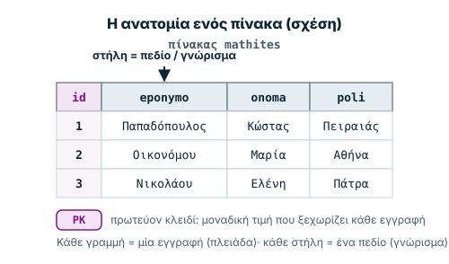
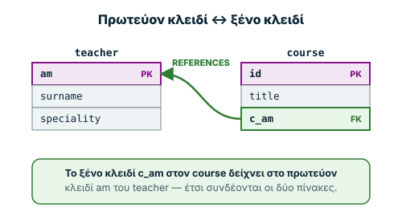
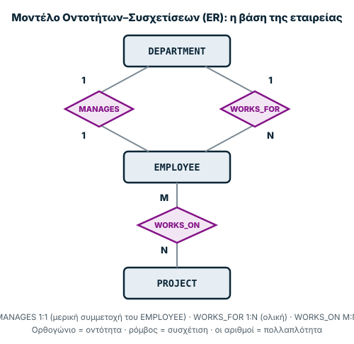

Σημειώσεις μελέτης για την Εβδομάδα 7. Πρώτα χτίζουμε τη θεωρία των **βάσεων
δεδομένων** — τι είναι, πώς τις μοντελοποιούμε (σχεσιακό μοντέλο, μοντέλο ER)
και πώς τις ρωτάμε με **SQL** — και μετά περνάμε στην ασφάλεια: την πιο κλασική
επίθεση σε εφαρμογές που μιλούν με βάση δεδομένων, την **SQL injection**. Όπως
και στην Εβδομάδα 6, κάθε επίθεση παρουσιάζεται **μαζί με την άμυνά της**.

> **Ηθική και νομιμότητα — διάβασέ το πρώτο.** Η SQL injection δείχνεται εδώ
> **μόνο** μέσα από ένα προσομοιωμένο εργαστήριο που τρέχει στον browser σου
> πάνω σε **εικονικά** δεδομένα — τίποτα πραγματικό δεν δοκιμάζεται. Η δοκιμή
> επίθεσης γίνεται **μόνο** σε συστήματα που σου ανήκουν ή για τα οποία έχεις
> **γραπτή άδεια** (π.χ. το εργαστηριακό DVWA σε δική σου εικονική μηχανή). Η
> μη εξουσιοδοτημένη πρόσβαση ή αλλοίωση δεδομένων είναι **ποινικό αδίκημα**.
> Αυτή η σελίδα εξηγεί τον μηχανισμό για να τον **καταλάβεις και να αμυνθείς**.

Η σελίδα έχει τρία μέρη: **Μάθε** (η θεωρία, με διαδραστικά εργαλεία),
**Εργαστήρια** (η επίθεση και η διόρθωσή της, προσομοιωμένα) και **Εξετάσεις**
(επανάληψη και αυτοαξιολόγηση).

**Μαθησιακοί στόχοι.** Μετά τη μελέτη θα μπορείς να:

1. εξηγείς τι είναι μια βάση δεδομένων και ένα ΣΔΒΔ, και τι κάνει μια βάση «καλή»·
2. περιγράφεις το σχεσιακό μοντέλο: πίνακες, εγγραφές, πεδία, **πρωτεύον** και **ξένο κλειδί**·
3. διαβάζεις ένα διάγραμμα **ER** και αναγνωρίζεις πολλαπλότητα **1:1 / 1:N / M:N**·
4. γράφεις βασικά ερωτήματα **SQL** (SELECT, WHERE, INSERT, UPDATE, DELETE, JOIN)·
5. εξηγείς πώς δουλεύει μια **SQL injection** και γιατί συμβαίνει·
6. αμύνεσαι με **παραμετροποιημένα ερωτήματα**, έλεγχο εισόδου και ελάχιστα προνόμια.

## Μάθε

### 1. Τι είναι μια βάση δεδομένων;

Μια **βάση δεδομένων (ΒΔ)** είναι μια οργανωμένη συλλογή από **συσχετιζόμενα**
δεδομένα. Το κλειδί είναι η λέξη «συσχετιζόμενα»: μια ΒΔ αναπαριστά έναν
*μικρόκοσμο* (ένα πανεπιστήμιο, μια εταιρεία, ένα νοσοκομείο) και κρατάει τις
πληροφορίες **και** τις σχέσεις μεταξύ τους — οι καθηγητές διδάσκουν μαθήματα,
τα μαθήματα τα παρακολουθούν φοιτητές κ.ο.κ.

- **ΣΔΒΔ (DBMS):** το λογισμικό που δημιουργεί και διαχειρίζεται τη βάση
  (π.χ. MySQL, Oracle, PostgreSQL, Microsoft Access). *Σύστημα Βάσης Δεδομένων*
  = η βάση **και** το λογισμικό μαζί.

Μια καλά σχεδιασμένη βάση έχει πέντε χαρακτηριστικά:

1. **Χωρίς περιττά δεδομένα** (no redundancy): η ίδια πληροφορία δεν
   αποθηκεύεται δύο φορές — αλλιώς σπαταλάμε χώρο και κινδυνεύουμε με
   **ασυνεπή δεδομένα** (αλλάζει η μία αντιγραφή, ξεχνιέται η άλλη).
2. **Γρήγορη ανάκτηση:** σωστή δομή μέσω **κανονικοποίησης** (normalization).
3. **Ασφάλεια:** ομάδες χρηστών με διαφορετικά **δικαιώματα πρόσβασης** και
   κωδικούς — όχι όλοι βλέπουν τα πάντα (π.χ. η γραμματεία δεν διαβάζει τον
   ιατρικό φάκελο).
4. **Ταυτόχρονη προσπέλαση** (concurrency control): δύο χρήστες δεν κλείνουν
   την ίδια θέση πτήσης ταυτόχρονα.
5. **Αντίγραφα ασφαλείας** (backups): ανάκτηση μετά από κατάρρευση.

Η διαχείριση γίνεται σε **τρία στάδια** — (1) σχεδίαση & υλοποίηση, (2)
καταχώρηση δεδομένων, (3) διαχείριση/ανάκτηση — και η λογική σχεδίαση
στηρίζεται σε ένα **μοντέλο**. Το επικρατέστερο σήμερα είναι το **σχεσιακό
μοντέλο** (relational model, Codd 1970)· παλιότερα υπήρχαν και το ιεραρχικό και
το δικτυωτό. Η γλώσσα για να μιλάμε με τη βάση είναι σχεδόν παντού η **SQL**.

### 2. Το σχεσιακό μοντέλο

Στο σχεσιακό μοντέλο τα δεδομένα ζουν σε **πίνακες** (ο μαθηματικός όρος είναι
*σχέση*, relation). Κάθε **γραμμή** είναι μια **εγγραφή** (ή *πλειάδα*, tuple)
και κάθε **στήλη** ένα **πεδίο** (ή *γνώρισμα*, attribute).



*Σχήμα 1. Η ανατομία ενός πίνακα.*

Δύο έννοιες-κλειδιά (κυριολεκτικά):

- **Πρωτεύον κλειδί (primary key, PK):** ένα πεδίο (ή συνδυασμός) με **μοναδική**
  τιμή για κάθε εγγραφή, που την ξεχωρίζει από όλες τις άλλες. Δύο εγγραφές δεν
  γίνεται να έχουν το ίδιο PK.
- **Ξένο κλειδί (foreign key, FK):** ένα πεδίο ενός πίνακα που **δείχνει** στο
  πρωτεύον κλειδί ενός άλλου πίνακα. Έτσι συνδέονται οι πίνακες μεταξύ τους.



*Σχήμα 2. Το ξένο κλειδί συνδέει δύο πίνακες.*

Πόσες εγγραφές του ενός πίνακα συνδέονται με πόσες του άλλου λέγεται
**πολλαπλότητα** (cardinality), και καθορίζει πού μπαίνει το ξένο κλειδί:

| Πολλαπλότητα | Παράδειγμα | Πού μπαίνει το FK |
| --- | --- | --- |
| **1:1** | τμήμα ↔ ο ένας manager του | σε όποιον από τους δύο πίνακες θέλουμε |
| **1:N** | τμήμα → πολλοί υπάλληλοι | το κλειδί της «1» πλευράς μπαίνει στην «N» |
| **M:N** | υπάλληλοι ↔ projects | χρειάζεται **τρίτος** πίνακας-σύνδεσμος με τα δύο κλειδιά |

Δοκίμασε να κατατάξεις μόνος σου κλειδιά και πολλαπλότητες:

<div data-demo="sql-keys" data-pagefind-ignore>
  Διαδραστική άσκηση κατάταξης (χρειάζεται JavaScript): για κάθε περίπτωση
  διάλεξε αν πρόκειται για πρωτεύον ή ξένο κλειδί, και αν η συσχέτιση είναι
  1:1, 1:N ή M:N.
</div>

### 3. Το μοντέλο Οντοτήτων–Συσχετίσεων (ER)

Πριν φτιάξουμε πίνακες, σχεδιάζουμε τη βάση με ένα **διάγραμμα ER** (Entity
Relationship) — τη διαγραμματική αναπαράσταση της δομής, στο στάδιο του
**εννοιολογικού σχεδιασμού**. Τρεις έννοιες:

- **Οντότητα (entity):** μια αυτόνομη μονάδα του κόσμου που μοντελοποιούμε
  (ένας `EMPLOYEE`, ένα `DEPARTMENT`, ένα `PROJECT`). Σχεδιάζεται με **ορθογώνιο**.
- **Χαρακτηριστικά (attributes):** οι ιδιότητες της οντότητας. Διακρίνονται σε
  **απλής τιμής** (η ηλικία), **πολλαπλής τιμής** (πολλά τηλέφωνα),
  **παραγόμενα** (η ηλικία υπολογίζεται από την ημερομηνία γέννησης) και
  **πεδίο-κλειδί** (ξεχωρίζει τα στιγμιότυπα — γίνεται το PK).
- **Συσχέτιση (relationship):** πώς συνδέονται οι οντότητες. Σχεδιάζεται με
  **ρόμβο** και χαρακτηρίζεται από **πολλαπλότητα** (1:1/1:N/M:N) και
  **συμμετοχή** (ολική ή μερική).



*Σχήμα 3. Το μοντέλο ER της βάσης μιας εταιρείας.*

Από το παράδειγμα της διάλεξης (βάση εταιρείας):

- **WORKS_FOR** (EMPLOYEE–DEPARTMENT): **1:N** — ένα τμήμα έχει πολλούς
  υπαλλήλους, κάθε υπάλληλος σε ένα μόνο τμήμα. Η συμμετοχή του `EMPLOYEE` είναι
  **ολική** (κάθε υπάλληλος *πρέπει* να ανήκει κάπου).
- **MANAGES** (EMPLOYEE–DEPARTMENT): **1:1** — κάθε τμήμα έχει έναν manager. Ο
  `EMPLOYEE` συμμετέχει **μερικά** (δεν είναι όλοι managers). Η συσχέτιση έχει
  και δικό της πεδίο, το `StartDate`.
- **WORKS_ON** (EMPLOYEE–PROJECT): **M:N** — με πεδίο συσχέτισης `HOURS`.

> **Αδύναμη οντότητα (weak entity):** δεν έχει δικό της κλειδί και ξεχωρίζει
> μόνο μέσω της σχέσης της με μια άλλη (τον *κάτοχο*). Παράδειγμα: ο
> `DEPENDENT` (προστατευόμενο μέλος) ξεχωρίζει μέσω του `EMPLOYEE` στον οποίο
> ανήκει.

### 4. Η γλώσσα SQL

Η **SQL** (Structured Query Language) είναι η κοινή γλώσσα όλων των ΣΔΒΔ. Χωρίζεται
σε εντολές που **ορίζουν** τη δομή (DDL) και εντολές που **χειρίζονται** τα
δεδομένα (DML).

**Ορισμός δομής (DDL).** Φτιάχνουμε πίνακα δηλώνοντας τύπους και ιδιότητες πεδίων:

```sql
CREATE TABLE mathites (
  id        INT NOT NULL AUTO_INCREMENT,
  lastname  VARCHAR(45) NOT NULL,
  firstname VARCHAR(45) NOT NULL,
  birthday  DATE,
  afm       CHAR(9) UNIQUE,
  city      VARCHAR(45) DEFAULT "Athens",
  PRIMARY KEY (id)
);
```

Τύποι: `INT`, `FLOAT(m,n)`, `DATE`, `CHAR(m)` (σταθερό μήκος), `VARCHAR(m)`
(μεταβλητό), `ENUM(...)`. Ιδιότητες: `NOT NULL`, `UNIQUE`, `DEFAULT`,
`AUTO_INCREMENT`, `PRIMARY KEY`, `FOREIGN KEY ... REFERENCES`. Αλλάζουμε πίνακα
με `ALTER TABLE`, τον σβήνουμε με `DROP TABLE`, τον αδειάζουμε με `TRUNCATE`.

**Χειρισμός δεδομένων (DML).** Οι τέσσερις βασικές πράξεις:

```sql
INSERT INTO mathites (firstname, lastname) VALUES ("Giannis", "Papadopoulos");
SELECT lastname, firstname FROM mathites WHERE city = "Piraeus";
UPDATE mathites SET city = "Athens" WHERE lastname = "Oikonomou";
DELETE FROM mathites WHERE lastname = "Papadopoulos";
```

Το **SELECT** είναι το πιο πλούσιο. Μερικά εργαλεία του:

- **Φιλτράρισμα:** `WHERE`, με τελεστές σύγκρισης (`= < > <= >= <>`) και
  λογικούς (`AND`, `OR`, `NOT`), εύρος (`BETWEEN`), σύνολο (`IN`).
- **Μοτίβα κειμένου:** `LIKE` με `%` (οποιαδήποτε συμβολοσειρά) και `_` (έναν
  χαρακτήρα): `WHERE city LIKE "A%"`.
- **Συναθροίσεις:** `COUNT`, `SUM`, `AVG`, `MIN`, `MAX` — συχνά με `GROUP BY`
  και φίλτρο ομάδων `HAVING`.
- **Ταξινόμηση/όριο:** `ORDER BY ... ASC|DESC`, `LIMIT n`.
- **Συνενώσεις (JOIN):** συνδυάζουν πίνακες πάνω σε κοινά πεδία (συνήθως
  PK ↔ FK): `SELECT * FROM course JOIN teacher ON course.c_am = teacher.am`.

Δοκίμασε ερωτήματα SELECT πάνω σε μια μικρή, εικονική βάση:

<div data-demo="sql-query" data-pagefind-ignore>
  Διαδραστικός παιχνιδότοπος SQL (χρειάζεται JavaScript): γράψε ένα ερώτημα
  SELECT (με WHERE, LIKE, ORDER BY, LIMIT) και δες το αποτέλεσμα πάνω σε δύο
  πίνακες, products και users.
</div>

### 5. SQL injection — η επίθεση

Μια εφαρμογή Web χτίζει συνήθως τα ερωτήματα SQL **βάζοντας μέσα τους την είσοδο
του χρήστη**. Αν αυτό γίνει με απλή **ένωση κειμένου** (string concatenation),
τότε η είσοδος μπορεί να «ξεφύγει» από τον ρόλο του δεδομένου και να γίνει
**κώδικας SQL**. Αυτό είναι η **SQL injection** — η νούμερο ένα κατηγορία
ευπαθειών σε εφαρμογές (OWASP: *Injection*), και το πρώτο module που δοκιμάζει
κανείς στο εργαστηριακό **DVWA** (Damn Vulnerable Web Application).

Σκέψου μια φόρμα σύνδεσης που φτιάχνει:

```sql
SELECT * FROM users WHERE username = '...' AND password = '...'
```

Αν στο πεδίο του **κωδικού** βάλουμε `' OR '1'='1`, το ερώτημα γίνεται:

```sql
SELECT * FROM users WHERE username = 'admin' AND password = '' OR '1'='1'
```

Επειδή το `AND` **προηγείται** του `OR`, η συνθήκη διαβάζεται ως «(σωστός
χρήστης ΚΑΙ κενός κωδικός) **Ή** `'1'='1'`». Το `'1'='1'` είναι **πάντα
αληθές**, οπότε το WHERE ικανοποιείται για **όλες** τις εγγραφές — **παράκαμψη
σύνδεσης**, χωρίς να χρειάζεται σωστός κωδικός. Μια άλλη παραλλαγή βάζει στο
**όνομα χρήστη** το `admin'#`: ο χαρακτήρας `#` (ή `-- `) ξεκινά **σχόλιο** στη
MySQL, που «κόβει» ό,τι ακολουθεί — άρα και ολόκληρο τον έλεγχο του κωδικού.


*Σχήμα 4. Γιατί περνάει μια SQL injection — και πώς σταματά.*

Η επίθεση δεν σταματά στην παράκαμψη. Με τον τελεστή **`UNION SELECT`** ο
επιτιθέμενος κολλάει στο αποτέλεσμα **δικό του** ερώτημα και διαβάζει άλλους
πίνακες — ακόμη και τα **μεταδεδομένα** της βάσης (στη MySQL, το
`information_schema`), για να ανακαλύψει ονόματα πινάκων και στηλών και μετά να
εξάγει κωδικούς. Το `UNION` απαιτεί **ίδιο πλήθος στηλών** στα δύο ερωτήματα —
γι' αυτό οι επιθέσεις ξεκινούν με `UNION SELECT null, null ...` μέχρι να
«ταιριάξει» ο αριθμός.

Τύποι SQL injection που αναφέρει η διάλεξη:

- **In-band / error-based:** το αποτέλεσμα (ή το μήνυμα σφάλματος) φαίνεται
  κατευθείαν.
- **Boolean-based blind:** δεν βλέπουμε δεδομένα, αλλά η σελίδα απαντά
  διαφορετικά σε αληθές/ψευδές, κι έτσι «μαντεύουμε» bit-bit.
- **Time-based blind:** η απάντηση **αργεί** (π.χ. `SLEEP`) όταν μια συνθήκη
  είναι αληθής.

> Η SQL injection είναι ο «γονιός» μιας ολόκληρης οικογένειας *injection*
> επιθέσεων που εμφανίζονται και στο DVWA: **XSS** (ένεση `<script>` σε HTML)
> και **command injection** (ένεση εντολών λειτουργικού, π.χ. `; whoami`). Η
> ρίζα είναι πάντα η ίδια: **μη έμπιστη είσοδος αντιμετωπίζεται ως κώδικας.**

### 6. SQL injection — η άμυνα

Όλες οι επιθέσεις πάνω έχουν **μία** βασική αιτία και **μία** βασική θεραπεία:
ποτέ μην ανακατεύεις δεδομένα με κώδικα.

1. **Παραμετροποιημένα ερωτήματα / prepared statements** — η πιο σημαντική
   άμυνα. Το ερώτημα στέλνεται με **placeholders** (`?`) και η είσοδος
   περνιέται **χωριστά** ως παράμετρος, οπότε η βάση την αντιμετωπίζει πάντα ως
   δεδομένο, ποτέ ως SQL:

   ```sql
   SELECT * FROM users WHERE username = ? AND password = ?
   -- params: [ username, password ]
   ```

2. **Έλεγχος εισόδου (validation/allow-list):** δέχομαι μόνο αυτό που περιμένω
   (π.χ. το id είναι ακέραιος). Το *escaping* βοηθά αλλά δεν αρκεί μόνο του.
3. **Ελάχιστα προνόμια (least privilege):** ο λογαριασμός της εφαρμογής στη ΒΔ
   έχει μόνο όσα χρειάζεται — όχι δικαίωμα να διαβάζει `information_schema` ή να
   κάνει `DROP`.
4. **ORM / query builders:** παράγουν παραμετροποιημένα ερωτήματα από
   προεπιλογή.
5. **Διαχείριση σφαλμάτων:** γενικά μηνύματα, όχι λεπτομέρειες SQL στον χρήστη
   (τα error-based injections ζουν από αυτά). Και φυσικά **WAF** ως επιπλέον
   στρώμα — όχι ως υποκατάστατο.

## Εργαστήρια

Τα δύο εργαστήρια είναι **προσομοιωμένα**: η «βάση» ζει στον browser σου και τα
ερωτήματα τα χτίζει και τα αναλύει η ίδια η σελίδα. Δες τον μηχανισμό και, με
ένα κλικ, την άμυνα.

### 7. Εργαστήριο: παράκαμψη σύνδεσης (DVWA → SQLi login)

Μια ψεύτικη φόρμα σύνδεσης. Με το ερώτημα φτιαγμένο με **ένωση κειμένου**,
δοκίμασε το κουμπί `' OR '1'='1' #` ή το `admin'#` και δες ότι μπαίνεις χωρίς
σωστό κωδικό (το `#` κόβει ως σχόλιο τον έλεγχο του κωδικού). Μετά γύρισε τον διακόπτη σε **παραμετροποιημένο** και δοκίμασε
ξανά τα ίδια: τώρα η είσοδος είναι απλό κείμενο και η παράκαμψη αποτυγχάνει.

<div data-demo="sql-injection" data-pagefind-ignore>
  Διαδραστικό εργαστήριο σύνδεσης (χρειάζεται JavaScript): φόρμα με όνομα
  χρήστη και κωδικό, διακόπτη ευάλωτου/ασφαλούς ερωτήματος, έτοιμες εισαγωγές
  επίθεσης και εμφάνιση του ερωτήματος που χτίζεται. Όλα προσομοιωμένα.
</div>

> **Παρατήρησε:** στο ευάλωτο ερώτημα, η εισαγωγή σου χρωματίζεται ως μέρος της
> **λογικής** του WHERE. Στο ασφαλές, το ερώτημα μένει `... = ?` και η εισαγωγή
> πάει στις παραμέτρους — ποτέ δεν αγγίζει τη δομή του ερωτήματος.

### 8. Εργαστήριο: διαρροή δεδομένων με UNION (DVWA → UNION-based)

Μια αναζήτηση χρηστών. Στην ευάλωτη έκδοση, το payload
`%' UNION SELECT label, value FROM secrets #` κολλάει ένα δεύτερο ερώτημα και
διαβάζει έναν πίνακα (`secrets`) που η σελίδα **δεν** ήθελε ποτέ να δείξει.
Στην ασφαλή έκδοση το ίδιο κείμενο είναι απλώς ένας (άκαρπος) όρος αναζήτησης.

<div data-demo="sql-union" data-pagefind-ignore>
  Διαδραστικό εργαστήριο αναζήτησης (χρειάζεται JavaScript): διακόπτης
  ευάλωτου/ασφαλούς ερωτήματος, ένα κανονικό όνομα και ένα έτοιμο UNION payload,
  με εμφάνιση του ερωτήματος και του αποτελέσματος. Ο πίνακας secrets περιέχει
  εικονικά «μυστικά».
</div>

### 9. Από την επίθεση στη διόρθωση

Το ζητούμενο δεν είναι να «σπάσεις» μια φόρμα, αλλά να αναγνωρίσεις το **ευάλωτο
μοτίβο** και να το διορθώσεις. Το μοτίβο είναι πάντα ένα string που χτίζεται με
`+` / interpolation γύρω από είσοδο χρήστη:

| Ευάλωτο (μην το γράφεις) | Διορθωμένο |
| --- | --- |
| `"... WHERE user='" + u + "'"` | `"... WHERE user = ?"` + παράμετρος `u` |
| μήνυμα σφάλματος με SQL στον χρήστη | γενικό μήνυμα· SQL μόνο στα logs |
| λογαριασμός ΒΔ με δικαιώματα `DROP` | λογαριασμός με μόνο `SELECT/INSERT` όσο χρειάζεται |
| `id` από το URL μπαίνει ως έχει | `id` ελέγχεται ότι είναι ακέραιος (allow-list) |

Η ίδια λογική («δεδομένο ≠ κώδικας») λύνει και το XSS (escaping/CSP στην έξοδο
HTML) και το command injection (API χωρίς shell, allow-list ορισμάτων).

## Εξετάσεις

### 10. Επαναληπτικός πίνακας

| Θέμα | Τι πρέπει να θυμάσαι |
| --- | --- |
| ΒΔ / ΣΔΒΔ | Συλλογή συσχετιζόμενων δεδομένων· το DBMS τη διαχειρίζεται |
| Καλή βάση | Χωρίς πλεονασμό, κανονικοποίηση, ασφάλεια, concurrency, backups |
| Σχεσιακό μοντέλο | Πίνακας=σχέση, γραμμή=εγγραφή/πλειάδα, στήλη=πεδίο/γνώρισμα |
| Κλειδιά | **PK** = μοναδικό, ξεχωρίζει εγγραφή· **FK** = δείχνει σε PK άλλου πίνακα |
| Πολλαπλότητα | 1:1 (FK όπου θέλω) · 1:N (FK στην «N») · M:N (τρίτος πίνακας) |
| Μοντέλο ER | Οντότητα=ορθογώνιο, συσχέτιση=ρόμβος· συμμετοχή ολική/μερική |
| SQL (DML) | SELECT/INSERT/UPDATE/DELETE· WHERE, LIKE (`%` `_`), JOIN, GROUP BY |
| SQL injection | Ένωση κειμένου → `' OR '1'='1`, `admin'#`, `UNION SELECT` |
| Τύποι SQLi | In-band/error, boolean-blind, time-based blind |
| Άμυνα #1 | **Παραμετροποιημένα ερωτήματα** (prepared statements) |
| Άμυνα (υπόλοιπα) | Validation/allow-list, least privilege, ORM, γενικά σφάλματα, WAF |

### 11. Αυτοαξιολόγηση

<details>
<summary>1. Ποια η διαφορά πρωτεύοντος και ξένου κλειδιού;</summary>

Το **πρωτεύον κλειδί** έχει μοναδική τιμή σε κάθε εγγραφή ενός πίνακα και την
ταυτοποιεί. Το **ξένο κλειδί** είναι πεδίο ενός πίνακα που **δείχνει** στο
πρωτεύον κλειδί ενός άλλου — έτσι συνδέονται οι δύο πίνακες.

</details>

<details>
<summary>2. Ένας υπάλληλος δουλεύει σε πολλά projects και κάθε project έχει πολλούς υπαλλήλους. Τι πολλαπλότητα, και πώς υλοποιείται;</summary>

**M:N**. Υλοποιείται με έναν **τρίτο πίνακα-σύνδεσμο** που περιέχει ως ξένα
κλειδιά τα κλειδιά και των δύο οντοτήτων (και, αν χρειάζεται, πεδία της
συσχέτισης, π.χ. `HOURS`).

</details>

<details>
<summary>3. Τι επιστρέφει το SELECT name FROM products WHERE price > 100 ORDER BY price DESC;</summary>

Τα ονόματα των προϊόντων με τιμή **πάνω από 100**, ταξινομημένα από το
**ακριβότερο** προς το φθηνότερο. (Δοκίμασέ το στον παιχνιδότοπο SQL.)

</details>

<details>
<summary>4. Γιατί το ' OR '1'='1 παρακάμπτει μια σύνδεση;</summary>

Γιατί το ερώτημα χτίζεται με **ένωση κειμένου**: το απόσπασμα (`'`) κλείνει το
κείμενο του ονόματος χρήστη και προσθέτει τη λογική συνθήκη `OR '1'='1'`, που
είναι **πάντα αληθής**. Έτσι το WHERE ικανοποιείται χωρίς σωστό κωδικό.

</details>

<details>
<summary>5. Τι πετυχαίνει ένα UNION SELECT σε μια ευάλωτη αναζήτηση, και τι περιορισμό έχει;</summary>

Κολλάει ένα **δεύτερο** ερώτημα στο αποτέλεσμα και διαβάζει **άλλον πίνακα**
(π.χ. κωδικούς ή μεταδεδομένα από το `information_schema`). Περιορισμός: τα δύο
ερωτήματα πρέπει να έχουν **ίδιο πλήθος στηλών** — γι' αυτό ξεκινά με
`UNION SELECT null, null, ...`.

</details>

<details>
<summary>6. Ποια είναι η νούμερο ένα άμυνα και γιατί δουλεύει;</summary>

Τα **παραμετροποιημένα ερωτήματα / prepared statements**. Το ερώτημα στέλνεται
με placeholders (`?`) και η είσοδος περνιέται **χωριστά** ως παράμετρος, οπότε η
βάση την αντιμετωπίζει πάντα ως **δεδομένο** και ποτέ ως κώδικα SQL — η είσοδος
δεν μπορεί να αλλάξει τη δομή του ερωτήματος.

</details>

<details>
<summary>7. Σε μια σελίδα η είσοδος του χρήστη εμφανίζεται ατόφια στο HTML. Ποια συγγενική επίθεση κινδυνεύει, και ποια η κοινή ρίζα με την SQL injection;</summary>

**XSS** (Cross-Site Scripting). Κοινή ρίζα: **μη έμπιστη είσοδος αντιμετωπίζεται
ως κώδικας** αντί για δεδομένο — εδώ ως HTML/JavaScript αντί για SQL. Άμυνα:
escaping στην έξοδο και Content-Security-Policy.

</details>
