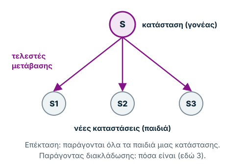
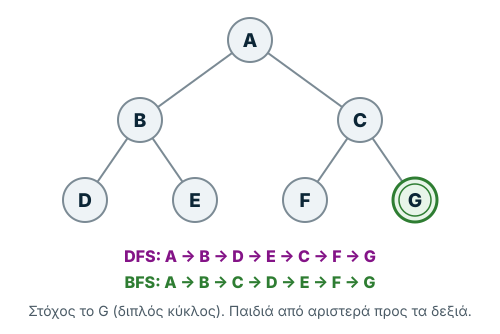
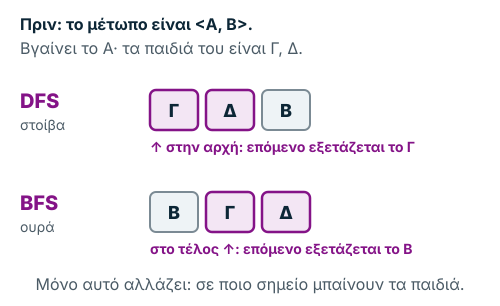
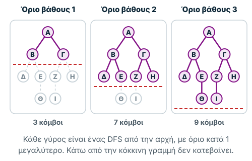
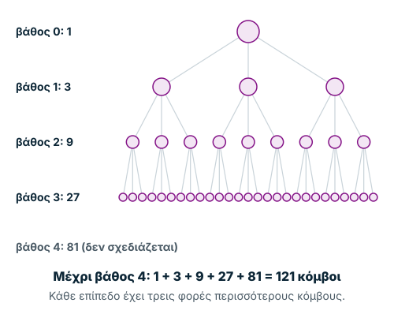
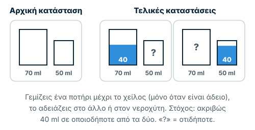
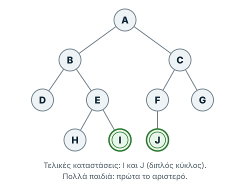
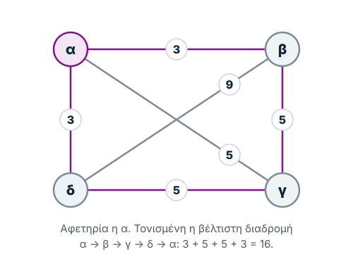
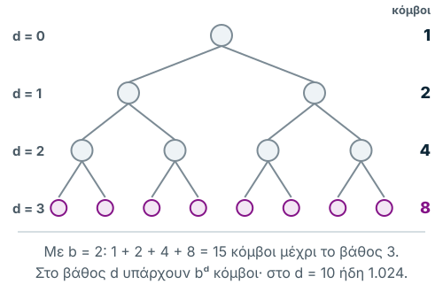
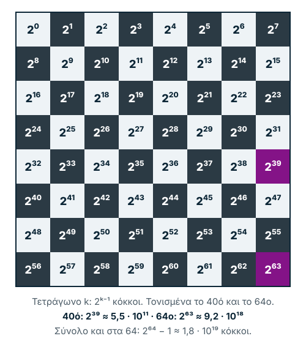

Σημειώσεις μελέτης βασισμένες στη Διάλεξη 2 του μαθήματος. Οι διαφάνειες, με
τις ασκήσεις πάνω σε δένδρα και λαβυρίνθους, βρίσκονται στο Moodle.

Την προηγούμενη εβδομάδα είδαμε πώς περιγράφουμε ένα πρόβλημα με χώρο
καταστάσεων. Τώρα περνάμε στο δεύτερο μισό: πώς ψάχνουμε **συστηματικά** τη
λύση. Ξεκινάμε από τους **τυφλούς** αλγορίθμους, που δεν ξέρουν τίποτα για το
πόσο κοντά είναι μια κατάσταση στον στόχο.

Η σελίδα έχει τρία μέρη. Το **Μάθε** είναι μια σύντομη πρώτη ανάγνωση, με τον
διαδραστικό visualizer και ένα μικρό quiz. Το **Εφάρμοσε** έχει τα παραδείγματα
της διάλεξης και ασκήσεις. Το **Εμβάθυνε** έχει τον αναλυτικό ψευδοκώδικα, τη
θεωρία πολυπλοκότητας και τις διορθώσεις των διαφανειών.

**Τι θα μάθεις.** Μετά την ενότητα θα μπορείς να:

1. Εξηγείς τι σημαίνει τυφλή αναζήτηση.
2. Ξεχωρίζεις κατάσταση, κόμβο, αρχική κατάσταση και στόχο.
3. Παρακολουθείς πώς ενημερώνονται Μέτωπο και Κλειστό.
4. Εκτελείς DFS και BFS σε ένα μικρό δέντρο.
5. Αναγνωρίζεις την ιδέα των Iterative Deepening, Bidirectional Search και
   Branch & Bound.
6. Διακρίνεις πληρότητα, βελτιστότητα, χρόνο και μνήμη.

## Μάθε

### 1. Τι είναι η τυφλή αναζήτηση;

Φαντάσου ότι ψάχνεις την έξοδο ενός λαβυρίνθου χωρίς χάρτη. Δεν γνωρίζεις ποια
διαδρομή σε φέρνει πιο κοντά στον στόχο. Μπορείς όμως να εξερευνήσεις
συστηματικά τις διαθέσιμες επιλογές.

Αυτή είναι η **τυφλή αναζήτηση** (*Uninformed Search* ή *blind search*):
εξερεύνηση καταστάσεων χωρίς ευριστική εκτίμηση του πόσο κοντά βρίσκονται στον
στόχο. Ο αλγόριθμος χρησιμοποιεί τον ορισμό του προβλήματος (αρχή, διαθέσιμες
ενέργειες, έλεγχο στόχου και ενδεχομένως κόστος), αλλά όχι μια συνάρτηση h(n)
που προβλέπει την απόσταση από τον στόχο.

Οι τυφλοί αλγόριθμοι εφαρμόζονται όταν το πρόβλημα έχει **μικρό χώρο
αναζήτησης** και **δεν υπάρχει πληροφορία αξιολόγησης** των καταστάσεων, δηλαδή
δεν ξέρουμε πόσο «καλή» είναι μια κατάσταση. Αντιμετωπίζουν με τον ίδιο ακριβώς
τρόπο οποιοδήποτε πρόβλημα καλούνται να λύσουν, και είναι ανεξάρτητοι από το
περιεχόμενο των καταστάσεων: καθορίζουν **μόνο τη σειρά** με την οποία
επεκτείνονται οι καταστάσεις.

> **Θυμήσου:** Η διαφορά των αλγορίθμων είναι κυρίως *ποια κατάσταση επιλέγουν
> να εξετάσουν στη συνέχεια*.

| Όνομα αλγορίθμου | Συντομογραφία | Ελληνική ορολογία |
| --- | --- | --- |
| Depth-First Search | DFS | Αναζήτηση πρώτα σε βάθος |
| Breadth-First Search | BFS | Αναζήτηση πρώτα σε πλάτος |
| Iterative Deepening | ID | Επαναληπτική εκβάθυνση |
| Bi-directional Search | BiS | Αναζήτηση διπλής κατεύθυνσης |
| Branch and Bound | B&B | Επέκταση και οριοθέτηση |
| Beam Search | BS | Ακτινωτή αναζήτηση |

Η ακτινωτή αναζήτηση χρησιμοποιεί ευριστική συνάρτηση, γι' αυτό την εξετάζουμε
αναλυτικά στην [Εβδομάδα 3](../3/).

### 2. Οι βασικές έννοιες

| Έννοια | Απλή εξήγηση |
| --- | --- |
| Κατάσταση (State) | Μια συγκεκριμένη διαμόρφωση του προβλήματος |
| Κόμβος (Node) | Μια εγγραφή αναζήτησης που περιγράφει κατάσταση και συνήθως γονέα, βάθος ή κόστος |
| Αρχική κατάσταση | Το σημείο εκκίνησης |
| Στόχος (Goal) | Η κατάσταση που θέλουμε να βρούμε |
| Παιδιά (Children) | Οι καταστάσεις που παράγονται με επιτρεπτές ενέργειες |
| Μέτωπο (Frontier/Open) | Κόμβοι που έχουν ανακαλυφθεί αλλά δεν έχουν επεκταθεί |
| Κλειστό (Closed/Explored) | Καταστάσεις που έχουν ήδη εξεταστεί/επεκταθεί, ανάλογα με τη σύμβαση της υλοποίησης |

> **Προσοχή:** Το δέντρο αναζήτησης μπορεί να περιέχει διαφορετικούς κόμβους που
> αντιστοιχούν στην ίδια κατάσταση. Ο έλεγχος επαναλήψεων αποτρέπει άσκοπες
> επιστροφές.

<details>
<summary>Αναλυτικά: τα μέρη του δένδρου αναζήτησης στη διάλεξη</summary>

Ο χώρος αναζήτησης μπορεί να αναπαρασταθεί με **γράφο**. Όταν τον ξεδιπλώνουμε
από την αρχική κατάσταση, παίρνει τη μορφή ενός **δένδρου αναζήτησης**, και
κάθε κομμάτι του δένδρου έχει ένα νόημα:

| Τμήμα δένδρου | Τι αναπαριστά |
| --- | --- |
| Κόμβος (node) | μια κατάσταση |
| Ρίζα (root) | την αρχική κατάσταση |
| Φύλλο (tip, leaf) ή τερματικός κόμβος | μια τελική κατάσταση ή ένα αδιέξοδο (dead node), δηλαδή μια κατάσταση στην οποία δεν εφαρμόζεται κανένας τελεστής μετάβασης |
| Κλαδί (branch) | έναν τελεστή μετάβασης, που μετατρέπει μια κατάσταση-γονέα (parent state) σε μια κατάσταση-παιδί (child state) |
| Λύση (solution) | ένα μονοπάτι (path) που ενώνει την αρχική κατάσταση με μια τελική |
| Επέκταση (expansion) | τη διαδικασία που παράγει όλες τις καταστάσεις-παιδιά ενός κόμβου |
| Παράγοντας διακλάδωσης (branching factor) | πόσες καταστάσεις-παιδιά προκύπτουν από την επέκταση μιας κατάστασης. Επειδή δεν είναι σταθερός αριθμός, λέγεται και μέσος παράγοντας διακλάδωσης (average branching factor) |



*Σχήμα 1. Η επέκταση μιας κατάστασης: οι τελεστές μετάβασης παράγουν τα παιδιά της.*

</details>

**Μικρό παράδειγμα.** Σε όλο το «Μάθε» χρησιμοποιούμε το ίδιο μικρό δέντρο, με
στόχο το G. Υποθέτουμε ότι τα παιδιά παράγονται από αριστερά προς τα δεξιά. Η
ακριβής σειρά εξαρτάται από αυτή τη σύμβαση.



*Σχήμα 2. Το μικρό δέντρο του παραδείγματος και η σειρά με την οποία το
εξερευνούν ο DFS και ο BFS.*

### 3. Πώς συνεργάζονται Μέτωπο και Κλειστό;

Στην αρχή το Μέτωπο περιέχει μόνο την αρχική κατάσταση A και το Κλειστό είναι
άδειο. Σε κάθε βήμα επιλέγουμε έναν κόμβο από το Μέτωπο, ελέγχουμε αν είναι
στόχος και, αν όχι, παράγουμε τα παιδιά του. Οι ήδη εξετασμένες καταστάσεις
καταγράφονται στο Κλειστό, εφόσον η υλοποίηση χρησιμοποιεί τέτοιο σύνολο.

Σε αυτή τη σελίδα, όπως στη διάλεξη και στον visualizer, η σύμβαση είναι μία:
βγαίνει η **πρώτη** κατάσταση του Μετώπου· αν είναι ήδη στο Κλειστό, δεν
επεκτείνεται ξανά (ο visualizer το γράφει «Βρόχος»)· ο έλεγχος στόχου γίνεται
τη στιγμή που βγαίνει από το Μέτωπο· αλλιώς τα παιδιά της μπαίνουν στο Μέτωπο
και η ίδια μπαίνει στο Κλειστό.

Ο τρόπος με τον οποίο **εισάγονται και αφαιρούνται** κόμβοι από το Μέτωπο
καθορίζει αν η συμπεριφορά μοιάζει με DFS ή BFS.



*Σχήμα 3. Το ίδιο βήμα στον DFS και στον BFS: τα παιδιά μπαίνουν στην αρχή ή στο τέλος του μετώπου.*

### 4. DFS — Depth-First Search

Ο **DFS** εξερευνά πρώτα έναν κλάδο όσο πιο βαθιά μπορεί και μετά επιστρέφει
για να δοκιμάσει άλλες επιλογές. Χρησιμοποιεί λογική **στοίβας (LIFO)**: ο πιο
πρόσφατα τοποθετημένος κόμβος εξετάζεται πρώτος, γιατί τα παιδιά μπαίνουν στην
**αρχή** του Μετώπου.

Με επιλογή αριστερού παιδιού πρώτα, η σειρά στο παράδειγμα είναι:

`A → B → D → E → C → F → G`

**Πλεονέκτημα:** Σε υλοποίηση δέντρου χωρίς πλήρες σύνολο επισκέψεων μπορεί να
χρειάζεται σχετικά λίγη μνήμη, γιατί κρατά βασικά μόνο το τρέχον κλαδί.

**Μειονέκτημα:** Μπορεί να χαθεί σε πολύ βαθύ ή άπειρο κλάδο. Δεν εγγυάται
διαδρομή ελάχιστου βάθους: η πρώτη λύση που βρίσκει **δεν είναι απαραίτητα η
καλύτερη**. Αν δεν ελέγχει για κύκλους ή αν ο χώρος είναι άπειρος, **δεν είναι
πλήρης**· αν ο χώρος αναζήτησης είναι **πεπερασμένος** και χρησιμοποιεί
κλειστό σύνολο, **είναι πλήρης**.

**Για τις εξετάσεις:** DFS = «προχωρώ βαθιά και μετά επιστρέφω».

### 5. BFS — Breadth-First Search

Ο **BFS** εξερευνά πρώτα όλους τους κόμβους του ίδιου βάθους και μετά προχωρά
στο επόμενο επίπεδο. Χρησιμοποιεί **ουρά (FIFO)**: ο κόμβος που μπήκε πρώτος
εξετάζεται πρώτος, γιατί τα παιδιά μπαίνουν στο **τέλος** του Μετώπου.

Στο παράδειγμα:

`A → B → C → D → E → F → G`

**Πλεονέκτημα:** Με πεπερασμένο αριθμό παιδιών ανά κόμβο είναι πλήρης και
βρίσκει λύση ελάχιστου βάθους. Στο πρόβλημα των ποτηριών της Εβδομάδας 1, η
λύση των έξι κινήσεων είναι ακριβώς αυτή που βρίσκει ο BFS: δεν υπάρχει λύση
με λιγότερες.

**Μειονέκτημα:** Μπορεί να χρειαστεί πολλή μνήμη επειδή αποθηκεύει πολλούς
κόμβους του ίδιου επιπέδου. Το επίπεδο μεγαλώνει εκθετικά (`$b^d$`), οπότε σε
πραγματικά προβλήματα συχνά σταματά επειδή τελειώνει η μνήμη.

> **Προσοχή:** Η διαδρομή με τις λιγότερες ακμές δεν είναι απαραίτητα η
> φθηνότερη όταν τα κόστη ακμών διαφέρουν.

### 6. DFS vs BFS με μία ματιά

| Κριτήριο | DFS | BFS |
| --- | --- | --- |
| Δομή Μετώπου | Στοίβα / LIFO | Ουρά / FIFO |
| Στρατηγική | Πρώτα βάθος | Πρώτα πλάτος |
| Πλήρης; | Όχι γενικά σε άπειρους χώρους | Ναι, με πεπερασμένη διακλάδωση |
| Βέλτιστος; | Όχι γενικά | Ναι σε αριθμό βημάτων· σε κόστος αν όλα τα βήματα κοστίζουν το ίδιο |
| Κύριος κίνδυνος | Βαθύς/άπειρος κλάδος | Μεγάλη κατανάλωση μνήμης |

### 7. Δοκίμασε τον visualizer

Όλοι οι αλγόριθμοι της εβδομάδας σε ένα εργαλείο. Ο **DFS**, ο **BFS** και η
**ID** τρέχουν στο δένδρο των ποτηριών της διάλεξης (ενότητα «Εφάρμοσε»). Η
**BiS**, ο **B&B** και η **Beam Search** (της Εβδομάδας 3) τρέχουν σε ένα μικρό
δένδρο με κόστη και ευριστικές τιμές, που φτιάξαμε για το εργαλείο. Δοκίμασε
με τη σειρά:

1. Επίλεξε DFS και παρακολούθησε τη σειρά εξερεύνησης.
2. Παρατήρησε πώς αλλάζουν τα πεδία **Μέτωπο** και **Κλειστό** σε κάθε βήμα.
3. Δες τον τρέχοντα κόμβο και τον κλάδο που επισημαίνονται στο δέντρο.
4. Επανάλαβε με BFS στο **ίδιο** πρόβλημα.
5. Σύγκρινε σε ποιο βήμα οι δύο αλγόριθμοι επιλέγουν διαφορετικό κόμβο.
6. Χρησιμοποίησε το πρόβλημα με τα δύο ποτήρια νερού για να συνδέσεις το δέντρο
   με πραγματικές καταστάσεις.

Πριν πατήσεις «Επόμενο», ρώτα τον εαυτό σου: **ποιος κόμβος θα επιλεγεί στο
επόμενο βήμα και γιατί;** Στον DFS επιλέγεται ο πρώτος κόμβος του Μετώπου
σύμφωνα με τη στοίβα: τα νέα παιδιά αποκτούν προτεραιότητα έναντι των
παλαιότερων επιλογών. Στον BFS επιλέγεται ο παλαιότερος κόμβος του Μετώπου: τα
νέα παιδιά μπαίνουν στο τέλος της ουράς. Σύγκρινε, για παράδειγμα, πόσα βήματα
χρειάζονται ο DFS και ο BFS μέχρι το Κ (40, 50).

<div data-demo="search-explorer" data-pagefind-ignore>
<p>Το διαδραστικό παράδειγμα χρειάζεται JavaScript. Ο πίνακας του DFS βρίσκεται
στη διαφάνεια 21 της διάλεξης.</p>
</div>

### 8. Iterative Deepening (ID)

Η **επαναληπτική εκβάθυνση** (*Iterative Deepening*, ID ή IDDFS) επαναλαμβάνει
DFS με αυξανόμενο όριο βάθους μέχρι να βρεθεί στόχος. Κάθε γύρος ξεκινά **από
την αρχή** με μεγαλύτερο όριο.

Γιατί το κάνουμε; Ο DFS μπορεί να κατέβει υπερβολικά βαθιά, ενώ ο BFS απαιτεί
πολλή μνήμη. Η ID συνδυάζει τη μικρή μνήμη της αναζήτησης βάθους με την εύρεση
λύσης ελάχιστου βάθους, όταν τα κόστη βημάτων είναι ίσα και η διακλάδωση
πεπερασμένη.

**Παράδειγμα:** Στο όριο 0 εξετάζουμε μόνο το A. Στο όριο 1 εξετάζουμε A, B, C.
Στο όριο 2 φτάνουμε και στα D, E, F, G.

> **Προσοχή:** Η διάλεξη (και ο visualizer) ξεκινά από **όριο 1**, όχι από 0, με
> βήμα 1. Τα όρια 1 και 2 του παραδείγματος δίνουν τα ίδια αποτελέσματα και με
> τις δύο συμβάσεις.



*Σχήμα 4. Επαναληπτική εκβάθυνση: κάθε γύρος είναι ένας DFS από την αρχή, με λίγο βαθύτερο όριο.*

Η ID είναι **πλήρης** και δεν χάνεται σε ατελείωτα κλαδιά. Το κόστος της είναι
ότι κάθε γύρος ξαναεξετάζει τα πάνω επίπεδα, αλλά αυτό κοστίζει λιγότερο απ'
όσο φαίνεται (ενότητα «Εμβάθυνε»).

### 9. Bidirectional Search

Η **αμφίδρομη αναζήτηση** ή **αναζήτηση διπλής κατεύθυνσης** (*Bi-directional
Search*, BiS) ξεκινά μία αναζήτηση από την αρχή και μία από τον στόχο. Αν οι δύο
αναζητήσεις συναντηθούν σε μια κοινή κατάσταση, οι διαδρομές μπορούν να
ενωθούν.

**Παράδειγμα:** Αν ψάχνουμε διαδρομή από A προς G, αναζητούμε ταυτόχρονα από A
προς τα εμπρός και από G προς τα πίσω.

**Προϋπόθεση:** Πρέπει να είναι εφικτή η αναζήτηση προς τα πίσω (οι κινήσεις
να **αντιστρέφονται**, ή να μπορούμε να παράγουμε προηγούμενες καταστάσεις), η
τελική κατάσταση να είναι **γνωστή** από πριν, και να αναγνωρίζουμε πότε
συναντιούνται τα δύο μέτωπα.

Δύο αναζητήσεις μέχρι τη μέση (βάθος `$d/2$`) εξετάζουν πολύ λιγότερους κόμβους
από μία μέχρι το τέλος: περίπου `$2 \cdot b^{d/2}$` αντί για `$b^d$`. Από την
άλλη, οι δύο αναζητήσεις πρέπει συνεχώς να ελέγχουν αν συναντήθηκαν, κάτι που
έχει επιπλέον κόστος.


*Σχήμα 5. Μία αναζήτηση μέχρι το βάθος d, ή δύο που συναντιούνται στη μέση.*

### 10. Branch & Bound

Ο **Branch & Bound** (B&B, επέκταση και οριοθέτηση) αναζητά λύση **ελάχιστου
κόστους** και χρησιμοποιεί ένα όριο για να απορρίπτει κλάδους που δεν μπορούν
να δώσουν καλύτερο αποτέλεσμα. Το όριο είναι το κόστος της καλύτερης λύσης που
έχει βρει μέχρι στιγμής (στην αρχή, άπειρο), και μικραίνει κάθε φορά που
βρίσκει φθηνότερη λύση. Στη συνηθισμένη του μορφή εξερευνά σαν τον DFS.

**Παράδειγμα:** Έχουμε ήδη βρει πλήρη διαδρομή κόστους 100. Αν μια άλλη μερική
διαδρομή έχει ήδη κόστος 120 και τα επιπλέον κόστη δεν είναι αρνητικά, δεν
υπάρχει λόγος να τη συνεχίσουμε.

> **Θυμήσου:** Δεν απορρίπτουμε κλάδο επειδή απλώς φαίνεται κακός, αλλά επειδή
> ένα έγκυρο κάτω φράγμα δείχνει ότι δεν μπορεί να βελτιώσει την καλύτερη
> γνωστή λύση.

Ένα πλήρες παράδειγμα, ο πλανόδιος πωλητής, βρίσκεται στο «Εφάρμοσε».

### 11. Γιατί η αναζήτηση γίνεται ακριβή;

Αν κάθε κόμβος παράγει κατά μέσο όρο **b** παιδιά και εξετάζουμε μέχρι βάθος
**d**, το πλήθος των κόμβων σε ένα πλήρες δέντρο είναι:

```math
1 + b + b^2 + \cdots + b^d = \frac{b^{d+1} - 1}{b - 1}, \quad b \ne 1
```

Για παράδειγμα, με b = 3 και d = 4 προκύπτουν 1 + 3 + 9 + 27 + 81 = **121
κόμβοι**.



*Σχήμα 6. Με τρία παιδιά ανά κόμβο, κάθε επίπεδο έχει τρεις φορές περισσότερους
κόμβους από το προηγούμενο.*

Αυτό εξηγεί γιατί ακόμη και μια μικρή αύξηση βάθους μπορεί να αυξήσει δραματικά
τον χρόνο και τη μνήμη. Η ακριβής πολυπλοκότητα εξαρτάται από τον αλγόριθμο και
την υλοποίηση. Αναλυτικοί πίνακες και το παράδειγμα της σκακιέρας βρίσκονται
στο «Εμβάθυνε».

### 12. Πληρότητα και βελτιστότητα

Ένας αλγόριθμος είναι **πλήρης** (*complete*) αν εγγυάται εύρεση λύσης εφόσον
υπάρχει, υπό συγκεκριμένες προϋποθέσεις, και **βέλτιστος** (*optimal*) αν
εγγυάται λύση με το μικρότερο κόστος (π.χ. τις λιγότερες κινήσεις), επίσης υπό
συγκεκριμένες προϋποθέσεις. Μην τα συγχέεις: ένας αλγόριθμος μπορεί να βρίσκει
*κάποια* λύση χωρίς να βρίσκει την καλύτερη.

Η διάλεξη κοιτάζει σε έναν αλγόριθμο και τρία ακόμη χαρακτηριστικά. Είναι
**αποδεκτός** (*admissible*) αν βρίσκει πάντα τη βέλτιστη λύση, αν υπάρχει, και
**εξαντλητικός** (*exhaustive*) αν εξετάζει ολόκληρο τον χώρο αναζήτησης. Η
**μνήμη** του είναι πόσες καταστάσεις κρατά ταυτόχρονα στο μέτωπο.

### 13. Αυτοαξιολόγηση

<details>
<summary>1. Ποιος αλγόριθμος εξετάζει πρώτα τους κόμβους μικρότερου βάθους;</summary>

BFS.

</details>

<details>
<summary>2. Γιατί ο DFS μπορεί να μη βρει λύση ενώ αυτή υπάρχει;</summary>

Μπορεί να συνεχίζει σε άπειρο κλάδο χωρίς να επιστρέφει στις άλλες επιλογές.

</details>

<details>
<summary>3. Ποια είναι η βασική διαφορά στο Μέτωπο;</summary>

DFS: LIFO/στοίβα, τα παιδιά μπαίνουν στην αρχή. BFS: FIFO/ουρά, τα παιδιά
μπαίνουν στο τέλος. Όλα τα άλλα βήματα του γενικού αλγορίθμου είναι ίδια.

</details>

<details>
<summary>4. Ο BFS βρίσκει πάντα τη διαδρομή με το μικρότερο συνολικό κόστος;</summary>

Όχι, μόνο όταν τα κόστη βημάτων είναι ίσα (ή σε αντίστοιχες ειδικές συνθήκες).

</details>

<details>
<summary>5. Τι κάνει ο Iterative Deepening;</summary>

Επαναλαμβάνει DFS αυξάνοντας σταδιακά το όριο βάθους.

</details>

<details>
<summary>6. Γιατί ο BFS συχνά δεν χρησιμοποιείται σε μεγάλα προβλήματα, παρόλο που βρίσκει τη συντομότερη λύση;</summary>

Γιατί το μέτωπό του κρατά σχεδόν όλο ένα επίπεδο του δένδρου, και τα επίπεδα
μεγαλώνουν εκθετικά. Η μνήμη τελειώνει πριν βρεθεί η λύση.

</details>

<details>
<summary>7. Τι προϋποθέσεις χρειάζεται η αναζήτηση διπλής κατεύθυνσης;</summary>

Κινήσεις που αντιστρέφονται, ώστε να μπορείς να ψάξεις «προς τα πίσω» από τον
στόχο, και μια τελική κατάσταση που είναι γνωστή από πριν.

</details>

<details>
<summary>8. Στον B&B, γιατί μπορούμε να πετάξουμε μια μερική διαδρομή με κόστος 17 όταν έχουμε ήδη λύση με κόστος 16;</summary>

Γιατί το κόστος μιας διαδρομής μόνο μεγαλώνει όσο τη συνεχίζουμε (οι αποστάσεις
είναι θετικές). Μια διαδρομή που κοστίζει ήδη 17 δεν μπορεί να καταλήξει
φθηνότερη από 16.

</details>

### 14. Σύνοψη μίας σελίδας

| Αλγόριθμος | Κεντρική ιδέα |
| --- | --- |
| DFS | Προχωρά όσο πιο βαθιά μπορεί |
| BFS | Εξερευνά επίπεδο προς επίπεδο |
| IDDFS | DFS με όλο και μεγαλύτερο όριο βάθους |
| Bidirectional | Αναζήτηση από αρχή και στόχο ταυτόχρονα |
| Branch & Bound | Απορρίπτει κλάδους που δεν μπορούν να βελτιώσουν τη λύση |

## Εφάρμοσε

### Το πρόβλημα των ποτηριών

Το παράδειγμα που ακολουθεί όλη τη διάλεξη. Έχουμε ένα ποτήρι των 70 ml και ένα
των 50 ml, αρχικά άδεια. Τα ποτήρια μπορούν να **γεμίζουν μέχρι το χείλος**
από μια βρύση, **μόνο όταν είναι άδεια**, και να **αδειάζουν** είτε το ένα μέσα
στο άλλο είτε στον νεροχύτη. Στόχος είναι να έχουμε **ακριβώς 40 ml** σε
οποιοδήποτε από τα δύο ποτήρια· τι έχει το άλλο δεν μας ενδιαφέρει.



*Σχήμα 7. Το πρόβλημα των ποτηριών: η αρχική κατάσταση και οι τελικές.*

Το δένδρο αναζήτησης αυτού του προβλήματος, με τις καταστάσεις Α έως Κ, είναι
αυτό που χρησιμοποιεί η διάλεξη για τον DFS, τον BFS και την ID, και αυτό που
ανοίγει ο visualizer της ενότητας 7. Εκεί φαίνεται και ο πλήρης πίνακας
εκτέλεσης κάθε αλγορίθμου, βήμα-βήμα, με το Μέτωπο και το Κλειστό.

### DFS και BFS στο ίδιο δέντρο

Στο δένδρο παρακάτω οι τελικές καταστάσεις είναι οι **I** και **J**. Όταν ένας
κόμβος έχει πολλά παιδιά, εξετάζεις πρώτα το αριστερό. Προσπάθησε να γράψεις
τη σειρά πριν ανοίξεις τη λύση.



*Σχήμα 8. Το δένδρο της εξάσκησης. Τελικές καταστάσεις τα I και J.*

<details>
<summary>Με ποια σειρά εξετάζει τους κόμβους ο DFS;</summary>

A → B → D → E → H → **I**. Κατεβαίνει πρώτα το αριστερό κλαδί (B, D) και, όταν
φτάνει σε αδιέξοδο στο D, γυρίζει στο E.

</details>

<details>
<summary>Με ποια σειρά εξετάζει τους κόμβους ο BFS;</summary>

A → B → C → D → E → F → G → H → **I**. Πρώτα όλο το επίπεδο 1 (B, C), μετά όλο
το επίπεδο 2 (D, E, F, G), και στο επίπεδο 3 βρίσκει το I.

</details>

<details>
<summary>Και η ID, με αρχικό όριο βάθους 1 και βήμα 1;</summary>

- Όριο 1: A → B → C
- Όριο 2: A → B → D → E → C → F → G
- Όριο 3: A → B → D → E → H → **I**

Η λύση βρίσκεται στον τρίτο γύρο, στο ίδιο βάθος με τον BFS, αλλά με τη μνήμη
του DFS.

</details>

### Ο λαβύρινθος ως πρόβλημα

Για να ψάξεις διαδρομή σε έναν λαβύρινθο, πρώτα τον γράφεις ως πρόβλημα
(I, G, T, S):

- χωρίζεις τον χάρτη σε **πλέγμα** και κάθε τετράγωνο είναι μια θέση pos(X, Y)·
- **S**: όλες οι ελεύθερες θέσεις (όχι οι τοίχοι)·
- **I**: η θέση της εισόδου, **G**: η θέση της εξόδου·
- **T**: τέσσερις κινήσεις: αριστερά, πάνω, δεξιά, κάτω (χωρίς διαγώνιες), αρκεί
  η νέα θέση να είναι ελεύθερη.

Ο DFS θα ακολουθήσει έναν διάδρομο μέχρι το τέλος του πριν δοκιμάσει άλλον, ενώ
ο BFS θα «απλωθεί» γύρω από την είσοδο σαν κύμα, βρίσκοντας τη συντομότερη
διαδρομή.

Στο σχήμα, ένας μικρός λαβύρινθος (δικό μας παράδειγμα, όχι αυτός της διάλεξης)
με τη σειρά κινήσεων της διάλεξης: αριστερά, πάνω, δεξιά, κάτω. Ο DFS προτιμά το
«πάνω», παίρνει τον γύρο από ψηλά και βρίσκει διαδρομή 14 βημάτων αφού εξετάσει
και τις 37 ελεύθερες θέσεις. Ο BFS βρίσκει την ευθεία διαδρομή των 10 βημάτων,
εξετάζοντας 33.


*Σχήμα 9. Ο ίδιος λαβύρινθος με DFS (πάνω) και BFS (κάτω).*

### Branch & Bound: ο πλανόδιος πωλητής με 4 πόλεις

Ο πωλητής ξεκινά από την πόλη α, πρέπει να περάσει **μία φορά** από κάθε πόλη
και να γυρίσει στην α, διανύοντας τη μικρότερη δυνατή απόσταση. Οι αποστάσεις
στο παράδειγμά μας:

- α–β: **3**, α–γ: **5**, α–δ: **3**
- β–γ: **5**, β–δ: **9**
- γ–δ: **5**



*Σχήμα 10. Οι τέσσερις πόλεις και οι αποστάσεις τους.*

Ο B&B δοκιμάζει τις διαδρομές με τη σειρά, σαν DFS:

1. **α→β→γ→δ→α**: 3 + 5 + 5 + 3 = **16**. Πρώτη πλήρης λύση· το όριο γίνεται
   **16**.
2. **α→β→δ→γ**: ήδη 3 + 9 + 5 = 17 > 16, άρα **κλάδεμα** πριν καν γυρίσει
   στην α.
3. **α→γ→β→δ**: ήδη 5 + 5 + 9 = 19, **κλάδεμα**.
4. **α→γ→δ→β**: ήδη 5 + 5 + 9 = 19, **κλάδεμα**.
5. **α→δ→β→γ**: ήδη 3 + 9 + 5 = 17, **κλάδεμα**.
6. **α→δ→γ→β→α**: 3 + 5 + 5 + 3 = 16, ίσο με το όριο, άρα όχι καλύτερη. Είναι η
   ίδια διαδρομή με την πρώτη, ανάποδα.


*Σχήμα 11. Branch & Bound: μετά την πρώτη λύση, τέσσερις διαδρομές κλαδεύονται.*

Η βέλτιστη διαδρομή είναι **α→β→γ→δ→α με κόστος 16**. Μόλις βρέθηκε μια καλή
λύση, τέσσερις από τις υπόλοιπες πέντε διαδρομές σταμάτησαν πριν
ολοκληρωθούν. Σε μεγαλύτερα προβλήματα το κλάδεμα γίνεται πιο ψηλά στο δένδρο
και εξοικονομεί τεράστιο αριθμό καταστάσεων.

Γιατί χρειάζεται κάτι τέτοιο; Με `$N$` πόλεις υπάρχουν `$(N-1)!$` διαφορετικές
διαδρομές. Για 20 πόλεις είναι περίπου 1,2 × 10¹⁷, πάρα πολλές για να τις
δοκιμάσεις όλες. Ο πλανόδιος πωλητής είναι ένα από τα γνωστά **NP-πλήρη**
προβλήματα, για τα οποία δεν ξέρουμε γρήγορο αλγόριθμο.

Το πόσο βοηθά ο B&B εξαρτάται από το **πόσο νωρίς** βρίσκει μια καλή λύση. Αν
οι λύσεις βρεθούν από τη χειρότερη προς την καλύτερη, μπορεί να μην κλαδέψει
σχεδόν τίποτα και να δουλέψει σαν απλός DFS.

## Εμβάθυνε

### Ο γενικός αλγόριθμος αναζήτησης

Όλοι οι αλγόριθμοι αυτής της εβδομάδας είναι παραλλαγές του ίδιου σχήματος, με
δύο λίστες: το **μέτωπο αναζήτησης** (frontier), τις καταστάσεις που έχουμε
βρει αλλά δεν έχουμε ακόμα εξετάσει, και το **κλειστό σύνολο** (closed set),
τις καταστάσεις που έχουμε ήδη εξετάσει, ώστε να μην τις ξαναεξετάσουμε. Το
**μόνο** που αλλάζει από αλγόριθμο σε αλγόριθμο είναι **σε ποιο σημείο του
μετώπου μπαίνουν τα παιδιά**, άρα ποια κατάσταση εξετάζεται μετά.

<details>
<summary>Αναλυτικά: τα 11 βήματα και ο ψευδοκώδικας της διάλεξης</summary>

1. Βάλε την αρχική κατάσταση στο μέτωπο της αναζήτησης.
2. Αν το μέτωπο είναι άδειο, σταμάτα.
3. Πάρε την **πρώτη** κατάσταση του μετώπου.
4. Αν η κατάσταση αυτή ανήκει ήδη στο κλειστό σύνολο, πήγαινε στο βήμα 2.
5. Αν είναι τελική κατάσταση, τύπωσε τη λύση και πήγαινε στο βήμα 2.
6. Εφάρμοσε τους τελεστές μετάβασης για να παραγάγεις τις καταστάσεις-παιδιά.
7. Βάλε τα νέα παιδιά στο μέτωπο.
8. **Κλάδεψε** όσες καταστάσεις δεν χρειάζονται (σύμφωνα με κάποιο κριτήριο),
   βγάζοντάς τες από το μέτωπο.
9. Κάνε **αναδιάταξη** του μετώπου (σύμφωνα με κάποιο κριτήριο).
10. Βάλε την κατάσταση-γονέα στο κλειστό σύνολο.
11. Πήγαινε στο βήμα 2.

Τα βήματα 8 και 9 είναι γενικά: στους τυφλούς αλγορίθμους συνήθως δεν κάνουν
τίποτα, ενώ τα χρησιμοποιούν ο B&B (κλάδεμα με βάση το κόστος) και οι
ευριστικοί αλγόριθμοι της Εβδομάδας 3 (αναδιάταξη με βάση την ευριστική
συνάρτηση). Ο ίδιος αλγόριθμος σε ψευδοκώδικα:

```text
algorithm general(Initial, Final)
begin
    Closed ← ∅;
    Frontier ← {Initial};                  // το μέτωπο αναζήτησης
    while (Frontier ≠ ∅) do
        CurrentState ← First(Frontier);
        Frontier ← Delete(CurrentState, Frontier);
        if (CurrentState ∈ Final)
            return CurrentState;
        if (CurrentState ∉ Closed)
            Next ← Expand(CurrentState);
            Frontier ← Frontier ∪ Next;
            Frontier ← prune(Frontier);      // κλάδεμα
            Frontier ← reorder(Frontier);    // αναδιάταξη
            Closed ← Closed ∪ CurrentState;
    endwhile;
    return failure;
end.
```

> **Επεξήγηση:** Οι δύο μορφές διαφέρουν σε δύο σημεία. Τα 11 βήματα ελέγχουν
> πρώτα το κλειστό σύνολο και μετά αν η κατάσταση είναι τελική, και όταν
> βρουν λύση τη «τυπώνουν» και συνεχίζουν (βρίσκουν όλες τις λύσεις). Ο
> ψευδοκώδικας ελέγχει πρώτα αν είναι τελική και σταματά στην πρώτη λύση
> (`return`). Στο μάθημα χρησιμοποιούμε συνήθως τη δεύτερη συμπεριφορά: σταματάμε
> στην πρώτη λύση.

</details>

### Εκθετική αύξηση των χώρων αναζήτησης

<details>
<summary>Αναλυτικά: οι πίνακες της διάλεξης και η διόρθωση της διαφάνειας 4</summary>

Αν σε κάθε κατάσταση εφαρμόζονται **δύο** τελεστές, το δένδρο διπλασιάζεται σε
κάθε επίπεδο. Στο επίπεδο `$n$` υπάρχουν `$2^n$` καταστάσεις, και μέχρι και το
επίπεδο `$n$` συνολικά:

```math
1 + 2 + 4 + \cdots + 2^n = 2^{n+1} - 1
```



*Σχήμα 12. Με δύο τελεστές ο αριθμός των κόμβων διπλασιάζεται σε κάθε επίπεδο.*

Ο πίνακας της διάλεξης δείχνει πόσο γρήγορα μεγαλώνουν αυτοί οι αριθμοί:

| n | `$2^n$` | `$2^{n+1} - 1$` |
| --- | --- | --- |
| 2 | 4 | 7 |
| 4 | 16 | 31 |
| 6 | 64 | 127 |
| 10 | 1.024 | 2.047 |
| 15 | 32.768 | 65.535 |
| 20 | 1.048.576 | 2.097.151 |
| 30 | 1.073.741.824 | 2.147.483.647 |

> **Διόρθωση της διάλεξης:** Στη διαφάνεια 4 δύο τιμές της τελευταίας στήλης
> είναι λάθος: για n = 6 γράφει 128 και για n = 15 γράφει 65536. Από τον τύπο
> `$2^{n+1} - 1$` βγαίνουν **127** και **65.535**, όπως στον πίνακα εδώ.

Αν εφαρμόζονται περισσότεροι τελεστές, το 2 στους τύπους αντικαθίσταται από τον
αριθμό τους: με `$b$` τελεστές (τον παράγοντα διακλάδωσης), στο βάθος `$d$`
υπάρχουν `$b^d$` καταστάσεις. Συνήθως οι τελεστές είναι περισσότεροι από δύο,
άρα οι καταστάσεις είναι ακόμη περισσότερες:

| b | d | Στο βάθος d | Συνολικά μέχρι το d |
| --- | --- | --- | --- |
| 2 | 10 | 1.024 | 2.047 |
| 3 | 10 | 59.049 | 88.573 |
| 10 | 5 | 100.000 | 111.111 |

Αυτή η **εκθετική αύξηση** είναι γενικό πρόβλημα στον σχεδιασμό προγραμμάτων
αναζήτησης. Επειδή πολλά προγράμματα ΤΝ στηρίζονται στην αναζήτηση, πολλές
τεχνικές της ΤΝ αφορούν ακριβώς το πώς διαχειριζόμαστε αυτούς τους τεράστιους
χώρους.

</details>

<details>
<summary>Αναλυτικά: το παράδειγμα της σκακιέρας</summary>

Ο μύθος λέει ότι ο βασιλιάς έπρεπε να βάλει έναν κόκκο ρυζιού στο πρώτο
τετράγωνο μιας σκακιέρας, δύο στο δεύτερο, τέσσερις στο τρίτο, και να
διπλασιάζει σε κάθε τετράγωνο. Στο τετράγωνο `$k$` μπαίνουν `$2^{k-1}$` κόκκοι.



*Σχήμα 13. Η σκακιέρα: σε κάθε τετράγωνο οι κόκκοι διπλασιάζονται.*

Το απόσπασμα της διάλεξης περιγράφει το μέγεθος του αριθμού: περίπου 210
δισεκατομμύρια τόνοι ρυζιού, αρκετοί για να σκεπάσουν όλη την Ινδία με ένα
στρώμα πάχους ενός μέτρου· και, με δέκα κόκκους ανά τετραγωνική ίντσα, χωράφια
διπλάσια από ολόκληρη την επιφάνεια της Γης, μαζί με τους ωκεανούς.

> **Διόρθωση της διάλεξης:** Οι αριθμοί του αποσπάσματος δεν συμφωνούν όλοι με
> τον διπλασιασμό. Στο 40ό τετράγωνο αντιστοιχούν `$2^{39} \approx 5{,}5 \cdot 10^{11}$`
> κόκκοι, όχι 1.000.000.000. Το «πάνω από 18.000.000.000.000.000.000» είναι το
> **σύνολο** και των 64 τετραγώνων (`$2^{64} - 1 \approx 1{,}8 \cdot 10^{19}$`)·
> μόνο στο 64ο τετράγωνο μπαίνουν `$2^{63} \approx 9{,}2 \cdot 10^{18}$`. Στη
> σκακιέρα της διαφάνειας, το 16ο τετράγωνο γράφει 32,868 αντί για 32.768.

</details>

<details>
<summary>Αναλυτικά: καταστάσεις που επαναλαμβάνονται</summary>

Ο υπολογισμός αυτός δεν λαμβάνει υπόψη ότι ένας τελεστής μπορεί να δώσει μια
κατάσταση **ίδια** με κάποια που υπάρχει ήδη στο δένδρο. Σε ορισμένα προβλήματα
αυτό κάνει μεγάλη διαφορά: η διάλεξη αναφέρει ότι στον πύργο του Ανόι υπάρχουν
μόνο 72 νόμιμες καταστάσεις. Γι' αυτό σε ορισμένες τεχνικές αναζήτησης είναι
σημαντικό να θυμόμαστε ποιες καταστάσεις έχουμε ήδη δει (το κλειστό σύνολο),
ενώ σε άλλες δεν αξίζει τον κόπο. Αν δεν το ελέγχεις, ο αλγόριθμος μπορεί να
κάνει κύκλους.

> **Επεξήγηση:** Στον κλασικό πύργο του Ανόι με `$n$` δίσκους οι νόμιμες
> καταστάσεις είναι `$3^n$`: 27 με 3 δίσκους, 81 με 4. Ο αριθμός 72 δεν προκύπτει
> από αυτόν τον τύπο, οπότε μάλλον αφορά άλλη παραλλαγή του προβλήματος.

</details>

### Το κόστος της επαναληπτικής εκβάθυνσης

Τα βήματα της ID στη διάλεξη:

1. Όρισε ένα αρχικό όριο βάθους (συνήθως 1).
2. Τρέξε DFS χωρίς να κατέβεις πιο βαθιά από το όριο.
3. Αν βρήκες λύση, σταμάτα.
4. Αλλιώς αύξησε το όριο (συνήθως κατά 1) και ξαναπήγαινε στο βήμα 2.

Αν το όριο αυξάνει κατά 1, βρίσκει τη λύση με τις **λιγότερες κινήσεις**, όπως
ο BFS. Η επανάληψη των πάνω επιπέδων κοστίζει λιγότερο απ' όσο φαίνεται, γιατί
οι περισσότεροι κόμβοι βρίσκονται στο τελευταίο επίπεδο. Για b = 10 και d = 5 ο
BFS εξετάζει 111.111 κόμβους και η ID 123.456, μόνο περίπου 11% περισσότερους.

### Σύγκριση όλων των αλγορίθμων

| Αλγόριθμος | Μέτωπο | Πλήρης; | Λιγότερες κινήσεις; | Μνήμη |
| --- | --- | --- | --- | --- |
| DFS | στοίβα | μόνο σε πεπερασμένο χώρο με κλειστό σύνολο | όχι | μικρή |
| BFS | ουρά | ναι, με πεπερασμένη διακλάδωση | ναι | πολύ μεγάλη |
| ID | στοίβα, με όριο | ναι, με πεπερασμένη διακλάδωση | ναι (βήμα 1) | μικρή |
| BiS | δύο μέτωπα | ναι, αν οι δύο αναζητήσεις είναι BFS | ναι, αν οι δύο αναζητήσεις είναι BFS | μικρότερη από BFS |
| B&B | στοίβα, με όριο κόστους | ναι, σε πεπερασμένο χώρο | βρίσκει το **ελάχιστο κόστος** | μικρή |

Οι εγγυήσεις του πίνακα ισχύουν **υπό τις προϋποθέσεις** που γράφει κάθε κελί·
δεν είναι απόλυτες. Για παράδειγμα, ο B&B κλαδεύει σωστά μόνο αν τα κόστη δεν
είναι αρνητικά.

---

**Πηγές:** Διάλεξη 2 του μαθήματος· Ι. Βλαχάβας, Π. Κεφαλάς, Ν. Βασιλειάδης,
Φ. Κόκκορας, Η. Σακελλαρίου, *Τεχνητή Νοημοσύνη* (4η έκδοση), κεφάλαιο για
τους αλγορίθμους τυφλής αναζήτησης.
