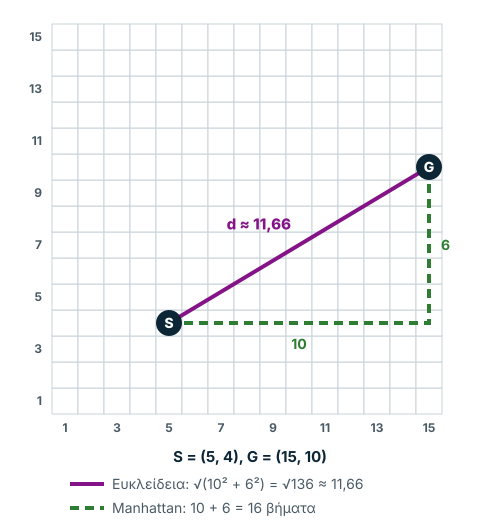
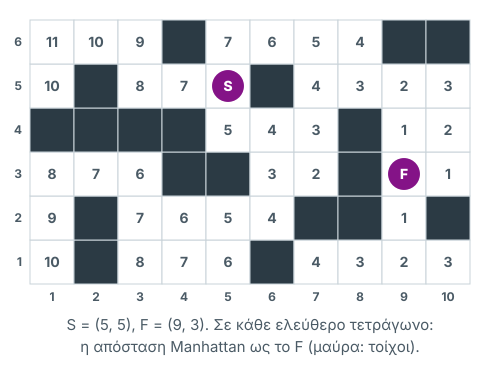
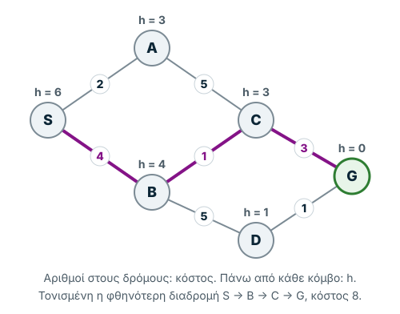

Σημειώσεις μελέτης βασισμένες στη Διάλεξη 3 του μαθήματος, στο κεφάλαιο
«Αλγόριθμοι Ευρετικής Αναζήτησης» του βιβλίου και στο εργαστήριο «MATLAB
Basics». Όλα τα σχήματα και οι πίνακες είναι ξαναφτιαγμένοι και ελεγμένοι· όπου
η διάλεξη έχει λάθος, το σημειώνουμε.

*Πώς μπορεί ένας αλγόριθμος να βρίσκει λύσεις πιο έξυπνα, χωρίς να εξετάζει
όλες τις πιθανές επιλογές;*

Η σελίδα διαβάζεται σε **δύο επίπεδα**. Η **κύρια διαδρομή** είναι σύντομη, με
παραδείγματα και μικρές ασκήσεις: καταλαβαίνω, βλέπω παράδειγμα, μαθαίνω τον
κανόνα, εφαρμόζω, ελέγχω αν κατάλαβα. Το **αναλυτικό επίπεδο** (πλήρεις
πίνακες, ψευδοκώδικας, ειδικές περιπτώσεις και οι διορθώσεις της διάλεξης)
βρίσκεται στις αναπτυσσόμενες ενότητες «Αναλυτικά». Η σελίδα χωρίζεται σε
τέσσερα μέρη: **Α. Κατανόηση**, **Β. Εφαρμογή**, **Γ. Εξετάσεις** και
**Δ. MATLAB Lab**.

## Μέρος Α — Κατανόηση

### 1. Από την τυφλή στην ευριστική αναζήτηση

Στην προηγούμενη εβδομάδα γνωρίσαμε αλγορίθμους όπως ο BFS και ο DFS. Αυτοί
εξερευνούν καταστάσεις με συγκεκριμένη σειρά, χωρίς να γνωρίζουν ποια φαίνεται
πιο κοντά στον στόχο. Σε πολλά προβλήματα όμως ο χώρος αναζήτησης μεγαλώνει
ραγδαία (*συνδυαστική έκρηξη*), οπότε η τυφλή αναζήτηση δεν τελειώνει ποτέ στην
πράξη.

Η **ευριστική αναζήτηση** (*Heuristic Search*) προσθέτει μια πληροφορία: μια
εκτίμηση για το πόσο υποσχόμενη είναι κάθε κατάσταση. Σκοπός είναι να μειωθεί ο
αριθμός των καταστάσεων που επισκέπτεται ο αλγόριθμος: με την πληροφορία αυτή
**αξιολογούμε** τις καταστάσεις, ώστε η αναζήτηση να πάει γρηγορότερα προς τη
λύση ή να **κλαδέψει** όσες δεν οδηγούν πουθενά.

Για παράδειγμα, αν ψάχνουμε την έξοδο ενός λαβυρίνθου, μπορούμε να προτιμούμε
τις θέσεις που φαίνονται πιο κοντά στην έξοδο. Αυτή η εκτίμηση μάς βοηθά να
επιλέγουμε πού θα ψάξουμε πρώτα. Δεν εγγυάται όμως ότι η επιλογή είναι σωστή,
επειδή μπορεί να υπάρχουν εμπόδια που δεν λαμβάνει υπόψη.

> **Βασική ιδέα:** Η ευριστική αναζήτηση χρησιμοποιεί πληροφορίες για το
> πρόβλημα ώστε να καθοδηγεί την εξερεύνηση. Οι αλγόριθμοι που την
> εκμεταλλεύονται λέγονται **αλγόριθμοι ευριστικής αναζήτησης** (*heuristic
> search algorithms*).

<details>
<summary>Αναλυτικά: ο ευριστικός μηχανισμός</summary>

Σκέψου πώς φτιάχνεις ένα παζλ. Με τυφλή αναζήτηση θα δοκίμαζες κομμάτια χωρίς
να κοιτάς χρώμα ή σχήμα. Στην πράξη τα χωρίζεις σε κατηγορίες: γωνίες και
ενδιάμεσα, ουρανός και βουνό. Αυτοί οι εμπειρικοί κανόνες είναι ένας
**ευριστικός** (ή ευρετικός) **μηχανισμός** (*heuristic*): μια στρατηγική,
βασισμένη στη γνώση που έχουμε για το πρόβλημα, που βοηθά να λυθεί γρηγορότερα.
Δεν είναι τέλειος: εξαρτάται από τη γνώση μας και μερικές φορές οδηγεί σε λάθος
κατεύθυνση.

Ο μηχανισμός υλοποιείται συνήθως ως **ευριστική συνάρτηση** (*heuristic
function*). Ορίσματά της είναι μια κατάσταση S και το σύνολο των τελικών
καταστάσεων· αποτέλεσμά της ένας αριθμός, η **ευριστική τιμή** (*heuristic
value*). Η ευριστική τιμή **δεν** είναι η πραγματική απόσταση από τον στόχο,
αλλά μια **εκτίμηση** (*estimate*). Από όλες τις επιλογές που έχουμε, προτιμάμε
πρώτα αυτή με το μικρότερο εκτιμώμενο κόστος.

</details>

### 2. Η ευριστική συνάρτηση h(n)

Η ευριστική συνάρτηση **h(n)** δίνει έναν αριθμό που εκτιμά το κόστος από μια
κατάσταση n μέχρι τον στόχο. Στο Σχήμα 1 η h(S) είναι 6, αλλά η εφικτή διαδρομή
γύρω από τους τοίχους θέλει 8 βήματα: η h είναι εκτίμηση, όχι το πραγματικό
κόστος.


*Σχήμα 1. Η εκτίμηση και η πραγματική διαδρομή: η ευθεία απόσταση αγνοεί τους
τοίχους, η εφικτή διαδρομή τους παρακάμπτει.*

Δύο συνηθισμένοι τρόποι υπολογισμού, για μια θέση n και τον στόχο G (η διάλεξη
γράφει την έξοδο του λαβυρίνθου F), είναι οι εξής.

**Ευκλείδεια απόσταση** (*Euclidean Distance*). Μετρά την απόσταση σε ευθεία
γραμμή μεταξύ δύο σημείων:

```math
h(n) = \sqrt{(x_n - x_G)^2 + (y_n - y_G)^2}
```

**Απόσταση Manhattan.** Μετρά την απόσταση όταν επιτρέπονται μόνο οριζόντιες
και κάθετες κινήσεις, όπως στους κάθετους δρόμους του Μανχάταν:

```math
h(n) = |x_n - x_G| + |y_n - y_G|
```

**Παράδειγμα:** Για S = (5, 4) και G = (15, 10), η ευκλείδεια απόσταση είναι
περίπου **11,66**, ενώ η Manhattan είναι **16**:

```math
\sqrt{(5-15)^2 + (4-10)^2} = \sqrt{136} \approx 11{,}66
\qquad
|5-15| + |4-10| = 10 + 6 = 16
```



*Σχήμα 2. Ευκλείδεια απόσταση (ευθεία) και απόσταση Manhattan (οριζόντια και
κάθετα).*

Καμία δεν υπολογίζει αυτόματα τις παρακάμψεις λόγω τοίχων, γι' αυτό είναι
**εκτιμήσεις**: η πραγματική διαδρομή είναι ίση ή μεγαλύτερη. Η Ευκλείδεια
απόσταση είναι πάντα μικρότερη ή ίση με την Manhattan, και η Manhattan
συμπίπτει με την πραγματική μόνο αν δεν υπάρχουν εμπόδια.

### 3. Οι τρεις συναρτήσεις που πρέπει να γνωρίζεις

| Σύμβολο | Σημασία |
| --- | --- |
| **g(n)** | Πραγματικό κόστος από την αρχή μέχρι τον n |
| **h(n)** | Εκτιμώμενο κόστος από τον n μέχρι τον στόχο |
| **f(n)** | Τιμή με την οποία αξιολογούμε τον n |

Δύο σημαντικές περιπτώσεις:

- **Greedy Best-First Search:** `$f(n) = h(n)$`
- **A\*:** `$f(n) = g(n) + h(n)$`

Ο Greedy ενδιαφέρεται μόνο για το πόσο κοντά φαίνεται ο στόχος. Ο A\* λαμβάνει
υπόψη και το κόστος που έχουμε ήδη πληρώσει. Και στις δύο περιπτώσεις μετράμε
κόστος, οπότε **μικρότερη τιμή = πιο υποσχόμενη κατάσταση**.

<details>
<summary>Αναλυτικά: οι τρεις τρόποι ορισμού της f στη διάλεξη</summary>

| Τρόπος | Τι μετράει | Πού τη συναντάμε |
| --- | --- | --- |
| f(n) = πόσο «καλή» είναι η n | την αξία της κατάστασης (*goodness*) | γενικά προβλήματα βελτιστοποίησης |
| `$f(n) = h(n)$` | το εκτιμώμενο κόστος από την n ως τον στόχο | Greedy BestFS, Hill Climbing, Beam |
| `$f(n) = g(n) + h(n)$` | το κόστος που έχει **ήδη** γίνει **και** την εκτίμηση για όσο απομένει | A\* |

</details>

### 4. Οι τέσσερις βασικοί αλγόριθμοι

Και οι τέσσερις κρατούν δύο λίστες: το **Μέτωπο** (*frontier*), τις καταστάσεις
που περιμένουν να εξεταστούν, και το **Κλειστό** σύνολο (*closed set*), όσες
έχουν ήδη επεκταθεί.

**Greedy Best-First Search (GBFS).** Ο αλγόριθμος **αναζήτησης πρώτα στο
καλύτερο** (*Best-First Search*, BestFS) στην άπληστη (*greedy*) μορφή του
επιλέγει από ολόκληρο το **Μέτωπο** τον κόμβο με τη μικρότερη `$h(n)$`. Κρατά
τις υπόλοιπες επιλογές ώστε να μπορεί να τις εξετάσει αργότερα, γι' αυτό μπορεί
να επιστρέψει σε μια προγενέστερη κατάσταση, αν ο δρόμος που ακολουθεί
χειροτερέψει. **Μειονέκτημα:** Μπορεί να βρει διαδρομή μεγαλύτερου κόστους από
τη βέλτιστη.

**Hill Climbing (Αναρρίχηση Λόφου).** Επιλέγει τον καλύτερο γείτονα της
τρέχουσας κατάστασης και απορρίπτει τις εναλλακτικές· δεν χρειάζεται μέτωπο
αναζήτησης. Στη συνηθισμένη εκδοχή σταματά αν δεν υπάρχει καλύτερος γείτονας.
**Μειονέκτημα:** Μπορεί να εγκλωβιστεί σε τοπικό βέλτιστο ή οροπέδιο.


*Σχήμα 3. Τοπικό μέγιστο έναντι καθολικού μέγιστου: ο Hill Climbing σταματά
στην πρώτη κορυφή που συναντά.*

<details>
<summary>Αναλυτικά: γιατί «αναρρίχηση λόφων» και τα τρία προβλήματά της</summary>

Φαντάσου ότι ανεβαίνεις έναν λόφο μέσα στην ομίχλη, ψάχνοντας την ψηλότερη
κορυφή. Δεν βλέπεις μακριά, οπότε κάθε φορά κάνεις το βήμα που ανεβαίνει
περισσότερο. Το ύψος κάθε σημείου είναι η τιμή της ευριστικής συνάρτησης. Το
βιβλίο ονομάζει τρία προβλήματα που βγαίνουν από αυτή την εικόνα:

- **Πρόποδες** (*foothill*): μια χαμηλότερη κορυφή τραβά την αναζήτηση. Η λύση
  που βρίσκεται είναι μόνο **τοπικά** καλύτερη (*local maximum*), όχι η
  καλύτερη.
- **Οροπέδιο** (*plateau*): όλα τα γύρω σημεία έχουν το ίδιο ύψος, άρα η
  ευριστική δεν δείχνει κατεύθυνση και η επιλογή γίνεται στην τύχη.
- **Κορυφογραμμή** (*ridge*): η ευριστική τιμή ανεβοκατεβαίνει, οπότε κάθε βήμα
  φαίνεται να μην προχωρά, αν και η κορυφή είναι πιο πέρα.


*Σχήμα 4. Πρόποδες, οροπέδιο και κορυφογραμμή: πού σταματά ο Hill Climbing.*

</details>

**Beam Search (Ακτινωτή Αναζήτηση).** Κρατά περιορισμένο αριθμό υποσχόμενων
καταστάσεων. Στην κλασική εκδοχή διατηρεί τις `k` καλύτερες σε κάθε επίπεδο. Η
παραλλαγή **BestNFS** της διάλεξης περιορίζει το συνολικό Μέτωπο στις `N`
καλύτερες· το N λέγεται «πλάτος ακτίνας». Είναι υβριδικός αλγόριθμος ανάμεσα σε
Hill Climbing και BestFS: με **N = 1** κρατά μόνο την καλύτερη κατάσταση και
γίνεται Hill Climbing, με **πολύ μεγάλο N** δεν πετάει τίποτα και γίνεται Greedy
BestFS. **Μειονέκτημα:** Μπορεί να απορρίψει τη μοναδική διαδρομή προς τον
στόχο.

**A\* (A-Star).** Ο αλγόριθμος **A\*** («Α άστρο») είναι κατά βάση BestFS, αλλά
επιλέγει τον κόμβο με το μικρότερο άθροισμα `$g(n) + h(n)$`. Συνδυάζει
πραγματικό και εκτιμώμενο κόστος. **Πλεονέκτημα:** Μπορεί να εγγυηθεί βέλτιστη
λύση με κατάλληλη ευριστική και υλοποίηση.


*Σχήμα 5. Η ιδέα του A\* (διαφάνεια 26): ό,τι έχει ήδη κοστίσει, συν ό,τι
εκτιμάμε ότι απομένει.*

Η g(S) δίνει την απόσταση της S από την αρχική κατάσταση, που είναι
**πραγματική και γνωστή**· η h(S) δίνει την **εκτίμηση** της απόστασης της S
από την τελική κατάσταση, όπως ακριβώς στον BestFS. Η f(S) είναι λοιπόν μια
**εκτίμηση του κόστους της καλύτερης λύσης που περνά από την S**. Ο Greedy
κοιτάζει μόνο μπροστά (h)· ο A\* κοιτάζει και πίσω (g), οπότε ένας δρόμος που
φαίνεται κοντά στον στόχο αλλά έχει ήδη κοστίσει πολύ χάνει την προτεραιότητά
του.

### 5. Παράδειγμα: Πώς επιλέγουν διαφορετικούς κόμβους;

Έστω ότι στο Μέτωπο υπάρχουν οι καταστάσεις A, B και C. Στο σχέδιο, η συνεχής
γραμμή από το S δείχνει το πραγματικό κόστος `$g(n)$` που έχουμε ήδη πληρώσει,
και η διακεκομμένη γραμμή ως το G την εκτίμηση `$h(n)$` για όσο απομένει. Κάτω
από κάθε κόμβο, το άθροισμά τους `$f(n) = g(n) + h(n)$`.


*Σχήμα 6. Το ίδιο Μέτωπο, δύο επιλογές: ο Greedy κοιτάζει μόνο τη διακεκομμένη
γραμμή (h), ο A\* και τις δύο (g + h).*

Ο **Greedy** επιλέγει τον **B**, επειδή έχει τη μικρότερη `$h(n) = 10$`. Ο
**A\*** επιλέγει τον **C**, επειδή έχει τη μικρότερη `$f(n) = 30$`. Άρα δύο
αλγόριθμοι μπορούν να εξετάσουν διαφορετικές καταστάσεις, παρότι χρησιμοποιούν
την ίδια ευριστική συνάρτηση.

### 6. Πλήρης και βέλτιστος αλγόριθμος

**Πληρότητα** (*Completeness*): Εγγυάται ο αλγόριθμος ότι θα βρει λύση εφόσον
υπάρχει; **Βελτιστότητα** (*Optimality*): Εγγυάται ότι θα βρει τη λύση με το
μικρότερο κόστος;

| Αλγόριθμος | Πλήρης; | Βέλτιστος; |
| --- | --- | --- |
| Greedy BestFS | Υπό προϋποθέσεις\* | Όχι γενικά |
| Hill Climbing | Όχι γενικά | Όχι γενικά |
| Beam Search | Όχι γενικά | Όχι γενικά |
| A\* | Υπό προϋποθέσεις\*\* | Υπό προϋποθέσεις\*\* |

\* Σε πεπερασμένο χώρο, με κλειστό σύνολο: κρατά όλες τις εναλλακτικές, άρα
βρίσκει λύση αν υπάρχει. \*\* Με παραδεκτή ευριστική συνάρτηση.

Για τον A\*, σημαντική έννοια είναι η **παραδεκτή** (ή αποδεκτή) **ευριστική**
(*Admissible Heuristic*): μια συνάρτηση που δεν υπερεκτιμά ποτέ το πραγματικό
ελάχιστο κόστος μέχρι τον στόχο. Όπως αποδεικνύεται αυστηρά, τότε ο A\* βρίσκει
πάντα λύση, και μάλιστα βρίσκει **πρώτα την καλύτερη**: είναι **πλήρης και
βέλτιστος**. Στην αναζήτηση σε γράφο απαιτείται επιπλέον προσοχή στον χειρισμό
επαναλαμβανόμενων καταστάσεων, ιδιαίτερα αν η ευριστική δεν είναι συνεπής.

Παραδείγματα: στον λαβύρινθο, η Manhattan και η Ευκλείδεια είναι παραδεκτές,
γιατί οι τοίχοι μόνο μακραίνουν τη διαδρομή. Από δύο παραδεκτές συναρτήσεις
προτιμάμε τη **μεγαλύτερη**: είναι πιο κοντά στο πραγματικό κόστος, άρα ο A\*
επεκτείνει λιγότερες καταστάσεις.

### 7. Ευριστικές συναρτήσεις στο 8-puzzle

Στο 8-puzzle μετακινούμε πλακίδια μέχρι να σχηματίσουμε την τελική διάταξη. Η
ευριστική συνάρτηση εκτιμά πόσες κινήσεις απέχει μια κατάσταση από την τελική.
Δύο τρόποι εκτίμησης:

1. **Misplaced Tiles** (πλακίδια εκτός θέσης): Μετράμε πόσα αριθμημένα
   πλακίδια βρίσκονται σε λάθος θέση.
2. **Manhattan Distance** (άθροισμα αποστάσεων Manhattan): Προσθέτουμε τις
   οριζόντιες και κάθετες αποστάσεις κάθε αριθμημένου πλακιδίου από τη σωστή
   του θέση.

Για τις τυπικές παραδεκτές ευριστικές δεν μετράμε το κενό πλακίδιο. Τότε είναι
παραδεκτές: κάθε πλακίδιο εκτός θέσης θέλει τουλάχιστον μία κίνηση, και
τουλάχιστον τόσες όσες η απόστασή του Manhattan. Η «διαφορά» μιας κατάστασης από
την τελική υλοποιείται συνήθως ως συνδυασμός των δύο.


*Σχήμα 7. Οι δύο ευριστικές για την αρχική κατάσταση του 8-puzzle της
διαφάνειας 18.*

> **Προσοχή στις εξετάσεις:** Η διάλεξη μετράει και το **κενό** σαν πλακίδιο.
> Έτσι η κατάσταση του Σχήματος 7 δίνει 5 και 8 αντί για 4 και 4, και έτσι
> υπολογίζονται οι τιμές του δένδρου του 8-puzzle παρακάτω. Μετρώντας το κενό,
> μια κατάσταση **μία** κίνηση πριν από τη λύση δίνει h = 2 (το πλακίδιο και το
> κενό εκτός θέσης): υπερεκτίμηση. Για τον Greedy δεν πειράζει· για τον A\*
> χάνεται η εγγύηση της βέλτιστης λύσης.

<details>
<summary>Αναλυτικά: το παράδειγμα της διάλεξης στο 15-puzzle</summary>

Οι ίδιες δύο συναρτήσεις εφαρμόζονται σε κάθε N-puzzle (8-puzzle,
15-puzzle). Η διάλεξη τις δείχνει στο 15-puzzle (διαφάνειες 7 και 9),
μετρώντας και το κενό: βγαίνουν 12 πλακίδια εκτός θέσης και άθροισμα Manhattan
28. Τα περισσότερα βιβλία δεν μετρούν το κενό: τότε η ίδια κατάσταση δίνει 11
και 26.


*Σχήμα 8. Οι δύο ευριστικές τιμές για μια κατάσταση του 15-puzzle (διαφάνειες 7
και 9).*

</details>

## Μέρος Β — Εφαρμογή

### 8. Πρακτική εξάσκηση: ευριστική αναζήτηση βήμα-βήμα

Όλοι οι αλγόριθμοι της εβδομάδας σε ένα εργαλείο, στο ίδιο κοινό πρόβλημα: τον
λαβύρινθο της διάλεξης. Επειδή το πρόβλημα μένει ίδιο, η προσοχή πάει στις
διαφορές των αλγορίθμων. Δοκίμασε με τη σειρά:

1. Εκτέλεσε τον Greedy στον λαβύρινθο.
2. Δες πώς μεταβάλλονται **Μέτωπο** και **Κλειστό**.
3. Εκτέλεσε τον Hill Climbing στον ίδιο λαβύρινθο.
4. Σύγκρινε τι συμβαίνει όταν οι αλγόριθμοι συναντούν αδιέξοδο.
5. Επανέλαβε με Beam Search και A\*.

Με την «Πρόβλεψη», πριν από κάθε βήμα το εργαλείο ρωτά ποια κατάσταση θα
επιλεγεί, και μετά την απάντηση εξηγεί γιατί. Με το «Ανά κελί» ο πίνακας
γεμίζει όπως στο χαρτί: πρώτα το κλειστό σύνολο, μετά το μέτωπο, η κατάσταση
και τα παιδιά. Στον χάρτη φαίνονται η τρέχουσα κατάσταση, τα παιδιά της και το
κλειστό σύνολο· στον πίνακα το μέτωπο σε κάθε βήμα, με την τιμή με την οποία
ταξινομείται. Υπάρχουν και άλλα προβλήματα: ο λαβύρινθος του βιβλίου, το οδικό
δίκτυο του A\* και οι δύο ασκήσεις. Για τις ασκήσεις, λύσε τες πρώτα στο χαρτί.

<div data-demo="heuristic-explorer" data-pagefind-ignore>
<p>Το διαδραστικό παράδειγμα χρειάζεται JavaScript. Ο πίνακας του Greedy
BestFS στον λαβύρινθο βρίσκεται στην επόμενη ενότητα.</p>
</div>

Ο λαβύρινθος του βιβλίου (Σχήμα 4.5) έχει S = <3,4> και έξοδο G = <7,8>· ο Greedy
BestFS εκεί αναπαράγει τον Πίνακα 4.1 του βιβλίου. Σύγκρινε τους δύο
λαβυρίνθους: στου βιβλίου και οι τέσσερις αλγόριθμοι φτάνουν στο G σε 8
κινήσεις, γιατί η απόσταση Manhattan δεν παραπλανά ποτέ την αναζήτηση. Στης
διάλεξης, το αδιέξοδο κοντά στο F ξεγελά τον Hill Climbing και τη Beam Search.

### 9. Λυμένο παράδειγμα: ο λαβύρινθος της διάλεξης

Ο λαβύρινθος της διάλεξης (διαφάνεια 14) έχει 10 × 6 θέσεις. Ξεκινάμε από
S = <5,5> (στήλη 5, γραμμή 5) και θέλουμε την έξοδο F = <9,3>. Ευριστική
συνάρτηση είναι η απόσταση Manhattan ως το F, και οι κινήσεις δοκιμάζονται με
τη σειρά αριστερά, πάνω, δεξιά, κάτω. Γράφουμε κάθε θέση όπως το βιβλίο,
<x,y> (στήλη, γραμμή), και την ευριστική τιμή της ως εκθέτη: <5,4>⁵ είναι η
θέση (5, 4) με h = 5.



*Σχήμα 9. Ο λαβύρινθος της διάλεξης και η ευριστική τιμή κάθε θέσης.*

**Greedy BestFS.** Ο Greedy βρίσκει το F με διαδρομή <5,5> → <5,4> → <6,4> →
<7,4> → <7,5> → <8,5> → <9,5> → <9,4> → <9,3>, δηλαδή **8 βήματα**. Στα βήματα
5–13 του πίνακα μπαίνει στο αδιέξοδο κάτω από το <7,4> (θέσεις <7,3>, <6,3>,
<6,2>), που *φαίνεται* κοντά στο F, αλλά τον χωρίζει τοίχος. Επειδή κρατά τις
υπόλοιπες καταστάσεις στο μέτωπο, γυρνά στο <7,5> και συνεχίζει. Αυτό ακριβώς
είναι το πλεονέκτημα του μετώπου.

<details>
<summary>Αναλυτικά: ο πλήρης πίνακας εκτέλεσης του Greedy BestFS</summary>

Ο εκθέτης κάθε κατάστασης είναι η h της. «Βρόχος» σημαίνει ότι η κατάσταση που
βγήκε από το μέτωπο είναι ήδη στο κλειστό σύνολο, άρα δεν επεκτείνεται ξανά.

| # | Μέτωπο αναζήτησης | Κλειστό σύνολο | Κατάσταση | Παιδιά |
| --- | --- | --- | --- | --- |
| 1 | ⟨<5,5>⁶⟩ | {} | <5,5>⁶ | <4,5>⁷, <5,6>⁷, <5,4>⁵ |
| 2 | ⟨<5,4>⁵, <4,5>⁷, <5,6>⁷⟩ | {<5,5>} | <5,4>⁵ | <5,5>⁶, <6,4>⁴ |
| 3 | ⟨<6,4>⁴, <5,5>⁶, <4,5>⁷, <5,6>⁷⟩ | {<5,5>, <5,4>} | <6,4>⁴ | <5,4>⁵, <7,4>³, <6,3>³ |
| 4 | ⟨<7,4>³, <6,3>³, <5,4>⁵, <5,5>⁶, …⟩ | {<5,5>, <5,4>, <6,4>} | <7,4>³ | <6,4>⁴, <7,5>⁴, <7,3>² |
| 5 | ⟨<7,3>², <6,3>³, <6,4>⁴, <7,5>⁴, …⟩ | {<5,5>, <5,4>, …, <7,4>} | <7,3>² | <6,3>³, <7,4>³ |
| 6 | ⟨<6,3>³, <7,4>³, <6,3>³, <6,4>⁴, …⟩ | {<5,5>, <5,4>, …, <7,3>} | <6,3>³ | <6,4>⁴, <7,3>², <6,2>⁴ |
| 7–10 | ⟨<7,3>², <7,4>³, <6,3>³, <6,4>⁴, …⟩ | {…, <6,3>} | <7,3>², <7,4>³, <6,3>³, <6,4>⁴ | βρόχος (τέσσερις φορές) |
| 11 | ⟨<6,2>⁴, <6,4>⁴, <7,5>⁴, <5,4>⁵, …⟩ | {…, <6,3>} | <6,2>⁴ | <5,2>⁵, <6,3>³ |
| 12–13 | ⟨<6,3>³, <6,4>⁴, <7,5>⁴, <5,2>⁵, …⟩ | {…, <6,2>} | <6,3>³, <6,4>⁴ | βρόχος (δύο φορές) |
| 14 | ⟨<7,5>⁴, <5,2>⁵, <5,4>⁵, <5,5>⁶, …⟩ | {…, <6,2>} | <7,5>⁴ | <7,6>⁵, <8,5>³, <7,4>³ |
| 15 | ⟨<8,5>³, <7,4>³, <7,6>⁵, <5,2>⁵, …⟩ | {…, <7,5>} | <8,5>³ | <7,5>⁴, <8,6>⁴, <9,5>² |
| 16 | ⟨<9,5>², <7,4>³, <7,5>⁴, <8,6>⁴, …⟩ | {…, <8,5>} | <9,5>² | <8,5>³, <10,5>³, <9,4>¹ |
| 17 | ⟨<9,4>¹, <8,5>³, <10,5>³, <7,4>³, …⟩ | {…, <9,5>} | <9,4>¹ | <9,5>², <10,4>², <9,3>⁰ |
| 18 | ⟨<9,3>⁰, <9,5>², <10,4>², <8,5>³, …⟩ | {…, <9,4>} | <9,3>⁰ | **τελική** |

> **Διόρθωση της διάλεξης:** Ο πίνακας της διαφάνειας 16 έχει μερικές λάθος
> ευριστικές τιμές, π.χ. h(<6,2>) = 4, όχι 3, και h(<5,4>) = 5, όχι 7, ενώ ως
> παιδί του <7,3> γράφει <6,4> αντί για <7,4>. Γι' αυτό εκεί η σειρά των βημάτων
> διαφέρει λίγο. Ο πίνακας εδώ υπολογίστηκε ξανά με τις σωστές τιμές·
> επισκέπτεται τις ίδιες θέσεις και βρίσκει την ίδια διαδρομή.

</details>

**Hill Climbing.** Ο HC πάει S → <5,4> → <6,4> → <7,4> → <7,3>, το ίδιο αδιέξοδο
που δοκίμασε κι ο Greedy. Εκεί όμως δεν έχει μέτωπο για να γυρίσει πίσω: από το
<7,3> πηγαίνει στο <6,3> (h = 3) και από το <6,3> ξανά στο <7,3> (h = 2), για
πάντα. Με τον κανόνα του βιβλίου, που σταματά όταν κανένα παιδί δεν είναι
καλύτερο από την τρέχουσα κατάσταση, θα σταματούσε στο <7,3> και θα το ανέφερε
ως «τοπικά καλύτερη» λύση. Σε κάθε περίπτωση, **δεν φτάνει ποτέ στο F**.

**Beam Search.** Με N = 2, η Beam Search μπαίνει στο αδιέξοδο κάτω από το <7,4>
και εκεί **πετάει το <7,5>**, γιατί έχει χειρότερη h από τις θέσεις του
αδιεξόδου. Από εκεί χάνεται στο αριστερό μέρος του λαβυρίνθου και το μέτωπο
αδειάζει χωρίς να βρεθεί το F. Έτσι ελέγχεις πόση μνήμη θα χρησιμοποιήσεις, με
αντάλλαγμα ότι μια κατάσταση που πέταξες μπορεί να ήταν ο δρόμος προς τη λύση.


*Σχήμα 10. Οι τρεις αλγόριθμοι στον ίδιο λαβύρινθο: ο Greedy βρίσκει το F, ο
Hill Climbing πηγαινοέρχεται, η Beam Search με N = 2 χάνει τον δρόμο.*

**A\*.** Στον λαβύρινθο, όπου κάθε κίνηση κοστίζει 1, ο A\* βρίσκει επίσης
διαδρομή 8 βημάτων, και αυτή τη φορά **με εγγύηση** ότι δεν υπάρχει
συντομότερη, γιατί η Manhattan είναι παραδεκτή. Δοκίμασέ το στο εργαλείο
παραπάνω.

### 10. Λυμένο παράδειγμα: το 8-puzzle

Στο 8-puzzle, με ευριστική τιμή τα πλακίδια εκτός θέσης (μαζί με το κενό, όπως
στη διάλεξη), ο Greedy επεκτείνει κάθε φορά την κατάσταση με τη μικρότερη h.
Χρειάζεται μόλις τέσσερις επεκτάσεις, ενώ το πλήρες δένδρο της διαφάνειας 17
μεγαλώνει γρήγορα.


*Σχήμα 11. Greedy BestFS στο 8-puzzle (διαφάνεια 18): τέσσερις κινήσεις του
κενού, r, d, r, d.*

### 11. Λυμένο παράδειγμα: Greedy και A\* σε ένα μικρό οδικό δίκτυο

Για να δούμε τη διαφορά Greedy και A\* με κόστη που δεν είναι όλα 1,
χρησιμοποιούμε ένα μικρό οδικό δίκτυο (δικό μας παράδειγμα). Θέλουμε να πάμε
από το **S** στο **G**· οι δρόμοι είναι διπλής κατεύθυνσης.



*Σχήμα 12. Το οδικό δίκτυο: κόστη στους δρόμους, ευριστική τιμή πάνω από κάθε
κόμβο.*

Η φθηνότερη διαδρομή είναι **S → B → C → G**, με κόστος 4 + 1 + 3 = **8**.

**Greedy BestFS.** Από το S, το A έχει μικρότερη h από το B (3 < 4), οπότε
επεκτείνει το A· από το A φτάνει στο C(3) και από εκεί στο G(0). Διαδρομή
S → A → C → G, κόστος 2 + 5 + 3 = **10**: γρήγορη, αλλά όχι η βέλτιστη, γιατί ο
Greedy δεν λογαριάζει ότι ο δρόμος A–C κοστίζει 5.

**A\*.** Ταξινομεί κατά g + h:

| Βήμα | Μέτωπο: κατάσταση (g + h = f) | Επεκτείνω |
| --- | --- | --- |
| 1 | S (0 + 6 = 6) | S |
| 2 | A (2 + 3 = 5), B (4 + 4 = 8) | A |
| 3 | B (4 + 4 = 8), C μέσω A (7 + 3 = 10) | B |
| 4 | C μέσω B (5 + 3 = 8), D (9 + 1 = 10) | C |
| 5 | G (8 + 0 = 8), D (9 + 1 = 10) | G: στόχος |

Στο βήμα 4 ο A\* βρίσκει φθηνότερο δρόμο προς το C (κόστος 5 μέσω B, αντί για 7
μέσω A): προσθέτει τον νέο και αφαιρεί τον παλιό. Το αποτέλεσμα είναι η
**S → B → C → G** με κόστος **8**, η βέλτιστη. Πρόσεξε ότι στο βήμα 2
επέκτεινε πρώτα το A, όπως ο Greedy, αλλά μόλις φάνηκε το πραγματικό κόστος του
δρόμου μέσω A, γύρισε στο B. Η h εδώ είναι παραδεκτή: π.χ. h(S) = 6 ενώ το
πραγματικό κόστος είναι 8, και h(B) = 4, όσο ακριβώς το πραγματικό.

### 12. Ασκήσεις

Και στις δύο, ο αριθμός σε αγκύλες δίπλα σε κάθε κόμβο είναι η ευριστική τιμή
του. Οι κόμβοι με τιμή 0 είναι οι τερματικοί. Γράψε τη σειρά με την οποία
εξετάζονται οι κόμβοι (π.χ. a, b, c, …) μέχρι να βρεθεί τερματική κατάσταση,
με **Hill Climbing** και με **Greedy BestFS**. Όταν δύο κόμβοι έχουν ίδια
τιμή, προηγείται αυτός που μπήκε τελευταίος στο μέτωπο.

**Άσκηση 1**

![Δένδρο με ρίζα a [10]. Παιδιά του a: b [10], c [6], d [8]. Παιδιά του b: e [12] και f [4]. Παιδί του f: i [0]. Παιδιά του d: g [6] και h [10]. Παιδί του g: j [9]. Παιδί του j: k [0]. Τερματικοί κόμβοι i και k.](./images/heuristic-exercise-1.svg)

*Σχήμα 13. Το δένδρο της Άσκησης 1 (διαφάνεια 24).*

<details>
<summary>Λύση</summary>

- **Hill Climbing:** a → c. Από τα παιδιά του a, το c έχει τη μικρότερη τιμή
  (6). Το c όμως δεν έχει παιδιά και δεν είναι τερματικό, και ο HC έχει πετάξει
  τα b και d: **αποτυγχάνει**, παρότι υπάρχουν δύο λύσεις.
- **Greedy BestFS:** a, c, d, g, j, k. Μετά το αδιέξοδο c, το μέτωπο είναι
  ⟨d(8), b(10)⟩, οπότε συνεχίζει στο d, μετά στο g(6), στο j(9) (μπροστά από τα
  b(10) και h(10)) και φτάνει στο k(0). Πρόσεξε ότι το i, επίσης τερματικό,
  ήταν πιο κοντά στη ρίζα, αλλά «κρυβόταν» πίσω από το b(10).

</details>

**Άσκηση 2**

![Δένδρο με ρίζα c [10]. Παιδιά του c: b [7], d [4], i [3]. Παιδιά του b: k [5] και ένα δεύτερο i [9]. Παιδί του k: o [7], παιδί του o: p [0]. Παιδί του δεύτερου i: e [0]. Παιδί του d: a [12], παιδί του a: l [0]. Παιδιά του πρώτου i: g [5] και h [10]. Παιδιά του g: m [11] και f [3]. Παιδιά του m: q [2] και r [0]. Παιδί του f: n [1]. Τερματικοί κόμβοι p, e, l και r.](./images/heuristic-exercise-2.svg)

*Σχήμα 14. Το δένδρο της Άσκησης 2 (διαφάνεια 25). Η διαφάνεια έχει δύο
διαφορετικούς κόμβους με το όνομα «i».*

<details>
<summary>Λύση</summary>

- **Hill Climbing:** c → i [3] → g → f → n. Σε κάθε βήμα διαλέγει το παιδί με
  τη μικρότερη τιμή: i [3] από τα b, d, i· g [5] από τα g, h· f [3] από τα m, f·
  n [1]. Το n δεν έχει παιδιά και δεν είναι τερματικό: **αποτυχία**.
- **Greedy BestFS:** c, i, d, g, f, n, b, k, o, p. Το μέτωπο μετά το c είναι
  ⟨i(3), d(4), b(7)⟩. Από το i μπαίνουν g(5) και h(10)· μετά εξετάζεται το d(4),
  που φέρνει το a(12)· μετά g(5), f(3), n(1), που είναι αδιέξοδο. Μένουν
  ⟨b(7), h(10), m(11), a(12)⟩, οπότε πάει στο b, στο k(5), στο o(7) και βρίσκει
  το p(0).

Δες τη λύση του Greedy BestFS βήμα-βήμα. Με «Πρόβλεψη» διαλέγεις εσύ τον
επόμενο κόμβο πριν τον δεις· με «Ανά κελί» ο πίνακας γεμίζει όπως στο χαρτί.
Οι κόμβοι που η αναζήτηση δεν έχει συναντήσει ακόμα φαίνονται αχνοί.

<div data-demo="heuristic-explorer" data-problem="ex2" data-algorithm="GREEDY" data-pagefind-ignore>
<p>Το διαδραστικό παράδειγμα χρειάζεται JavaScript. Η σειρά του Greedy BestFS
είναι c, i, d, g, f, n, b, k, o, p.</p>
</div>

</details>

## Μέρος Γ — Εξετάσεις

### 13. Συγκριτικός πίνακας

| Αλγόριθμος | Ταξινομεί με | Κρατά στο μέτωπο | Πλήρης | Βέλτιστος |
| --- | --- | --- | --- | --- |
| Greedy BestFS | h | όλες | ναι\* | όχι |
| Hill Climbing | h | μόνο την καλύτερη | όχι | όχι |
| Beam Search | h | τις N καλύτερες | όχι | όχι |
| A\* | g + h | όλες | ναι\*\* | ναι\*\* |

\* Σε πεπερασμένο χώρο, με κλειστό σύνολο. \*\* Με παραδεκτή ευριστική
συνάρτηση.

Ο A\* περιέχει άλλους αλγορίθμους ως ειδικές περιπτώσεις (βιβλίο). Αν
**g(S) = 0** για κάθε S, μένει μόνο η h: ο A\* εκτελεί **αναζήτηση πρώτα στο
καλύτερο** (BestFS). Αν **h(S) = 0** για κάθε S, μένει μόνο η g· αν η g είναι
το συσσωρευμένο κόστος, ο A\* συμπεριφέρεται σαν **αναζήτηση ενιαίου κόστους**
(*Uniform Cost Search*), ενώ αν η g είναι το μήκος της διαδρομής (κάθε βήμα
κοστίζει 1), συμπεριφέρεται σαν **αναζήτηση κατά πλάτος** (BFS). Η h = 0 δεν
υπερεκτιμά ποτέ, άρα είναι παραδεκτή: ο A\* βρίσκει ακόμα τη βέλτιστη λύση,
αλλά χωρίς «πυξίδα» εξετάζει πολύ περισσότερες καταστάσεις.

### 14. Πλήρης ψευδοκώδικας

<details>
<summary>Greedy BestFS: βήματα, ψευδοκώδικας, πλεονεκτήματα και μειονεκτήματα</summary>

Ο αλγόριθμος, όπως στη διάλεξη:

1. Βάλε την αρχική κατάσταση στο μέτωπο της αναζήτησης.
2. Αν το μέτωπο είναι κενό, σταμάτα (αποτυχία).
3. Βγάλε την πρώτη κατάσταση του μετώπου, έστω S.
4. Αν η S ανήκει στο κλειστό σύνολο, πήγαινε στο βήμα 2.
5. Αν η S είναι τελική, ανέφερε τη λύση. (Αν θέλεις κι άλλες λύσεις, πήγαινε
   στο 2· αλλιώς σταμάτα.)
6. Εφάρμοσε τους τελεστές για να βρεις τις καταστάσεις-παιδιά.
7. Υπολόγισε την ευριστική τιμή κάθε παιδιού.
8. Βάλε τα παιδιά στο μέτωπο και **ταξινόμησέ το με αύξουσα ευριστική τιμή**.
9. Βάλε την S στο κλειστό σύνολο και πήγαινε στο βήμα 2.

Σε ψευδοκώδικα (διαφάνεια 12):

```text
algorithm GreedyBestFS(Initial, Final)
begin
  Closed ← ∅;
  Frontier ← {Initial};
  while Frontier ≠ ∅ do
    CurrentState ← First(Frontier);
    Frontier ← Delete(CurrentState, Frontier);
    if CurrentState ∈ Final then return CurrentState;
    if CurrentState ∉ Closed then
      Next ← Expand(CurrentState);
      for each S in Next: calculate h(S);
      Frontier ← Next ∪ Frontier;
      Frontier ← order-ascending(Frontier);
      Closed ← Closed ∪ {CurrentState};
  endwhile;
  return failure;
end.
```

Η διαφορά από τον DFS είναι μία γραμμή: η **ταξινόμηση** του μετώπου. Ο DFS
βάζει τα παιδιά μπροστά και τα εξετάζει με τη σειρά που βγήκαν· ο Greedy τα
ανακατεύει με το υπόλοιπο μέτωπο και προτιμά όποια κατάσταση έχει τη μικρότερη
h, όσο παλιά κι αν είναι.

- **Πλεονεκτήματα:** συνήθως δίνει γρήγορα μια λύση, εξετάζοντας μικρό μέρος
  του χώρου αναζήτησης.
- **Μειονεκτήματα:** το μέτωπο μεγαλώνει με υψηλό ρυθμό (αυξημένες απαιτήσεις σε
  μνήμη και χρόνο)· δεν εγγυάται ότι η λύση είναι η βέλτιστη· δεν λαμβάνει
  υπόψη την απόσταση που έχει ήδη διανύσει· εξαρτάται πολύ από τον ευριστικό
  μηχανισμό.

</details>

<details>
<summary>Hill Climbing: βήματα, ψευδοκώδικας, σύγκριση με τον DFS</summary>

1. Η αρχική κατάσταση είναι η τρέχουσα κατάσταση.
2. Αν η τρέχουσα είναι τελική, ανέφερέ τη και σταμάτα.
3. Εφάρμοσε τους τελεστές για να βρεις τις καταστάσεις-παιδιά.
4. Βρες την κατάσταση με τη μικρότερη ευριστική τιμή.
5. Η καλύτερη κατάσταση γίνεται η τρέχουσα· πήγαινε στο βήμα 2.

Σε ψευδοκώδικα (διαφάνεια 20) είναι ο Greedy BestFS με μία αλλαγή: μετά την
ταξινόμηση, `Frontier ← prune(Frontier, 1)`, δηλαδή «άσε στο μέτωπο μία μόνο
κατάσταση».

Σε σχέση με τον DFS (βιβλίο): στον HC η ευριστική συνάρτηση διαλέγει ποιο παιδί
θα επεκταθεί, ενώ ο DFS παίρνει απλώς το πρώτο (συνήθως το αριστερότερο)· και
στον HC υπάρχει μία μόνο κατάσταση στο μέτωπο, άρα **δεν υπάρχει
οπισθοδρόμηση**, ενώ στον DFS τα υπόλοιπα παιδιά περιμένουν στο μέτωπο.

- **Πλεονεκτήματα:** δίνει λύση πάρα πολύ γρήγορα, με ελάχιστη μνήμη.
- **Μειονεκτήματα:** **δεν είναι πλήρης** (μπορεί να μη βρει λύση, ακόμη κι αν
  υπάρχει)· δεν εγγυάται τη βέλτιστη λύση· εξαρτάται πολύ από τον ευριστικό
  μηχανισμό.

</details>

<details>
<summary>Beam Search: βήματα και η διόρθωση της διαφάνειας 23</summary>

1. Βάλε την αρχική κατάσταση στο μέτωπο.
2. Αν το μέτωπο είναι κενό, σταμάτα.
3. Βγάλε την πρώτη κατάσταση του μετώπου, έστω S.
4. Αν η S ανήκει στο κλειστό σύνολο, πήγαινε στο βήμα 2.
5. Αν η S είναι τελική, ανέφερε τη λύση.
6. Βρες τις καταστάσεις-παιδιά και υπολόγισε την ευριστική τιμή καθενός.
7. Βάλε τα παιδιά στο μέτωπο και ταξινόμησέ το με αύξουσα ευριστική τιμή.
8. **Αν το μέτωπο έχει περισσότερες από N καταστάσεις, πέταξε τις χειρότερες.**
9. Βάλε την S στο κλειστό σύνολο και πήγαινε στο βήμα 2.

Σε ψευδοκώδικα είναι ο Greedy BestFS με `Frontier ← prune(Frontier, N)` μετά
την ταξινόμηση, και με τα παιδιά που είναι ήδη στο κλειστό σύνολο να μην
μπαίνουν καν στο μέτωπο.

> **Διόρθωση της διάλεξης:** Η διαφάνεια 23 γράφει `if (S ∉ Closed) Next ← Next − {S}`,
> δηλαδή «αφαίρεσε το παιδί αν **δεν** είναι στο κλειστό σύνολο». Είναι
> ανάποδα: πρέπει να αφαιρούνται τα παιδιά που **είναι** ήδη στο κλειστό
> σύνολο, `S ∈ Closed`.

</details>

<details>
<summary>A*: τα βήματα της διαφάνειας 28</summary>

Σε κάθε βήμα ο A\*:

1. Εφαρμόζει τους τελεστές στην καλύτερη κατάσταση του μετώπου, που γίνεται ο
   γονικός κόμβος, και βρίσκει τις διάδοχες καταστάσεις.
2. Αν υπάρχουν διάδοχες καταστάσεις:
   - αφαιρεί τον γονικό κόμβο από το μέτωπο·
   - προσθέτει στο μέτωπο **μόνο** όσες διάδοχες καταστάσεις έχουν διαδρομή
     **φθηνότερη** από ίδιες καταστάσεις που είναι ήδη στο μέτωπο·
   - **αφαιρεί** από το μέτωπο τις παλιότερες καταστάσεις που μόλις
     αντικαταστάθηκαν από φθηνότερες·
   - **ταξινομεί όλο** το μέτωπο κατά f, δηλαδή το μέχρι τώρα κόστος (με
     υπερτίμηση) συν το κόστος που υπολείπεται ως τον στόχο (με υποτίμηση).

</details>

### 15. Συχνά λάθη

> **Προσοχή στις εξετάσεις:**
>
> - Greedy και Hill Climbing διαλέγουν και οι δύο τη μικρότερη h· μόνο ο
>   Greedy κρατά τις υπόλοιπες καταστάσεις στο μέτωπο και μπορεί να γυρίσει
>   πίσω.
> - Ο A\* ταξινομεί κατά **g + h**, όχι μόνο κατά h. Με ίδια h, μπορεί να
>   διαλέξει διαφορετικό κόμβο από τον Greedy (ενότητα 5).
> - Η διαφάνεια 13 γράφει «Δεν είναι πλήρης» στα *πλεονεκτήματα* του BestFS. Το
>   βιβλίο λέει το αντίθετο: ο BestFS είναι **πλήρης** (σε πεπερασμένο χώρο, με
>   κλειστό σύνολο), αλλά δεν εγγυάται τη βέλτιστη. Μη πλήρης είναι ο Hill
>   Climbing.
> - Η διάλεξη μετρά το κενό στο N-puzzle (ενότητα 7): για τον A\*, η
>   συνάρτηση τότε δεν είναι παραδεκτή.
> - Ο πίνακας της διαφάνειας 16 και η συνθήκη της διαφάνειας 23 έχουν λάθη
>   (ενότητες 9 και 14).
> - Η Ευκλείδεια απόσταση είναι πάντα μικρότερη ή ίση με την Manhattan.

### 16. Ερωτήσεις αυτοαξιολόγησης

<details>
<summary>1. Ποια είναι η διαφορά ανάμεσα στον Greedy BestFS και στον Hill Climbing;</summary>

Και οι δύο διαλέγουν την κατάσταση με τη μικρότερη h. Ο Greedy κρατά όλες τις
υπόλοιπες στο μέτωπο και μπορεί να γυρίσει σε αυτές· ο Hill Climbing τις
πετάει, γι' αυτό χρειάζεται ελάχιστη μνήμη αλλά μπορεί να κολλήσει, όπως στο
αδιέξοδο <7,3> του λαβυρίνθου.

</details>

<details>
<summary>2. Γιατί ο Greedy βρήκε στο οδικό δίκτυο διαδρομή κόστους 10 και όχι 8;</summary>

Γιατί ταξινομεί μόνο με την h. Το A είχε μικρότερη h από το B (3 < 4), οπότε
ακολούθησε τον δρόμο μέσω A, χωρίς να λογαριάσει ότι ο δρόμος A–C κοστίζει 5.
Ο A\* προσθέτει το g και το καταλαβαίνει.

</details>

<details>
<summary>3. Για S = (2, 3) και F = (7, 1), πόσο είναι η απόσταση Manhattan και πόσο η Ευκλείδεια;</summary>

Manhattan: |2 − 7| + |3 − 1| = 5 + 2 = **7**. Ευκλείδεια: √(5² + 2²) = √29 ≈
**5,39**. Όπως πάντα, η Ευκλείδεια είναι μικρότερη ή ίση.

</details>

<details>
<summary>4. Ποια σχέση έχει η Beam Search με N = 1 και ο Hill Climbing; Και με πολύ μεγάλο N;</summary>

Με N = 1 κρατά στο μέτωπο μόνο την καλύτερη κατάσταση, δηλαδή κάνει ό,τι και ο
Hill Climbing. Με πολύ μεγάλο N δεν πετάει τίποτα και γίνεται Greedy BestFS.

</details>

<details>
<summary>5. Τι γίνεται αν δώσουμε στον A* την h(n) = 0 για κάθε κατάσταση;</summary>

Η h = 0 δεν υπερεκτιμά ποτέ, άρα είναι παραδεκτή και ο A\* βρίσκει ακόμα τη
βέλτιστη λύση. Όμως ταξινομεί μόνο με το κόστος g: γίνεται αναζήτηση ενιαίου
κόστους (ή BFS, αν κάθε βήμα κοστίζει 1) και εξετάζει πολύ περισσότερες
καταστάσεις.

</details>

<details>
<summary>6. Στο 8-puzzle, μια παραδεκτή συνάρτηση δίνει 4 και μια άλλη 6 για την ίδια κατάσταση. Ποια προτιμάς για τον A*;</summary>

Αυτή που δίνει 6 (συνήθως το άθροισμα Manhattan). Αφού καμία δεν υπερεκτιμά, η
μεγαλύτερη είναι πιο κοντά στο πραγματικό κόστος, άρα οδηγεί την αναζήτηση
καλύτερα και ο A\* επεκτείνει λιγότερες καταστάσεις.

</details>

<details>
<summary>7. Γιατί τα «πλακίδια εκτός θέσης μαζί με το κενό» δεν είναι παραδεκτή συνάρτηση;</summary>

Σε μια κατάσταση μία κίνηση πριν από τη λύση, εκτός θέσης είναι ένα πλακίδιο
και το κενό, άρα h = 2, ενώ το πραγματικό κόστος είναι 1. Η συνάρτηση
υπερεκτιμά, οπότε ο A\* χάνει την εγγύηση ότι θα βρει τη βέλτιστη λύση.

</details>

## Μέρος Δ — MATLAB Lab

Στο εργαστήριο του μαθήματος δουλεύουμε με το **MATLAB**, είτε εγκατεστημένο
στον υπολογιστή είτε στον browser μέσω του MATLAB Online. Το βασικό παράθυρο
είναι το **Command Window**, όπου γράφεις εντολές μετά το `>>`. Δίπλα
βρίσκονται ο τρέχων φάκελος (Current Folder), ο χώρος εργασίας (Workspace) με
τις μεταβλητές σου και το ιστορικό εντολών. Κάθε κεφάλαιο έχει ένα παράδειγμα
για να το τρέξεις και μία μικρή άσκηση.

### Δ1. Μεταβλητές και αριθμητικές πράξεις

```matlab
>> 7 + 3 * 2        % ο πολλαπλασιασμός γίνεται πρώτα
ans = 13
>> (7 + 3) * 2      % οι παρενθέσεις αλλάζουν τη σειρά
ans = 20
>> 2^10             % δύναμη
ans = 1024
>> x = 1.5e3        % επιστημονικός συμβολισμός: 1.5 · 10³
x = 1500
```

Η σειρά των πράξεων είναι η γνωστή από τα μαθηματικά: παρενθέσεις, δυνάμεις,
πολλαπλασιασμοί και διαιρέσεις, προσθέσεις και αφαιρέσεις. Τα ονόματα
μεταβλητών ξεκινούν με λατινικό γράμμα, έχουν μόνο γράμματα, ψηφία και `_`, και
**τα κεφαλαία διαφέρουν από τα μικρά** (`y` και `Y` είναι δύο μεταβλητές). Το
`%` ξεκινά σχόλιο και το `;` στο τέλος μιας εντολής κρύβει το αποτέλεσμα.

<details>
<summary>Άσκηση Δ1: υπολόγισε το (2 + 3)² / 5 και κράτησέ το στη μεταβλητή r, χωρίς να τυπωθεί.</summary>

```matlab
r = (2 + 3)^2 / 5;   % το ; κρύβει το αποτέλεσμα
r                    % γράψε το όνομα για να το δεις: r = 5
```

</details>

### Δ2. Πίνακες και βασικές συναρτήσεις

Ο πίνακας είναι το βασικό εργαλείο του MATLAB. Γράφεται σε αγκύλες: κενά ή
κόμματα χωρίζουν τα στοιχεία μιας γραμμής και το `;` αλλάζει γραμμή.

```matlab
v = [4 1 3];          % πίνακας-γραμμή
A = [1 2; 3 4];       % πίνακας 2×2
Z = zeros(2, 3);      % 2×3 με μηδενικά
A(2, 1)               % στοιχείο 2ης γραμμής, 1ης στήλης: 3
A(:, 2)               % όλη η 2η στήλη: [2; 4]
```

Χρήσιμες συναρτήσεις: `min`, `max`, `sum`, `prod`, `sort` και `find`, που
επιστρέφει τις θέσεις των στοιχείων που ικανοποιούν μια συνθήκη (π.χ.
`find(v > 2)` δίνει `[1 3]`). Σε δισδιάστατο πίνακα, οι `min`, `max`, `sum` και
`prod` δουλεύουν ανά στήλη. Για οποιαδήποτε εντολή, η `help όνομα` δείχνει τη
βοήθειά της.

<details>
<summary>Άσκηση Δ2: για h = [7 7 5 4], βρες τη μικρότερη τιμή και ποιες θέσεις έχουν τιμή 7.</summary>

```matlab
h = [7 7 5 4];
min(h)          % 4
find(h == 7)    % [1 2]
```

</details>

### Δ3. Συνθήκες if και επαναλήψεις for

```matlab
h = [7 7 5];               % h των παιδιών του S: <4,5>, <5,6>, <5,4>
[best, idx] = min(h);      % η μικρότερη τιμή και η θέση της
if best == 0
    disp('Βρέθηκε ο στόχος')
else
    disp(['Επεκτείνω το παιδί ', num2str(idx)])   % το 3ο, δηλαδή το <5,4>
end

total = 0;
for k = 1:5                % k = 1, 2, 3, 4, 5
    total = total + k;
end
disp(total)                % 15
```

Αντί να ξαναγράφεις τις εντολές κάθε φορά, τις αποθηκεύεις σε ένα **αρχείο
εντολών** (*script*) με κατάληξη `.m` και το τρέχεις με το όνομά του. Έτσι
μπορείς να αλλάξεις μια τιμή και να ξανατρέξεις όλο το πρόγραμμα.

<details>
<summary>Άσκηση Δ3: με έναν βρόχο for, υπολόγισε το άθροισμα 1² + 2² + 3² + 4².</summary>

```matlab
total = 0;
for k = 1:4
    total = total + k^2;
end
disp(total)                % 30
```

</details>

### Δ4. Υπολογισμός ευριστικών συναρτήσεων με MATLAB

Με όσα είδαμε, οι δύο αποστάσεις του παραδείγματος της ενότητας 2 γράφονται σε
μία γραμμή η καθεμία:

```matlab
S = [5 4];  G = [15 10];
manhattan = sum(abs(S - G))         % 16
euclid    = sqrt(sum((S - G).^2))   % 11.6619
```

Το `.^` σημαίνει «ύψωσε **κάθε στοιχείο** στο τετράγωνο». Με τον ίδιο τρόπο
υπολογίζονται μαζί οι h των τριών παιδιών του S στον λαβύρινθο της διάλεξης,
ένα παιδί ανά γραμμή:

```matlab
F = [9 3];
kids = [4 5; 5 6; 5 4];             % <4,5>, <5,6>, <5,4>
h = sum(abs(kids - F), 2)'          % [7 7 5], όπως στη γραμμή 1 του πίνακα
```

<details>
<summary>Άσκηση Δ4: υπολόγισε την απόσταση Manhattan και την Ευκλείδεια για S = (2, 3) και F = (7, 1).</summary>

```matlab
S = [2 3];  F = [7 1];
sum(abs(S - F))          % 7
sqrt(sum((S - F).^2))    % 5.3852
```

Είναι η ερώτηση 3 της αυτοαξιολόγησης, λυμένη στο MATLAB.

</details>

---

**Πηγές:** Διάλεξη 3 του μαθήματος· «MATLAB Basics» του εργαστηρίου· Ι.
Βλαχάβας, Π. Κεφαλάς, Ν. Βασιλειάδης, Φ. Κόκκορας, Η. Σακελλαρίου, *Τεχνητή
Νοημοσύνη* (4η έκδοση), κεφάλαιο «Αλγόριθμοι Ευρετικής Αναζήτησης».
